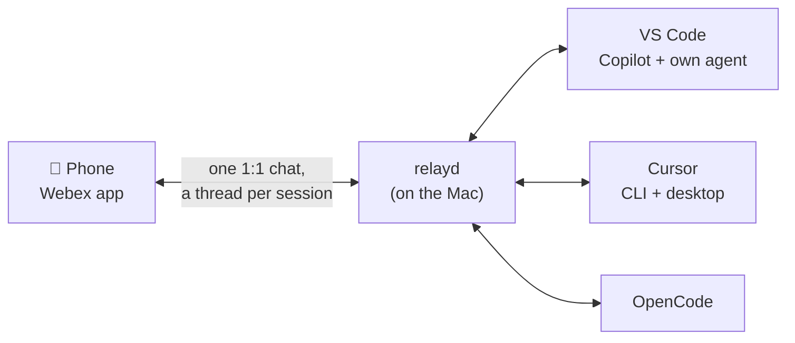

# agent-relay

Drive the coding agents on this Mac (VS Code with Copilot, Cursor, OpenCode) from your phone, over one Webex chat.



- Sessions run in the same apps you use at the desk; pick them up there later.
- One message per turn: the final answer, or `answer.html` for a long or rich one.
- Questions from agents arrive as cards; files go both ways.
- **No approvals**: the relay allows the tool calls it answers. `/panic` is the brake.
- `/away` hands your desk chats to the phone; `/back` returns them.
- `/chats` lists last week's desk chats; **Continue** carries on with one from the phone.
- Nothing listens on the network; secrets stay in the Keychain.

## Quick start

```bash
uv sync --frozen --all-extras
(cd extensions/relay-bridge && npm ci && npm run build)

pbpaste | uv run relay setup token --stdin          # bot token from the clipboard; never printed
uv run relay config set webex.allowed_email you@example.com
uv run relay ws add scratch "$PWD/.scratch"

uv run relay install            # dry run: what it will change
uv run relay install --apply    # hooks, MCP sync, skills, launch agents, relay-bridge
uv run relay start
uv run relay doctor
```

Then send `/help` to the bot from your phone. Full walkthrough: [docs/setup.md](docs/setup.md).

- Your first message from `allowed_email` pins your account; nobody else is answered.
- `uv run relay uninstall --apply` restores every file it changed.
- Try it without touching your home folder: `(export RELAY_HOME=$(mktemp -d); uv run relay install && uv run relay doctor)`.

## Docs

| I want to… | Read |
|---|---|
| Set it up on the Mac | [docs/setup.md](docs/setup.md) |
| Use it from the phone | [docs/user-guide.md](docs/user-guide.md) |
| Understand how it works | [docs/architecture.md](docs/architecture.md) |
| Look up a command, setting or component | [docs/operations.md](docs/operations.md) |
| Run the tests or the live end-to-end driver | [docs/testing.md](docs/testing.md) |
| Know the threat model | [docs/security.md](docs/security.md) |
| See what is still open | [TODO.md](TODO.md) |

Records (for contributors):

| Doc | Holds |
|---|---|
| [docs/PLAN.md](docs/PLAN.md) | The original spec and acceptance criteria |
| [docs/deviations.md](docs/deviations.md) | Every departure from the plan, and why (wins over PLAN) |
| [docs/acceptance.md](docs/acceptance.md) | Each acceptance criterion and the tests that prove it |
| [docs/spikes.md](docs/spikes.md) | Experiments run against the real apps before building |
| [docs/research.md](docs/research.md) | Background research that led to the plan |
| [sandbox/](sandbox/README.md) | Review reports from the October and November rounds (local only: git-ignored) |
| [AGENTS.md](AGENTS.md) | Rules for coding agents working on this repo |

## Development

```bash
uv run tox     # ruff format, ruff check, mypy --strict, pytest, TypeScript builds and tests
```

Live tests run only with `RELAY_LIVE=1`; see [docs/testing.md](docs/testing.md).

## License

[MIT](LICENSE)
