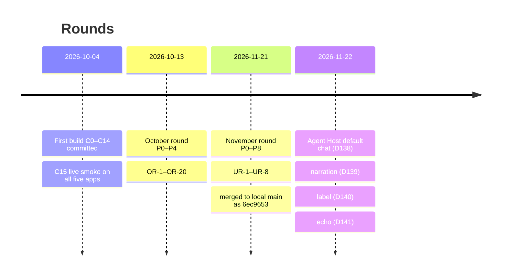

# agent-relay: status and what's left

Last updated 2026-11-22 18:30, after the agent-only items (D140, D141, spikes, Definition of Done). Local `main`, never pushed.

| Doc | What |
|---|---|
| [`docs/PLAN.md`](docs/PLAN.md) | The plan |
| [`sandbox/08-usability-round.md`](sandbox/08-usability-round.md) | November round plan: decisions U1–U14, phases P0–P8 |
| [`docs/deviations.md`](docs/deviations.md) | Departures D1–D141 |
| [`docs/acceptance.md`](docs/acceptance.md) | Criteria to tests: AC-1–AC-40, OR-1–OR-20 (October), UR-1–UR-8 (November) |
| [`docs/testing.md`](docs/testing.md) | Live results per app and scenario |
| [`docs/user-guide.md`](docs/user-guide.md) | Start here as a user |

## Open now

Needs: **Desk** = owner at the Mac; **Phone** = owner on Webex Android; **Code** = an agent can do it alone.
No **Code** items are left: everything below needs the owner.

| Item | Needs | Refs |
|---|---|---|
| Restart relayd so it runs D140 and D141 (`relay stop && relay start`; it runs from this repo's `.venv`) | Desk | D140, D141 |
| Scenario 8 for Cursor and Copilot CLI desk chats (restart Cursor first); steps below | Desk + Phone | P5, P6, D120 |
| Confirm D141 live: an Agent Host desk chat's reply to the phone starts with `📱 <your message>`, and its thread root says `vscode_copilot` (D140); details below | Desk + Phone | D135, D137, D140, D141 |
| Re-check live that a VS Code desk chat (its own agent) shows the phone's message as a `📱` hook line (`systemMessage`, D135) | Desk + Phone | scenario 8 |
| Does Cursor desktop skip its own prompt when the hook answers `allow`? (Only matters while away.) | Desk | D117, D124 |
| Does VS Code honour `permissionDecision: "allow"` from `PreToolUse`, given `chat.tools.global.autoApprove: true` in your settings? | Desk | D117, D124 |
| Is Cursor's last `afterAgentResponse` always the final answer, or can it be pre-tool narration? (Cleared when a tool hook follows it, so a turn ending after a tool yields no text.) | Desk | D118 |
| A bad token on a running relayd (P1's daemon robustness) not tried live | Desk | P1, D121 |
| Does a Webex Android card delete remove the card cleanly, with no "Unable to send your request" on a stale tap? (Every one-shot card.) | Phone | D119 |
| Does Webex Android open `answer.html` in the app or hand it to the browser, and does the CSP survive either path? | Phone | D122 |
| Does a Webex client honour `label`, `isRequired` and `errorMessage` on the `/new` card's inputs? (`scripts/card_check.py` only proves Webex accepts them.) | Phone | D119 |
| Open the `/new` and `/model` cards on Android and check the layout | Phone | P4, D119 |
| Delete the three retired app bots at developer.webex.com | Desk | U13, D116 |
| An installed copy of the old `stepping-away` patch reads as drifted: restore the base skill, run `relay install --apply` (see [`docs/operations.md`](docs/operations.md)) | Desk | |
| D61, partly done: find a command Cursor prompts for on its own (e.g. sandboxed auto-run off), then confirm it still prompts with the hooks in place | Desk | D61 |
| October: notifications show the bot name clearly; space sections sync to the phone (now one space) | Phone | October round |
| October: a photo reaches each app natively; an HTTPS clone works under launchd | Desk + Phone | October round |
| October: window reload vs VS Code follow-ups | Desk | D85 |
| Upstream: `cursor-agent` sometimes appends "Error: RetriableError: WritableIterable is closed" to a woken turn's reply (the reply is complete). Report to Cursor if it persists | Owner | |

### Scenario 8 steps (Cursor and Copilot CLI desk chats)

Headless `cursor-agent -p` and `copilot -p` create no phone thread, so use a real desk chat:

1. In the phone space send `/away`.
2. In a Cursor chat, a Copilot chat in VS Code or a Copilot CLI session in `.scratch`, ask `Reply with exactly: OK`.
3. The phone gets a thread with `OK`; the chat parks (🅿️).
4. Reply in that thread; check the desk chat continues.
5. Send `/back`; check the root drops 🅿️/🏝️ and the desk chat is released.

Live runs use the end-to-end driver ("The live end-to-end test", see [`docs/testing.md`](docs/testing.md)):
`RELAY_LIVE=1 .venv/bin/python scripts/phone_e2e.py`. Away is one global flag, so scenario 8 affects every
desk chat until its closing `/back`.

### Scenario 8 on VS Code: works, two cosmetic findings

2026-11-21 20:14, owner at the desk. A VS Code Copilot chat in `.scratch` with away on reached the phone (`OK`),
parked, took the phone's `BACK` and answered it; `/back` released it and handed 10 phone sessions to the desk.

- **Glued reply:** the desk chat showed the phone's reply glued to the previous answer (`OKBACK`) and never the
  phone message itself. Fixed offline by D135, D137 and D141 (details below); not re-checked live.
- **Wrong label:** the thread root said `copilot_cli` for this VS Code Agent Host chat: its hooks are the Copilot
  CLI's, so the payload cannot tell them apart. Fixed offline by D140: at the first stop the relay reads
  `clientName: vscode-agent-host` from the session's `events.jsonl` and relabels it `vscode_copilot`.

### D135 / D137 / D141 details

- The Agent Host chat showed only `OKBACK`: the Copilot runtime ignores `systemMessage`.
- D137 asked the agent to start its reply with the `📱 …` line, but only for camelCase hooks. A rerun at 22:50
  (after D137 was live) recorded a continuation with no such line: the installed `Stop` is PascalCase, so the
  Agent Host's arrives snake case. D141 makes the echo follow the app (`copilot_cli`, `vscode_copilot`).
- Check, after restarting relayd: with away on, ask an Agent Host chat in `.scratch` `Reply with exactly: OK`,
  reply in the phone thread, and check the reply starts with `📱 <your message>` and the root says `vscode_copilot`.
- A VS Code chat on its own agent should show the line through `systemMessage`, with no echo.

## History, newest first

### Agent-only items (2026-11-22)

| Item | Outcome |
|---|---|
| VS Code Agent Host desk chat labelled `copilot_cli` | D140: relabelled `vscode_copilot` from its `events.jsonl` at the first stop. All 103 Agent Host transcripts on this Mac name the client; no Copilot CLI one does |
| Do Copilot hook payloads always carry `transcript_path`? | Yes for the stop: 1,518 of 1,518 recorded `agentStop` runs carry `transcriptPath` (D140) |
| D137's echo never reached a park continuation | D141: found in the transcript of the 22:50 rerun; the echo now follows the app, in every hook casing |
| Definition of Done: `docs/spikes.md` complete | S2 (Copilot held full 25-minute slices and renewed, measured from `events.jsonl`), S4, S6 and S10 carry their live results; every spike has an outcome and a path |
| Definition of Done: `docs/deviations.md` lists every departure | D1–D141 in order, each in the area index; every `Dnn` cited in code, tests and docs exists |
| Definition of Done: C0–C15 committed with `uv run tox` green | C0–C14 have their checkpoint commits; C15 closes with `chore: live install verified`; tox green (1,534 passed, 7 live tests skipped) |

### November round (2026-11-21)

- Code done, merged to `main`, green under `uv run tox`.
- Live results per app and scenario: [`docs/testing.md`](docs/testing.md).
- Left: mostly owner checks (scenario 8 at the desk, the Android look).

| Phase | Deviations | State |
|---|---|---|
| P0 unblock: drop `webex.bots`, truncate the error log, restart relayd | | ✅ done live 2026-11-21 16:07 |
| P1 one space, daemon robustness | D116, D121 | ✅ one space works live; a deliberately bad token on a running relayd not tried |
| P2 no approvals | D117, D124, D125 | ✅ scenario 7 ran a shell command with no card on all five phone apps; desk-session flags (Cursor desktop, VS Code hooks) unverified |
| P3 final result only | D118, D127 | ✅ scenarios 2 and 3 on all five phone apps |
| P3b files in, HTML out, `send_phone_file` | D122 | ✅ image and PDF (scenario 4) and `answer.html` (scenario 5) on all five phone apps; `answer.html` on Android not checked |
| P4 cards | D119 | ✅ `scripts/card_check.py` 14 of 14, scenarios 2 and 6; the Android look is the owner's |
| P5 away, manual and global | D120 | Partly: `/away`, `/back`, `/panic` (scenario 9) ✅; **scenario 8 (a desk chat reaching the phone) needs the owner** |
| P6 every app working | | ✅ VS Code, Copilot (AHP), Cursor IDE (CDP), Cursor CLI, OpenCode: scenarios 2 to 7 pass. Not live: Cursor desktop hooks and Copilot CLI hooks as desk sessions (scenario 8) |
| P7 docs and bookkeeping | D116–D134 | ✅ docs updated with the code; acceptance UR-1–UR-8 |
| P8 E2E driver | D123 | ✅ run against Webex as the owner (webex-cli token), 6 live fixes along the way |

**Closed live checks** (plan §6 and phase checks; open ones are in *Open now*):

| Check | Result |
|---|---|
| Does `cursor-agent --force acp` stop sending `session/request_permission`? (D125) | Not observable: the relay answers every request itself (D117). Scenario 7 passes on Cursor CLI with no card either way |
| AHP: is `autoApprove` a valid `createSession` config value on VS Code 1.147? (D125) | Yes: accepted; scenarios 2 to 7 pass on Copilot (AHP) with no card |
| With away on, does a Cursor CDP chat also register as a second desk session through Cursor's hooks? | Yes; fixed with a claim (D134) |
| Does the OAuth integration behind `webex-cli` have the scope for `POST /attachment/actions`? (D123; fallback: typed commands, card taps stay a phone check) | Yes: the card taps of scenarios 2, 6 and 9 ran from the owner's token live |
| `scripts/card_check.py` | Every card accepted (HTTP 200), 14 of 14 |
| `scripts/phone_e2e.py` | Scenarios 1 to 7 and 9 pass on every phone app ([`docs/testing.md`](docs/testing.md)); scenario 8 open |
| P6 per phone app | VS Code, Copilot AHP, Cursor CLI, OpenCode, Cursor CDP on 3.31.15 with selectors v4 |

**Closed items:**

| Item | Outcome |
|---|---|
| Cursor CDP live | Selectors v4 (D133); self-test passes on 3.31.15, `/new cursor-ide` answers `OK`, `/models cursor-ide` lists models |
| Cursor CDP scenarios 2 to 7 | Pass live (D134); a CDP chat no longer registers a second desk session |
| VS Code and Copilot (AHP) scenarios 2 to 7 | Pass live (12 of 12) |
| Full `uv run tox` on 2026-11-21 | Green: format, lint, mypy --strict, pytest, ts. The Playwright PWA card test and the live tests are not part of it |
| `uv.lock` hand-edited for `markdown-it-py` (D126); run `uv lock` once online | `uv lock` resolves with no change, so the hand edit matches |
| `scrub.scrub_text` quadratic on one long unbroken word (5,000 word characters 0.5 s; 60,000 over a minute). `render_answer` scrubs three times and `validate_file` scrubs text, so a base64 or minified blob could stall the caller. Proposed: possessive quantifiers or a length guard in `scrub.py`, answers rendered through `asyncio.to_thread` | Fixed: `scrub.py` guards runs over 2,000 characters; `tests/test_scrub.py` pins it |
| Dead approval and wizard code | The unused `broker` of `HookService` and `notify` of `ParkManager` are gone. `PendingKind` keeps `"approval"` and housekeeping keeps the draft sweep on purpose: they close or clear rows an older relayd left in an existing database; removing them needs a migration |
| `plugins/opencode/package.json` said the plugin "relays tool approvals"; the installer's timeout for approval-kind hooks is `question_hook_timeout_s()` though they no longer block | Description corrected. Timeout left alone: changing it makes every installed hook file read as drifted for no visible gain |
| `ws_client.DeviceError` said "Webex rejected the bot token (401). Check the Keychain entry." | Now says `pbpaste \| relay setup token --stdin`, like the host and doctor |
| `card.offer:<nonce>` keys of never-submitted `/new` and `/model` cards stay in the registry (about 4 KB each) | Housekeeping drops an offer a day after first seeing it without a live `card.nonce:` key (`_prune_offers`, tested) |
| The CDP self-test does not save the model list; only `/models cursor-ide` does (`core.service.discovery.CDP_MODELS_KEY`). The Cursor CLI's own 30 s `models` call keeps running when the card's 3 s timeout gives up (it fills the cache) | Left as designed: the self-test must not open Cursor's model menu on the owner's screen. Run `/models cursor-ide` once to fill the list |
| `webex_token_check` runs in both `relay doctor` and `/doctor` (one `GET /people/me` each) | Left as is: two cheap calls, each in its own report; a shared cache adds state for no gain |
| [`docs/PLAN.md`](docs/PLAN.md) §5 still described approvals, per-workspace away, streaming, `answer.md` and `scripts/smoke_live.py` (replaced per D116–D127 and D57) | `docs/PLAN.md` opens with a table of what the November round superseded, pointing at the deviations |
| Squash-merge `feat/november-round` to `main` at the end; never push (U14) | Squash-merged to local `main` as `6ec9653`; nothing pushed |
| November checks still open after the first live run | All closed by later runs except the Android look of the `/new` and `/model` cards and scenario 8 for Cursor and Copilot CLI |

### October round (2026-10-13)

Superseded in places by the November round (D116–D127). Kept for history.

| Phase | State | Commits |
|---|---|---|
| P0 groundwork: lifecycle, registry migrations, cancel-aware IPC, split service, cards and commands | ✅ | `dc14985` |
| P1 safety fixes: L1 install, L2 core, L3a AHP/OpenCode, L3b Cursor/VS Code, L4 Webex | ✅ | `94ffb44`, `90cf39b` |
| P2 phone UX, L5–L11: cards, queue modes, screen-lock away, attachments, `/ws`, recall skill | ✅ | `aa28713`, `ce6712b`, `1b3f2ce`, `8936007`, `ae4de94` |
| P3 L12 one bot per app (removed in the November round, D116) | ✅ | `a0bde79` |
| P3 L13 create the bots, live (retired, D116) | ✅ | none (live setup, D111) |
| P4 docs and final tox | ✅ | pending the orchestrator's commit |

- Human live checks that still stand are in *Open now* (each now covered by a November check where it applies).
- Dropped by the November round:
  - The show-card submit check and `webex.new_card_layout = "two"`: the show-card is gone (D119).
  - "A card can be edited after a submit": cards are deleted (D119).
  - "Screen lock turns away mode on and off": there is no trigger (D120).
  - Regenerating the first app bot's token: the app bots are retired (D116).

### After C15 (2026-10-04)

History from the first build. Its approval, park-with-lock and smoke-script parts are superseded by D116–D123.

- **Code:** C0–C14 built and committed. C15 (live verification) nearly done: all five apps passed the live smoke test.
- **Checks:** `uv run tox` green: format, lint, mypy `--strict`, pytest (641 passed, 6 skipped live tests), `ts`.
- **Install:** applied to the real home directory after gate G1, re-applied after D69. relayd runs under
  launchd, `relay doctor` reports 0 failing, the Webex bot is connected.
- **Live tests:** AC-16 (Agent Host sessions), AC-20 (OpenCode) and AC-22 (Cursor CLI) pass on the real apps.
  AC-24 (Cursor CDP self-test) was still open then (closed below).

**Checks at the Mac (all closed except D61, which is in *Open now*):**

| Check | Result |
|---|---|
| Cursor IDE smoke (`--only cursor`) | Passed 2026-10-04 08:41 UTC |
| G2 / S7: screen-locked test | Passed for all four phone-driven apps (see [`docs/spikes.md`](docs/spikes.md)) |
| AC-24 / D35: CDP self-test | Passes on Cursor 3.23.12 with selectors v2 (first run found three stale selectors, fixed). `cdp.enabled` is **true** in `~/.config/agent-relay/relay.toml`; Cursor runs with the debug port |
| CDP live (D35) | A real phone prompt and a follow-up both returned correct replies; the `model_option` selector is fixed (selectors v3, nine models found) |
| CDP, then unverified live: `/models cursor-ide` after the v3 fix, choosing a model with `/new cursor-ide scratch "…" <model>`, `/stop` on a running turn (one of three live session creations was left) | Done: `/models cursor-ide`, a model choice (scenario 6) and `/stop` (scenario 10) pass live on every app |
| D61: hooks vs commands Cursor auto-runs | A/B run showed no difference with and without the relay's hooks (see D61); the rest is open |
| D25: Cursor CLI smoke | No duplicate `cursor` hook session and one approval card (recorded in D25) |
| Bookkeeping | AC-24 ticked in [`docs/acceptance.md`](docs/acceptance.md), D35 updated; D61 stays partly open |

**Definition of Done (PLAN §9):**

| Criterion | State |
|---|---|
| Every checkpoint C0–C15 committed with `uv run tox` green, including `ts` | ✅ 2026-11-22 (C15: `chore: live install verified`) |
| AC-1 to AC-40 all ticked in `docs/acceptance.md` | ✅ |
| `docs/spikes.md` complete; `docs/deviations.md` lists every departure | ✅ 2026-11-22 |
| No stubs or open-work markers (`test_no_stubs` passes) | ✅ |
| `relay doctor` all green after G1 | ✅ |
| Live smoke works for VS Code, VS Code Copilot, OpenCode, the Cursor IDE and the Cursor CLI | ✅ |
| The README quick start works from a clean `RELAY_HOME` | ✅ init, config, `ws add`, `install` (dry run) and `doctor` ran from an empty `RELAY_HOME` and wrote only there |

**Smaller follow-ups noticed during testing:**

| Follow-up | Outcome |
|---|---|
| The VS Code model card listed internal utility models (`copilot-utility`, `copilot-utility-small`, `copilot-dictation-cleanup-luna`) | The `/new` and `/model` cards, `/models` and a typed `/model` now hide them (D119) |
| Leftover sessions from earlier smoke runs | Migration 5 ended every old session (D116); housekeeping ends idle sessions after 7 days (D121) |
| Upstream `cursor-agent` "RetriableError" | Open (see *Open now*) |
| The OpenCode provider config can print provider tokens in a terminal | The scrubber catches them (D69), plus the long-run guard in the scrubber |

### Done: what exists

| Area | What exists |
|---|---|
| relayd | Router with a desk-session gate, SQLite registry, question deadlines, parking, one global away flag, IPC socket, launchd agent, rotating logs; survives a Webex failure (D120, D121) |
| relay-hook | Installed for Cursor, VS Code (its own agent and Copilot), Copilot CLI and OpenCode; fails open, and always answers Cursor with valid JSON (D61, D124) |
| Adapters | VS Code (its own agent, through the relay-bridge extension), VS Code Copilot (Agent Host Protocol), OpenCode server, Cursor CLI (ACP), Cursor IDE over CDP (gated off by default) |
| Front ends | Webex bot (one bot, one space; websocket, flat Adaptive Cards deleted after use, one message per turn, `answer.html`), optional PWA on loopback |
| relay-mcp | `notify_phone`, `ask_phone`, `send_phone_file` |
| Skills | `agent-relay-away` (`/away`, `/back`), the `stepping-away` patch, plugin bundles |
| relay CLI | `install`/`uninstall`, `start`/`stop`, `status`, `doctor`, `ws`, `away`, `config`, `skills dedupe`, `selftest`, update handling |
| Docs | README quick start, user guide, operations guide, security model, acceptance map, deviations, spikes |

### Bugs found by live testing (all fixed, tested and committed)

| Commit | Fix | Deviation |
|---|---|---|
| `0fdaa48` | Cursor's fail-closed hooks blocked every tool call when relay had no opinion | D61 |
| `3c20f46` | `/new` took the first prompt word as the model; duplicate thread roots; session stuck "running" after a Local error | D62 |
| `ea36882` | A one-line `/new` still asked for a model; a stale sticky model was offered; duplicate model choices | D62 |
| `9ba5871` | "Parked" was posted with away mode off; a bare `/away` only reported the state | D63 |
| `f5e4147` | Turning away mode off left desk approvals waiting for the phone until their 10-minute deadline | D64 |
| `f2454cb` | `/back` inside a thread was refused for every app ("does not support parking") | D65 |
| `e452caa` | An HTTP failure in the Webex websocket client stopped relayd instead of retrying | D66 |
| `98ee590` | A phone-started Agent Host session got a duplicate Copilot CLI session and a split thread | D67 |
| `5c4c802` | The Copilot CLI process's `SessionEnd` posted "Released (session ended)" for a live Agent Host session | D67 |
| `7065437` | Cursor CLI tool lines showed raw JSON for a single argument | D68 |
| `99dd699` | With relayd unreachable, OpenCode called the plugin's helper exports as plugins and returned HTTP 500 | D69 |
| `024489b` | `relay start` right after `relay stop` failed with launchd error 37 | D55 |
| `f8f5c4f` | `relay install --apply` failed with launchd error 5 and left relayd and OpenCode unloaded | D55 |
| `86f0e53` | The smoke script expected OpenCode and the Cursor CLI to park; they go idle and wake (D11) | D57 |

### Live smoke results (2026-10-04)

- Driven from Webex on 2026-10-04 with a script that is gone (D57, D123).
- Recorded in the "Live smoke 2026-10-04" tables; the November results sit beside them. Both: [`docs/testing.md`](docs/testing.md).

| App | Result |
|---|---|
| VS Code (`vscode`) | ✅ register, stream, approve, park, reply, back |
| VS Code Copilot (Agent Host) | ✅ register, stream, approve, park, reply, back |
| OpenCode | ✅ register, stream, approve, idle, wake |
| Cursor CLI | ✅ register, stream, approve, idle, wake |
| Cursor IDE (hooks and parking) | ✅ register, stream, approve, park, reply, back |
