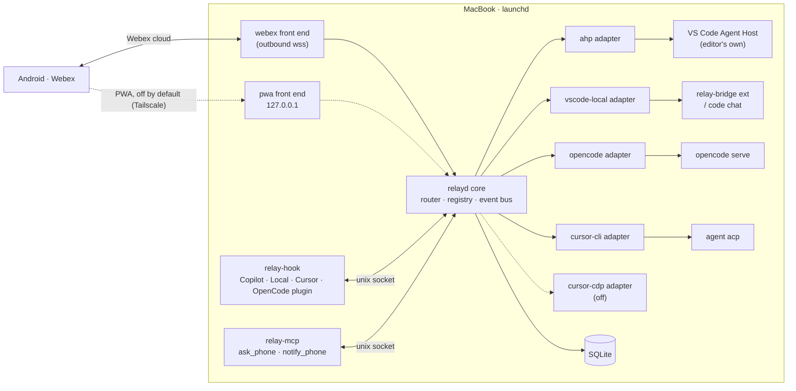

# Agent Relay: implementation plan

Control VS Code Copilot (both the Local and Copilot harnesses), Cursor and OpenCode on this MacBook
from an Android phone over Webex. Every session runs in the same harness the desktop uses.

> **Who reads what**
> - **Reviewer (human):** read §0–§3. Everything after that is the build spec.
> - **Coding agent:** read everything, then follow §1 to the letter.
>
> Research snapshot: 2026-10-03 · macOS 27 · VS Code 1.140 · Cursor 3.23 · Cursor CLI 2026.07.17 ·
> OpenCode 1.18.15 · Python 3.13.5 · uv 0.12.3.

---

## 0. Reviewer summary

**What gets built:** one repo, `~/Desktop/Repository/Personal/agent-relay`, containing:

| Piece | What it is |
|---|---|
| `relayd` | A launchd daemon. A Webex bot on an outbound websocket, a session registry, and one adapter per harness. |
| `relay-hook` | A tiny program installed into every harness's hooks. It handles observing, approving, steering and parking sessions. |
| `relay-bridge` | A VS Code extension for the Local harness, so the phone can choose the model and cold-start sessions. |
| `relay-mcp` | An MCP server exposing `notify_phone` and `ask_phone`. |
| `/away` and `/back` skills | Switch away mode on and off. |
| `relay` CLI | Install, doctor, config sync, skills dedupe, self-tests. |
| PWA | An optional browser UI, off by default. It is only for use over Tailscale. |
| Cursor CDP adapter | Off by default; a fallback only. |

**What it will touch on your Mac.** Only at the final step, and only after you say yes (gate G1):

| Path | Change |
|---|---|
| `~/.copilot/hooks/agent-relay.json` | New file |
| `~/.cursor/hooks.json` | Entries merged in. `git-ai` entries are kept, and a backup is taken first. |
| `~/.config/opencode/plugins/agent-relay.ts` | New file |
| `~/.copilot/mcp-config.json`, `~/.cursor/mcp.json`, `opencode.jsonc`, VS Code `mcp.json` | Rendered from one source, `~/.agents/mcp.yaml`. A diff is shown first and backups are taken. |
| `~/.copilot/skills`, `~/.cursor/skills`, `~/.claude/skills`, `~/.config/opencode/skills` | Duplicate folders moved to a backup. They are byte-identical to `~/.agents/skills`. |
| `~/.agents/skills/agent-relay-away` | New skill (symlinked) |
| `~/.agents/skills/stepping-away` | Patched to drop its Webex posting, which the hooks now do. Backed up first. |
| `~/Library/LaunchAgents/io.github.cyberquill.agent-relay.*.plist` | Three agents: `relayd`, `opencode serve`, and a weekly Cursor CLI update |
| VS Code | The `relay-bridge` VSIX is installed |

**What you must do before the agent starts** (§2):
- create the Webex bot;
- put its token in Keychain;
- open a 1:1 space with it.

**Gates where the agent must stop and ask you:**
- **G1:** before writing anything outside the repo (the table above).
- **G2:** before locking your screen for the screen-locked test.

The agent never creates a git remote and never pushes.

---

## 1. Instructions to the coding agent (binding)

**Scope and completeness**
1. **Build everything in this document in one session.** There is no "phase 2" and no "later". Every
   section in §5 is in scope, including components that are off by default (PWA, Cursor CDP).
2. **Don't be lazy, and don't drop scope.**
   - No stubs, no `pass`-only bodies, no `NotImplementedError`, no `TODO`/`FIXME`/`XXX`, no
     "placeholder" or "left as an exercise" in committed code. `tests/test_no_stubs.py` (C2)
     enforces this; only `tests/fakes/` is exempt.
   - Don't weaken an assertion, skip a test, or narrow a requirement to get green. The only allowed
     skip is live tests gated by `RELAY_LIVE=1`.
3. **When reality differs from this plan, implement the documented fallback** (§6). Record the
   change in `docs/deviations.md` (what, why, evidence). Never silently skip a requirement.
4. **Trace every requirement.** Keep `docs/acceptance.md` as a checklist of every **[AC-x]** in this
   plan, each mapped to the test(s) that prove it. All boxes must be ticked at the end.
5. **Keep going until the Definition of Done (§9).** Don't stop to summarise midway. Ask the human
   only at gates G1 and G2.

**Repository and commits**

6. Create the repo at `~/Desktop/Repository/Personal/agent-relay`:
   - Run `git init -b main`.
   - Copy this file to `docs/PLAN.md`.
   - If `/tmp/mobile_agent_remote_control.prev.md` exists, copy it to `docs/research.md`; it is the
     background research.
7. **Commit at every checkpoint in §7**, with Conventional Commit messages, and only after
   `uv run tox` is green. Small extra commits within a checkpoint are fine.
   - Never commit secrets, tokens, `.env` or captured payloads that contain tokens.
   - Never add a remote or push.

**Safety while building**

8. **Never write to the real home directory during development.** All home-relative paths go through
   `agent_relay/paths.py`, which honours `RELAY_HOME`. Tests and spikes set
   `RELAY_HOME=$(mktemp -d)`. Real writes happen only through `relay install --apply` after G1.
9. **Read-only probing of live apps is allowed:**
   - `code agent endpoints`/`ps`, `agent models`, `opencode` `GET /doc`, `cursor-agent status`.
   - Live session creation is allowed only in the scratch workspace `agent-relay/.scratch/`, with
     the prompt `Reply with exactly: OK`, at most 3 times per adapter.
10. **Never print secrets.** Redact `connectionToken`, bot tokens and passwords in all logs, test
    output and terminal commands (e.g. `jq` that replaces any key matching `token|secret|password`).

**Gotchas on this Mac**

11. **Commands:**
    - `code` is **not on PATH**. Use `/Applications/Visual Studio Code.app/Contents/Resources/app/bin/code`.
    - Cursor is `/usr/local/bin/cursor`; the Cursor CLI is `~/.local/bin/cursor-agent` (alias `agent`).
    - OpenCode is `~/.opencode/bin/opencode`.
12. **zsh:**
    - Never put `!` in commands, because history expansion rewrites it. Use single-quoted heredocs
      for inline Python.
    - Never use `path` as a variable name.
    - Don't prefix commands with `VAR=value`; it blocks auto-approval. Export instead.
13. **Output size:** send large output (tox, pytest `-v`, diffs) to a file under `/tmp` and read it
    with `head`/`tail`. Pagers are already disabled (`LESS=-FRX`, `GH_PAGER=cat`).

**Engineering standards**

14. **Python:**
    - Python 3.13 with uv; `ruff format`, `ruff check`, `mypy --strict`, pytest, and `tox` running
      all of them.
    - Precise types everywhere, Pydantic models for every wire format, f-strings only, no `print()`
      outside CLI rendering.
    - Logging through `agent_relay/log.py`, which scrubs secrets.
15. **TypeScript** (extension and OpenCode plugin only): strict `tsconfig`, built and tested in the
    repo. `tox -e ts` runs `npm ci && npm run build && npm test` for both.
16. **Docs** move with the code: README, `docs/operations.md`, `docs/security.md`,
    `docs/deviations.md`, `docs/spikes.md`, `docs/acceptance.md`.

---

## 2. Human prerequisites (before the agent starts)

| # | Do | How |
|---|---|---|
| H1 | Create a Webex bot | developer.webex.com → My Apps → Create a Bot, e.g. `agent-relay-yourname`. Copy the token. |
| H2 | Put the token in Keychain (the agent never sees it) | `security add-generic-password -U -s agent-relay -a webex-bot-token -w` (prompts for the token) |
| H3 | Open a 1:1 space with the bot and send `hi` | In Webex, message the bot's email address |
| H4 | Tell the agent your Webex email | It goes into `relay.toml` as `allowed_email`. On the first message, the relay pins your `personId`. |
| H5 | Optional policy checks (not blocking) | GitHub org policy *Store local sessions in the Cloud*; Cursor admin Remote Control |

---

## 3. Decisions locked in

| Decision | Choice | Why |
|---|---|---|
| Phone channel | **Webex bot over an outbound websocket** | no inbound ports, works behind a VPN |
| Browser GUI | PWA built in but **off**; enable only if Tailscale is wanted | Tailscale is optional and can be unreliable alongside a VPN client |
| VS Code, Copilot harness | **AHP client** on the editor's own Agent Host socket | Same live sessions as the desktop; a stable, versioned protocol |
| VS Code, Local harness | **Fully supported.** `relay-bridge` extension for cold start and model choice; `code chat` when the extension is absent; hooks for the rest | Local isn't formally deprecated and is still developed (§10) |
| OpenCode | HTTP + SSE to `opencode serve`; the TUI uses `opencode attach`; a plugin registers any other server instance | The server *is* the harness |
| Cursor, desk-started sessions | **Hooks** plus parked sessions | Documented; the real IDE harness |
| Cursor, phone-started sessions | **Cursor CLI `agent acp`** | Official API; shares config with the IDE; drift is low and listed (§5.4.4) |
| Cursor CDP | Built, **off by default** | Fragile. Only for "the phone-started chat must appear in the desktop composer". |
| Session plane | **One `relay-hook`**, installed everywhere the way `git-ai` is | Deterministic, costs no tokens, model-independent |
| Waiting on the phone | **Parked sessions:** a stop hook long-polls `relayd` | Waiting is free; it continues the same desktop chat |
| Skills | Behaviour only (`/away`, `/back`, the away-mode contract) | Skills are model-chosen, so they can't be a transport |
| Config drift | `~/.agents/mcp.yaml` is the single source of truth for MCP; skills come only from `~/.agents/skills` | MCP sets differ in all 4 harnesses today; skill copies are duplicates |
| Approvals | **Fail-closed everywhere**, by the relay's own deadline | Copilot hook timeouts fail open |

---

## 4. Architecture



**Two planes**
- **Start plane:** creating a session from the phone. Done by the adapters: AHP, `relay-bridge` /
  `code chat`, OpenCode HTTP, `agent acp`, CDP.
- **Session plane:** observing, approving, steering and parking any session, whether it started at
  the desk or from the phone. Done by `relay-hook`, plus the adapters' native event streams.

**Repo layout**

```text
agent-relay/
├── AGENTS.md  README.md  pyproject.toml  tox.ini  uv.lock  .gitignore
├── agent_relay/
│   ├── paths.py  settings.py  log.py  scrub.py  ipc.py          # foundations
│   ├── models/        # events, sessions, capabilities, config (pydantic)
│   ├── core/          # router, registry (sqlite), away-mode, approvals, parking
│   ├── frontends/     # webex/, pwa/
│   ├── adapters/      # ahp/, vscode_local/, opencode/, cursor_cli/, cursor_cdp/
│   ├── hook/          # relay_hook.py (stdlib-only entry), shims/, installers/
│   ├── mcp/           # relay-mcp server
│   ├── sync/          # mcp.yaml import/render, skills dedupe
│   ├── doctor/        # checks + self-tests
│   └── cli.py         # `relay` (Typer)
├── extensions/relay-bridge/      # VS Code extension (TypeScript)
├── plugins/opencode/agent-relay.ts
├── skills/agent-relay-away/SKILL.md
├── launchd/*.plist.tmpl
├── scripts/spikes/  scripts/smoke_live.py
├── tests/  (unit, contract with fakes/, live gated by RELAY_LIVE=1)
└── docs/   PLAN.md research.md spikes.md deviations.md acceptance.md operations.md security.md
```

---

## 5. Component specs

Acceptance criteria are tagged **[AC-x]**. Every one must map to a test in `docs/acceptance.md`.

### 5.1 Core

- **Paths** (`paths.py`): every home-relative path in one place, overridable with `RELAY_HOME`.
  - **[AC-1]** No module outside `paths.py` builds a path from `~`, `Path.home()` or `$HOME`. A test
    scans the source to prove it.
- **Settings:**
  - Config files: `~/.config/agent-relay/relay.toml` and `workspaces.toml`.
  - Secrets come from Keychain (`keyring`, service `agent-relay`).
  - **[AC-2]** A missing token makes the daemon exit non-zero with a clear message and the H2 command.
- **Event model:** normalised events `session.started`, `text.delta`, `tool.started`,
  `tool.finished`, `approval.requested`, `approval.resolved`, `question.asked`, `question.answered`,
  `turn.completed`, `session.parked`, `session.released`, `error`.
  - Each carries `harness`, `session_key`, `workspace`, `ts` and `origin` (desk or phone).
- **Registry** (SQLite at `~/Library/Application Support/agent-relay/relay.db`):
  - Stores sessions (`session_key ↔ harness id ↔ webex thread`), sticky model, workspace, away flag,
    last seen Webex message id, and pending approvals and questions.
  - **[AC-3]** State survives a daemon restart.
  - **[AC-4]** Concurrent writes from hooks and adapters are safe (WAL mode, a single writer task).
- **Router:**
  - Each session has its own async queue. Adapters are isolated, so one adapter crashing never
    affects another.
  - **[AC-5]** A fake adapter that raises doesn't stop the other sessions' events.
- **Capabilities:** each adapter declares `cold_start`, `model_select`, `token_stream`, `approve`,
  `question`, `cancel`, `park`, `wake_idle`. The UI hides what isn't supported. **[AC-6]**
- **IPC:**
  - The Unix socket `~/Library/Application Support/agent-relay/relay.sock` has mode `0600`.
  - Messages are length-prefixed JSON frames.
  - **[AC-7]** The daemon refuses connections from other uids.
- **Scrubbing:**
  - Regexes for tokens, keys and passwords run on everything posted outward and everything logged.
  - **[AC-8]** A corpus of known secret shapes is fully redacted.

### 5.2 Webex front end

**Transport**
- Use `webex_bot` (≥ 1.3.1) if it works on Python 3.13 (spike S8). Otherwise vendor its websocket
  client (MIT; keep the header).
- Single instance, enforced with a file lock.
- Clean up stale device registrations on start.
- Reconnect with exponential backoff.
- **[AC-9]** After a reconnect, call `GET /messages?roomId=…` from the last seen id, so messages sent
  during an outage are processed exactly once.

**Access control**
- Accept only 1:1 rooms, from `allowed_email`; pin the `personId` on first contact.
- Leave any group room.
- Apply the same checks to `attachmentActions`.
- **[AC-10]** Messages from other people, group rooms, and card submissions from other people are all
  ignored and logged.

**Threads and commands**
- **One thread per session.** The root is the session card (`app · workspace · model · status`).
  A reply in the thread goes to that session.
- Commands:

  | Command | Behaviour |
  |---|---|
  | `/new [app] [ws] [model] ["prompt"]` | Missing pieces are asked for with a card: app → workspace → model → prompt |
  | `/sessions` | List sessions |
  | `/apps` | List apps |
  | `/ws` | List workspaces |
  | `/models <app>` | List that app's models |
  | `/model [m]` | In a thread: show or switch the model |
  | `/stop` | In a thread: cancel the turn |
  | `/status` | In a thread |
  | `/diff` | In a thread: `changes.diff` attachment |
  | `/away [on\|off]` | In a thread, or globally |
  | `/back` | Release the parked session |
  | `/doctor` | Health report |
  | `/panic` | Cancel everything, deny all pending approvals, pause |
  | `/help` | Command list |

  Plain text in a thread is a prompt; plain text at the top level gets a help hint.
  **[AC-11]** The command parser has full table tests.

**Cards and limits**
- Use Adaptive Cards v1.3: `Input.ChoiceSet`, `Action.Submit`, one card per message. A card is
  edited once with its outcome. **[AC-12]**
- Limits are enforced in code: 7,439 bytes of text, 10 edits per message, `Retry-After` on 429.
- **Renderer:**
  - The root card has an edit budget of 8.
  - `text.delta` is buffered and flushed at a paragraph boundary at ≥ 1.5 KB or after 15 s idle,
    with at most 6 KB per message.
  - Tool events go out as batched one-liners.
  - Final answers over 6 KB become an `answer.md` attachment.
  - Pacing is a token bucket of 1 message per 2 s per thread.
  - **[AC-13]** Against the fake Webex, no message exceeds a limit, no message is edited more than
    10 times, and 429 responses are honoured.

### 5.3 PWA front end (off by default)

- FastAPI on `127.0.0.1:8787`, a single static HTML/JS page (no build step), and SSE for raw tokens.
- A bearer token from Keychain.
- The same command set as Webex; it calls the same core API.
- `relay pwa expose` prints the `tailscale serve` command. It never runs Funnel.
- **[AC-14]**
  - With `enabled=false`, nothing binds.
  - With it on, it binds only to loopback.
  - Unauthenticated requests get 401.
  - SSE delivers deltas in order.

### 5.4 Adapters

#### 5.4.1 `ahp`: VS Code Copilot harness

- **Discovery:** run `code agent endpoints` and use the JSON: `endpoints[].endpoint.{type:"socket", path}`,
  `connectionToken` and `protocolVersion` (0.9.0 here). Re-run it whenever the connection drops.
- **Protocol:** JSON-RPC 2.0.
  - Generate Pydantic models from the published AHP JSON Schemas (`state`, `actions`, `commands`,
    `notifications`, `errors`) for the negotiated version, and commit them under `adapters/ahp/schema/`.
  - The handshake is `initialize` with `protocolVersions`. Transport framing and how the token is
    passed come from the AHP Transport and Lifecycle specs (spike S1).
- **Flow:**
  1. `subscribe ahp-root://` to get agents, models and sessions.
  2. `createSession`, then `createChat {initialMessage{text, model, agent}}`.
  3. Subscribe to `ahp-chat:/…`.
  4. Map `chat/delta`, `chat/responsePart`, `chat/toolCallStart`/`Ready`/`Complete`,
     `chat/inputRequested`, `chat/turnComplete` and `chat/error` to the event model.
  5. Send approvals as `chat/toolCallConfirmed` and answers as `chat/inputCompleted`; cancel with
     `chat/turnCancelled`; send steering as a queued or steering message.
- **[AC-15]** A fake AHP server replays recorded traces and the adapter produces the expected events.
- **[AC-16]** A live, gated test lists sessions on the real editor host.

#### 5.4.2 `vscode_local`: VS Code Local harness

- **`relay-bridge` extension** (TypeScript):
  - Activates `onStartupFinished` and connects to `relay.sock`.
  - Registers the window: its workspace folders and a window id.
  - Lists models with `vscode.lm.selectChatModels` (shown with picker-visible ones first).
  - Starts sessions with `workbench.action.chat.newLocalChat`, then
    `workbench.action.chat.open {query, mode, modelSelector, blockOnResponse: true}`. Uses
    `preserveInput` for steering when a draft exists.
  - Approves with `workbench.action.chat.acceptTool` / `skipTool`; cancels with
    `workbench.action.chat.cancel`.
  - Packaged as a VSIX and installed with `code --install-extension`.
- **Fallback without the extension:** run `code chat -m agent -r "<prompt>"` from the workspace
  directory. Window targeting is checked in spike S5. There is no model choice; the capability flag
  says so.
- Events for this harness come from hooks (§5.5).
- **[AC-17]** Extension unit tests cover the message protocol with a mocked `vscode` module.
- **[AC-18]** Adapter tests run against a fake bridge.

#### 5.4.3 `opencode`

- **Server:**
  - A launchd agent runs `opencode serve --hostname 127.0.0.1 --port 4096`, with
    `OPENCODE_SERVER_PASSWORD` from Keychain (basic auth user `opencode`).
  - The docs tell you to use `opencode attach http://127.0.0.1:4096` for the TUI.
- **API:**
  - Sessions: `POST /session?directory=…`, `POST /session/:id/prompt_async {model:{providerID,modelID}, agent, parts:[{type:"text",text}]}`,
    `POST /session/:id/abort`.
  - Models: `GET /config/providers`.
  - Events: the SSE stream `GET /global/event`.
  - Permission and question replies: detect which endpoint variant exists from `GET /doc` (spike S9);
    implement both variants.
- **Plugin** `plugins/opencode/agent-relay.ts`:
  - On load, it sends `{serverUrl, directory}` to `relayd`, so any OpenCode instance (even a plain
    `opencode` run) becomes visible.
  - It forwards `session.idle`, which is used for parking.
- **[AC-19]** A contract test runs against a fake OpenCode server that serves a recorded `/doc` and
  SSE.
- **[AC-20]** A live, gated test creates a session in `.scratch`, streams `OK`, and aborts.

#### 5.4.4 `cursor_cli`: Cursor sessions started from the phone

- **Process:** `cursor-agent acp` over stdio, one process per session, with
  `cwd = workspace` (`--workspace`). Add `--worktree` when the user asks for isolation.
- **ACP flow:**
  1. `initialize`, then `authenticate {methodId:"cursor_login"}` (check `agent status` first).
  2. `session/new`, then `session/prompt`.
  3. Map `session/update` (`agent_message_chunk`, tool updates) to the event model.
  4. Answer `session/request_permission` with `allow-once` / `allow-always` / `reject-once`; answer
     `cursor/ask_question` and `cursor/create_plan`.
  5. Cancel with `session/cancel`.
- **Models** come from `cursor-agent models`, parsed and cached for 10 minutes.
- **Drift controls:**
  - `relay sync` renders the permissions in `~/.cursor/cli-config.json` from the same allowlist as
    the IDE.
  - `doctor` warns about CLI and desktop version skew.
  - A weekly launchd job runs `cursor-agent update`.
  - The session card says "Cursor CLI. Resume at the desk with `agent resume <id>`".
- **[AC-21]** Contract test against a fake ACP agent (a stdio script).
- **[AC-22]** A live, gated test gets `OK` back.

#### 5.4.5 `cursor_cdp` (off by default)

- When enabled, `relay` launches Cursor with `--remote-debugging-port=9223`, bound to loopback.
- It drives the composer with Playwright `connect_over_cdp`: new chat, choose the model, insert the
  prompt, send, stop. Tokens come from a `MutationObserver`.
- All selectors live in `adapters/cursor_cdp/selectors.json`.
- `relay selftest cursor-cdp` checks every selector against the running Cursor.
- If Cursor's version changes, the adapter disables itself until the self-test passes.
- **[AC-23]** Unit tests against a saved DOM fixture.
- **[AC-24]** The live self-test is gated; spike S6 decides feasibility. If it's infeasible, the
  adapter ships disabled and `doctor` explains why.

### 5.5 `relay-hook` and parked sessions

**Entry point**
- `agent_relay/hook/relay_hook.py` uses the **stdlib only**: it reads the JSON from stdin and talks
  to the socket.
- **[AC-25]** Measured p95 wall time: under 80 ms when away mode is off or `relayd` is down (it exits
  0 with no output), and under 150 ms for observe-only events.

**Installers** (idempotent, with backups, dry-run by default):

| Target | File | Events |
|---|---|---|
| VS Code Local, Copilot harness, Copilot CLI | `~/.copilot/hooks/agent-relay.json` | PascalCase for shared events (`SessionStart`, `PreToolUse`, `PostToolUse`, `Stop`, `SubagentStop`), plus Copilot-only ones in their documented names (`permissionRequest`, `notification`, `sessionEnd`, `errorOccurred`). Set a `timeout`/`timeoutSec` for each. |
| Cursor | Merge into `~/.cursor/hooks.json` (`version: 1`) and keep `git-ai` | `sessionStart`, `sessionEnd`, `preToolUse`, `postToolUse`, `beforeShellExecution`, `beforeMCPExecution`, `afterShellExecution`, `afterMCPExecution`, `afterFileEdit`, `afterAgentResponse`, `afterAgentThought`, `stop` (`loop_limit: null`). Use `failClosed: true` on permission hooks. |
| OpenCode | The plugin from §5.4.3 | `tool.execute.before` (await the decision; throw to deny), `event` |

- **[AC-26]** Installing twice produces the same output.
- **[AC-27]** Uninstall restores the backups byte for byte.
- **[AC-28]** The existing `git-ai` entries are kept.

**Payload shims**
- Normalise the Copilot camelCase, VS Code-compatible snake_case, Cursor and OpenCode formats into
  the event model.
- Capture real payloads during spike S2 into `tests/fixtures/hooks/`, scrubbed.
- **[AC-29]** Every fixture parses.

**Behaviour**

| Need | How |
|---|---|
| Register a session | The start event creates a Webex thread, but only when away mode is on for that workspace or globally (no noise at the desk) |
| Observe | Tool and response events go to the event bus. The final text comes from Cursor `afterAgentResponse.text`, Copilot or Local `transcript_path`, or the OpenCode events. |
| Approve | Block, post the approval card, and return the harness-specific allow/deny. **The relay's own deadline (default 10 min) is always below the configured hook timeout, and on expiry it returns an explicit deny.** **[AC-30]** Fail-closed holds on every harness, including Copilot. |
| Steer mid-turn | Queued phone text goes out as `additionalContext` / `additional_context` on the next post-tool event |
| Park | On `stop` / `agentStop` / `Stop` with away mode on: long-poll `relayd` for the next phone message, then return `followup_message` (Cursor) or `block` + `reason` (Copilot / Local). Release on `/back`, `/panic`, away mode off, or the deadline (default 4 h, configurable, with the hook timeout set above it). **[AC-31]** |
| Wake an idle Copilot session | Return queued text from `notification` (`agent_idle`) as `additionalContext` (spike S3) |
| Respect loop guards | Honour `stop_hook_active`. Copilot's 8-in-a-row cap: on the 8th, post "parking limit; reply to wake" and use the S3 wake-up or AHP. **[AC-32]** |

### 5.6 Skills and plugin packaging

- **`skills/agent-relay-away/SKILL.md`:**
  - User-invocable as `/away` and `/back` in every harness that supports slash skills; in OpenCode
    via a custom command.
  - It flips away mode through `relay away on|off --workspace <cwd>`.
  - It states the away-mode contract: decide instead of asking, prefer reversible changes, log
    decisions, end each turn with a status summary of 3 lines or fewer, and use `ask_phone` only for
    real blockers.
- **`stepping-away` patch:** remove its Webex posting steps and point to `agent-relay-away`; keep
  the decision rules. Applied only at G1, with a backup.
- **Plugin bundles:** produce installable bundles that carry `relay-hook` and the skill, for
  - Copilot CLI (`plugin` with `hooks.json` + skills);
  - Cursor (`pluginPaths`);
  - OpenCode (the plugin file).
- **[AC-33]** Each bundle validates with the vendor's documented schema or loader dry run.

### 5.7 `relay-mcp`

- A FastMCP stdio server with two tools:
  - `notify_phone(text)`
  - `ask_phone(question, options[], timeout_s≤900)`, which blocks on `relayd` and returns the answer,
    or `timeout` / `denied`.
- Registered in every harness through `relay sync` (§5.8). The per-server timeout is set where the
  harness supports it (OpenCode `timeout` ≥ 900000).
- **[AC-34]** Contract tests with an MCP client.

### 5.8 Config sync, skills dedupe, doctor

- **`relay config import`:**
  - Builds `~/.agents/mcp.yaml` as the **union** of servers in VS Code `mcp.json`,
    `~/.copilot/mcp-config.json`, `~/.cursor/mcp.json` and `opencode.jsonc`.
  - Name conflicts are flagged, never dropped.
  - Secret values are left as env references.
- **`relay config sync [--apply]`:**
  - Renders each harness's native format.
  - Without `--apply` it shows a diff; with it, it writes with timestamped backups.
  - **[AC-35]**
    - Round-tripping today's files loses no server.
    - The renderers produce valid JSON / JSONC.
    - Secrets are never printed.
- **`relay skills dedupe [--apply]`:**
  - Moves per-harness skill folders to `~/.agents/.skill-dup-backup/<ts>/`, but only when they are
    byte-identical to `~/.agents/skills/<name>`.
  - Any non-identical folder is reported and left alone.
  - **[AC-36]**
- **`relay doctor`** (also `/doctor`) checks:
  - each adapter's reachability and self-test;
  - app versions and CLI skew;
  - that hooks are installed and fresh;
  - MCP and skills drift;
  - Keychain items;
  - launchd agents loaded;
  - the Webex connection;
  - away-mode state.

  The output is human-readable, or JSON with `--json`. **[AC-37]**
- **Update handling:** when an app's `Info.plist` version changes, re-run that adapter's self-test.
  On failure, degrade (Cursor CDP → disabled; AHP → paused) and post to Webex. **[AC-38]**

### 5.9 Operations

- **launchd templates:**
  - `io.github.cyberquill.agent-relay.relayd` (`KeepAlive`, `RunAtLoad`)
  - `io.github.cyberquill.agent-relay.opencode` (opencode serve)
  - `io.github.cyberquill.agent-relay.cursor-update` (weekly)

  Logs go to `~/Library/Logs/agent-relay/`, rotated.
- **`relay install [--apply]`** does everything in §0's touch table. It runs as a dry run with a full
  plan unless `--apply` is given. **`relay uninstall --apply`** reverses it.
- On start, `relayd` posts "Mac online" to the 1:1 space. `/panic` writes a pause flag that
  persists across restarts.
- **[AC-39]** Install, uninstall, then install again inside `RELAY_HOME` leaves no stray files.

### 5.10 Security requirements

- No listening TCP port except the optional PWA on loopback. The Unix sockets are `0600`.
- Only the pinned `personId`; 1:1 rooms only; every card submission is re-checked.
- Approvals default to manual. "Allow for session" expires when the session ends. There is never a
  global auto-approve.
- Scrub everything outbound. Attachments are scrubbed as text before upload.
- Never log message bodies at INFO. DEBUG bodies are scrubbed and off by default.
- The Cursor CDP port runs only while the CDP adapter is enabled and Cursor is running.
- `docs/security.md` documents the threat model: phone theft, a compromised Webex account, local
  processes, and prompt injection via repo content into approval cards.
- **[AC-40]** Security unit tests cover each control.

---

## 6. Spikes (checkpoint C1): run first, and the fallbacks are mandatory

Write each outcome to `docs/spikes.md`: command, evidence (scrubbed), and the path chosen.

| # | Question | If yes | If no, implement this instead |
|---|---|---|---|
| S1 | Can a third-party client do the AHP handshake on the editor socket and `createSession` (Copilot harness)? | Primary `ahp` path | Run a dedicated `code agent host --port <p> --connection-token-file <f>` under launchd, have the adapter use it, and document "open in the Agents window → Remote" |
| S2 | Do stop hooks tolerate blocking for ≥ 30 min (Cursor `stop`, Copilot `agentStop`, Local `Stop`)? Capture all payloads. | Parking with a 4 h deadline | Park in slices: re-arm with a hook-chosen deadline under the tolerated max and post "parking renewed". If a harness tolerates under 2 min, use the start plane to continue instead (`relay-bridge` for Local, AHP for Copilot, `agent acp --resume` for Cursor). |
| S3 | Does Copilot `notification` `agent_idle` fire for the main agent, and does `additionalContext` wake it? | Wake path enabled | AHP `chat/turnStarted` on the same chat |
| S4 | Does the Local `Stop` `reason` reach the model? Does `chat.agent.maxRequests` cap the parked loop? | Park Local via `Stop` | Continue Local through `relay-bridge` `chat.open` (with `preserveInput`). Document a recommended `chat.agent.maxRequests` value. |
| S5 | Does `code chat -r` target the window whose workspace contains the cwd? | Fallback valid as specified | Fallback opens with `code <ws>` first, waits for the `relay-bridge` registration, then uses the extension. Without the extension, report "open the workspace first". |
| S6 | Does Cursor honour `--remote-debugging-port` (`npx @electron/fuses read`, then connect)? | CDP adapter testable live | Ship it disabled, with a `doctor` explanation |
| S7 | With the screen locked (gate G2), do AHP, OpenCode, the hooks, the extension and the CLI still work? | — | For each one that fails: document it, have `doctor` warn, and send a "screen locked: X unavailable" card |
| S8 | Does `webex_bot` work on Python 3.13? | Use it | Vendor its websocket client |
| S9 | Which OpenCode permission and question endpoints are in 1.18.15 `/doc`? | Use those | Implement both variants, chosen at runtime |
| S10 | Is `cursor-agent` authenticated headless (`agent status`), and does ACP `authenticate` work? | Use it | `doctor` prints `cursor-agent login`; the adapter reports "auth needed" |

---

## 7. Checkpoints and commits

Commit only when `uv run tox` is green. One or more commits per checkpoint.

| CP | Scope | Commit message (prefix) | Done when |
|---|---|---|---|
| C0 | Scaffold: repo, pyproject, tox (format, lint, mypy, pytest, ts), `AGENTS.md` (a summary of §1), `docs/PLAN.md`, `docs/research.md`, empty `docs/*` | `chore: scaffold agent-relay` | `tox` green on an empty test |
| C1 | Spikes S1–S6 and S8–S10 (S7 runs in C15, after gate G2), `docs/spikes.md`, captured fixtures | `docs(spikes): record findings and chosen paths` | Every spike has an outcome and a path |
| C2 | Foundations: `paths`, `settings`, `log`/`scrub`, models, registry, router, IPC, `test_no_stubs` | `feat(core): …` | AC-1–8 |
| C3 | `relay-hook`, shims, installers (sandboxed) | `feat(hook): …` | AC-25–29 |
| C4 | Webex front end (fake Webex) | `feat(webex): …` | AC-9–13 |
| C5 | Approvals, questions, steering, parking, wake | `feat(core): approvals and parked sessions` | AC-30–32 |
| C6 | OpenCode adapter, plugin, launchd template | `feat(opencode): …` | AC-19–20 |
| C7 | AHP adapter (generated schema) | `feat(ahp): …` | AC-15–16 |
| C8 | `relay-bridge` extension and the `vscode_local` adapter | `feat(vscode-local): …` | AC-17–18 |
| C9 | Cursor CLI ACP adapter and drift controls | `feat(cursor-cli): …` | AC-21–22 |
| C10 | Cursor CDP adapter (off by default) | `feat(cursor-cdp): …` | AC-23–24 |
| C11 | `relay-mcp`, the `agent-relay-away` skill, the `stepping-away` patch file, plugin bundles | `feat(skills,mcp): …` | AC-33–34 |
| C12 | Config import/sync, skills dedupe, doctor, update handling | `feat(sync,doctor): …` | AC-35–38 |
| C13 | PWA | `feat(pwa): …` | AC-14 |
| C14 | Ops: install/uninstall, launchd, security controls, docs complete, `scripts/smoke_live.py` | `feat(ops): …` / `docs: …` | AC-39–40 |
| C15 | **Gate G1** → `relay install --apply` → live smoke → **Gate G2** → S7 | `chore: live install verified` (no secrets) | §9 is all green |

---

## 8. Test strategy

| Layer | What |
|---|---|
| Unit | Every module; `mypy --strict`; Hypothesis property tests for the renderer limits and the registry |
| Contract | Fakes in `tests/fakes/`: Webex REST + websocket, AHP server, OpenCode server (`/doc` + SSE), ACP agent (stdio), `relay-bridge` peer, hook payload replays |
| Installer | Everything inside a temporary `RELAY_HOME`, with byte-level backup and restore checks |
| Performance | `relay-hook` startup p95 (AC-25) |
| Live (`RELAY_LIVE=1`) | One trivial session per adapter in `.scratch/`; read-only discovery calls |
| End-to-end smoke (C15) | Phone → `/new` for each app → stream → approve → park → reply → `/back`, recorded in `docs/operations.md` |

---

## 9. Definition of Done

- [ ] Every checkpoint C0–C15 is committed on `main`, and `uv run tox` is green, including `ts`.
- [ ] `docs/acceptance.md`: AC-1 to AC-40 are all ticked, each with a test reference.
- [ ] `docs/spikes.md` is complete. `docs/deviations.md` lists every departure from this plan.
- [ ] No stubs or TODOs (`test_no_stubs` passes).
- [ ] After G1: `relay doctor` is all green, or shows only documented, expected warnings.
- [ ] Live smoke from the phone works for VS Code Local, the VS Code Copilot harness, OpenCode, the
      Cursor IDE (hooks/parking) and the Cursor CLI.
- [ ] The README's quick start works from a clean `RELAY_HOME`.

---

## 10. Reference facts (verified 2026-10-03)

**On this Mac**
- **VS Code Agent Host:** `code agent endpoints` lists the editor's Agent Host as a Unix socket with
  a connection token, protocol 0.9.0. `code agent ps|logs|host|stop` exist.
- **VS Code CLI:** `code chat [-m ask|edit|agent|<custom>] [-r|-n] [-a file] "<prompt>"` exists in 1.140.
- **Local harness status:**
  - The 1.140 build's own setting texts say "This setting and the Local agent harness will be removed
    in a future release", with no date.
  - The 1.140 release notes list "Deprecated: None".
  - Local still received features in 1.140.
  - → Treat it as supported.
- **Cursor hooks:** `~/.cursor/hooks.json` is `version: 1` and already holds `git-ai` entries
  (`afterFileEdit`, `beforeSubmitPrompt`, `preToolUse`, `postToolUse`).
- **Copilot hooks:** `~/.copilot/hooks/git-ai.json` uses PascalCase `PreToolUse`/`PostToolUse` with
  `type: command`.
- **OpenCode plugins:** `~/.config/opencode/plugins/git-ai.ts` uses `tool.execute.before/after`.
- **MCP drift today:**
  - VS Code: {atlassian, webex-messaging}
  - Copilot CLI: {GitHub, sonarqube}
  - Cursor: {GitHub, atlassian, chrome-devtools, example-local, webex-messaging}
  - OpenCode: {}
- **Skills:** all harnesses read `~/.agents/skills` (43 skills). The 22-entry folders under
  `~/.copilot`, `~/.cursor`, `~/.claude` and `~/.config/opencode` are byte-identical copies.
- **Cursor CLI** `2026.07.17` vs desktop `3.23`. It has a separate `~/.cursor/cli-config.json`
  (`approvalMode`, `permissions`, `sandbox`).
- **Network:** a VPN client
  is active. Tailscale isn't installed.

**Limits and behaviours from vendor docs**
- **Webex:**
  - 7,439 bytes per message; 10 edits per message; messages with files can't be edited.
  - One card per message; Adaptive Cards v1.3.
  - 429 with `Retry-After`.
  - A bot sees every message in a 1:1 room.
- **Copilot hooks:**
  - Default timeout 30 s, and **a timeout fails open**.
  - `permissionRequest` returns `behavior`/`interrupt`.
  - `agentStop` `block` uses the `reason` as the next prompt, capped at 8 in a row.
  - `notification` `additionalContext` can wake an idle session.
- **Cursor hooks:**
  - `stop` → `followup_message`; `loop_limit: null` means unlimited.
  - `failClosed`.
  - `afterAgentResponse.text`.
  - No hook can start a turn when the agent is idle.
- **OpenCode:**
  - Plugins are created once per directory instance.
  - `tool.execute.before` awaits with no timeout.
  - The documented `permission.ask` hook isn't called on 1.x (issue #7006).
- **VS Code Local hooks:**
  - Default timeout 30 s.
  - There is no `notification` event, and `UserPromptSubmit` can't inject context.
  - `chat.agent.maxRequests` defaults to 25.

**Sources**
- VS Code: [Agent Host](https://code.visualstudio.com/docs/agents/concepts/agent-host) ·
  [harnesses](https://code.visualstudio.com/docs/agents/run/agent-harnesses) ·
  [hooks reference](https://code.visualstudio.com/docs/agents/reference/hooks-reference) ·
  [1.140 notes](https://code.visualstudio.com/updates/v1_140)
- [Agent Host Protocol spec](https://microsoft.github.io/agent-host-protocol/specification/overview.html)
- GitHub: [Copilot hooks configuration](https://docs.github.com/en/copilot/reference/hooks-configuration) ·
  [Copilot CLI remote control](https://docs.github.com/en/copilot/concepts/agents/copilot-cli/about-remote-control)
- Cursor: [hooks](https://cursor.com/docs/agent/hooks) · [CLI](https://cursor.com/docs/cli/using) ·
  [CLI ACP](https://cursor.com/docs/cli/acp) ·
  [mobile and Remote Control](https://cursor.com/docs/background-agent/web-and-mobile)
- OpenCode: [server](https://opencode.ai/docs/server/) · [plugins](https://opencode.ai/docs/plugins/) ·
  [issue #7006](https://github.com/anomalyco/opencode/issues/7006)
- Webex: [edit message](https://developer.webex.com/docs/api/v1/messages/edit-a-message) ·
  [buttons and cards](https://developer.webex.com/docs/buttons-and-cards) ·
  [`webex_bot`](https://github.com/fbradyirl/webex_bot)
- Tailscale with a VPN: [#19128](https://github.com/tailscale/tailscale/issues/19128)
