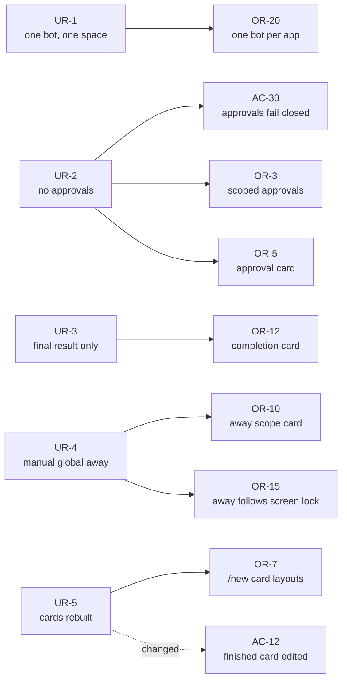

# Acceptance

Every **[AC-x]** in [PLAN.md](PLAN.md), plus later rounds, with the tests that prove each.

- `tests/test_acceptance.py` checks this file:
  - each AC-1 to AC-40 appears once;
  - each cited file exists and names its AC;
  - an open box says what it waits for, as `(pending C15: …)`;
  - OR ids run from OR-1 without gaps, all ticked, every cited file exists.
- Row format: `- [x] **ID** requirement — test files`.
- Live tests run only with `RELAY_LIVE=1`.

## Summary

| Section | IDs | Count | Status |
|---|---|---|---|
| Foundations (C2) | AC-1 – AC-8 | 8 | all ticked |
| Webex and the PWA (C4, C13) | AC-9 – AC-14 | 6 | all ticked; AC-12 changed by D119 |
| Adapters (C6–C10) | AC-15 – AC-24 | 10 | all ticked; live ones passed at C15 |
| Hooks, approvals and parking (C3, C5) | AC-25 – AC-32 | 8 | all ticked; AC-30 superseded |
| Skills, MCP, sync and doctor (C11, C12) | AC-33 – AC-38 | 6 | all ticked |
| Operations and security (C14) | AC-39 – AC-40 | 2 | all ticked |
| October round (beyond the plan) | OR-1 – OR-20 | 20 | all ticked; 7 superseded |
| November round (usability) | UR-1 – UR-8 | 8 | offline tests ticked; live checks open |

Rows superseded or changed by the November round (old row kept, its tests prove the new behaviour):

## Foundations (C2)

- [x] **AC-1** No module outside `paths.py` builds a home-relative path — `tests/test_paths.py`
- [x] **AC-2** A missing token exits non-zero with the Keychain command — `tests/test_daemon.py`
- [x] **AC-3** State survives a daemon restart — `tests/core/test_registry.py`
- [x] **AC-4** Concurrent writes from hooks and adapters are safe — `tests/core/test_registry.py`
- [x] **AC-5** A raising adapter does not stop other sessions' events — `tests/core/test_router.py`
- [x] **AC-6** Capabilities are declared; the UI hides what is unsupported — `tests/core/test_router.py`, `tests/frontends/test_flows.py`
- [x] **AC-7** The daemon refuses connections from other uids — `tests/test_ipc.py`
- [x] **AC-8** A corpus of secret shapes is fully redacted — `tests/test_scrub.py`

## Webex and the PWA (C4, C13)

- [x] **AC-9** After a reconnect, missed messages are fetched from the last seen id — `tests/frontends/test_ws_client.py`
- [x] **AC-10** Other people, group rooms and their card submissions are ignored — `tests/frontends/test_access.py`
- [x] **AC-11** The command parser has full table tests — `tests/frontends/test_commands.py`
- [x] **AC-12** Adaptive Cards v1.3, one per message; a finished one-shot card is deleted (was: edited once with the outcome; changed by D119, proven again under UR-5) — `tests/frontends/test_cards.py`
- [x] **AC-13** No message exceeds a Webex limit or the edit budget — `tests/frontends/test_renderer.py`
- [x] **AC-14** PWA: nothing binds when off, loopback only, 401 without the token, ordered SSE — `tests/frontends/test_pwa.py`

## Adapters (C6–C10)

- [x] **AC-15** The AHP adapter turns replayed traces into the expected events — `tests/adapters/test_ahp.py`
  - `tests/adapters/test_ahp.py` → `::test_a_phone_session_shows_up_in_the_session_list_after_its_first_turn`, `::test_a_session_whose_default_chat_has_no_turn_is_left_out_of_the_list`, `::test_a_workspace_file_sends_its_uri_and_every_folder`, `::test_a_workspace_without_a_file_sends_no_workspace_file`, `::test_an_unreadable_workspace_file_refuses_the_session`, `::test_the_default_chat_is_the_one_the_host_names_not_a_guessed_uri`, `::test_an_adopted_desk_session_with_a_uuid_default_chat_streams`, `::test_a_session_the_host_cannot_open_is_disposed_and_never_recorded` (D138)
- [x] **AC-16** Live: list sessions on the real editor host — `tests/live/test_ahp_live.py` (passed at C15, 2026-10-04; the C15 smoke run of the Copilot harness is in [testing.md](testing.md))
- [x] **AC-17** relay-bridge protocol unit tests with a mocked `vscode` — `extensions/relay-bridge/test/bridge.test.ts`
- [x] **AC-18** The vscode adapter against a fake bridge — `tests/adapters/test_vscode.py`
- [x] **AC-19** OpenCode contract test against a fake server with a recorded `/doc` and SSE — `tests/adapters/test_opencode.py`
- [x] **AC-20** Live: an OpenCode session in `.scratch` streams `OK` and aborts — `tests/live/test_opencode_live.py` (run at C6, see S9 in [spikes.md](spikes.md); re-run at C15 after D69)
- [x] **AC-21** Cursor CLI contract test against a fake ACP agent — `tests/adapters/test_cursor_cli.py`
- [x] **AC-22** Live: the Cursor CLI returns `OK` — `tests/live/test_cursor_cli_live.py` (passed at C15, 2026-10-04)
- [x] **AC-23** Cursor CDP unit tests against a saved DOM fixture — `tests/adapters/test_cursor_cdp.py`
- [x] **AC-24** Live: the Cursor CDP self-test passes — `tests/live/test_cursor_cdp_live.py` (passed at C15, 2026-10-05, Cursor 3.23.12, selectors v2; the first run found three stale selectors, see D35)

## Hooks, approvals and parking (C3, C5)

- [x] **AC-25** `relay-hook` p95 under 80 ms when away is off or relayd is down — `tests/hook/test_relay_hook.py`
- [x] **AC-26** Installing hooks twice produces the same output — `tests/hook/test_installers.py`
- [x] **AC-27** Uninstall restores hook backups byte for byte — `tests/hook/test_installers.py`
- [x] **AC-28** Existing `git-ai` entries are kept — `tests/hook/test_installers.py`
- [x] **AC-29** Every hook payload fixture parses — `tests/hook/test_shims.py`
- [x] **AC-30** *Superseded by UR-2 (D117, D124).* Was: approvals fail closed on every harness; the relay's deadline denies first. Now: every tool call the relay answers is allowed at once; a failing hook leaves the call to the app — `tests/core/test_hooks.py`
- [x] **AC-31** Parking releases on `/back`, `/panic`, away off and the deadline — `tests/core/test_hooks.py`
- [x] **AC-32** Loop guards: `stop_hook_active` and Copilot's 8-block cap — `tests/core/test_hooks.py`

## Skills, MCP, sync and doctor (C11, C12)

- [x] **AC-33** Each plugin bundle validates by schema and, where one exists, the vendor loader — `tests/ops/test_bundles.py`, `tests/live/test_bundle_loaders_live.py`
- [x] **AC-34** relay-mcp contract tests with an MCP client — `tests/mcp/test_relay_mcp.py`
- [x] **AC-35** Config sync round-trips today's files, renders valid JSON/JSONC, never prints secrets — `tests/sync/test_config_sync.py`
- [x] **AC-36** Skills dedupe moves only byte-identical folders — `tests/sync/test_skills_dedupe.py`
- [x] **AC-37** `relay doctor` covers every area, as text or `--json` — `tests/doctor/test_local.py`, `tests/doctor/test_daemon.py`
- [x] **AC-38** An app update re-runs the self-test and degrades on failure — `tests/core/test_updates.py`

## Operations and security (C14)

- [x] **AC-39** Install, uninstall, install inside `RELAY_HOME` leaves no stray files — `tests/ops/test_install.py`
- [x] **AC-40** Security unit tests cover each control (map in [security.md](security.md)) — `tests/test_security.py`

## October round (beyond the plan)

- Features and fixes added after the plan; deviations D72–D111.
- Not plan ACs. Superseded rows keep their old text after "Was:".

- [x] **OR-1** Uninstall restores only files unchanged since the relay's last write, else unmerges or keeps the backup; backups are private — `tests/test_fileops.py`, `tests/ops/test_install.py`
- [x] **OR-2** An answer that cannot reach the app reopens its request — `tests/core/test_approvals_delivery.py`
- [x] **OR-3** *Superseded by UR-2 (D117).* Was: scoped approvals (recent decisions per session for 60 s, workspace grants per tool and workspace). Now: no approvals, no grants; migration 5 deletes the old grant keys — `tests/core/test_no_approvals.py`, `tests/core/test_hooks.py`, `tests/core/test_registry.py`
- [x] **OR-4** Parking uses the full block limit before releasing — `tests/core/test_hooks.py`
- [x] **OR-5** *Superseded by UR-2 (D117).* Was: the approval card offers allow once, for the session, for the workspace, deny, and deny with a reason. Now: no approval card or action exists — `tests/frontends/test_no_approval_card.py`
- [x] **OR-6** Question cards answer, skip or take custom text; their notification line carries the question — `tests/frontends/test_cards.py`
- [x] **OR-7** *Superseded by UR-5 (D119).* Was: `/new` is one card, or two with `webex.new_card_layout = "two"`. Now: `/new` is one flat card, no show-cards, no layout setting — `tests/frontends/test_new_card.py`
- [x] **OR-8** `/sessions` is a dashboard card with a reusable nonce — `tests/frontends/test_dashboard.py`
- [x] **OR-9** A bare `/model` in a thread sends a model picker — `tests/frontends/test_model_switch.py`
- [x] **OR-10** *Superseded by UR-4 (D120).* Was: a bare top-level `/away` sends a scope card. Now: `/away` and `/back` are plain global toggles; the scope card is deleted — `tests/frontends/test_flows.py`
- [x] **OR-11** `/panic` asks first; `/panic now` does not — `tests/frontends/test_panic_confirm.py`
- [x] **OR-12** *Superseded by UR-3 (D118).* Was: a turn ends with a completion card. Now: a turn ends with one message, the final text plus a footer of duration, tool calls and changed files — `tests/frontends/test_renderer.py`, `tests/frontends/test_renderer_status.py`
- [x] **OR-13** `/queue` shows a card with the mode and removable waiting messages — `tests/frontends/test_queue_card.py`
- [x] **OR-14** Queue modes (`queue`, `steer`, `interrupt`) and `/steer` — `tests/core/test_queue_modes.py`
- [x] **OR-15** *Superseded by UR-4 (D120).* Was: away mode follows the screen lock and undoes only what it did. Now: nothing turns away mode on or off by itself — `tests/core/test_away_global.py`, `tests/doctor/test_daemon.py`
- [x] **OR-16** Photos and files reach a thread or `/new`, natively where the app takes them (extended by UR-6: a top-level file is held for the next `/new`) — `tests/core/test_inbox.py`, `tests/frontends/test_attachments_intake.py`, `tests/adapters/test_attachments.py`
- [x] **OR-17** `/ws` adds a folder, clones a repo on an allowed host, and adds a repo to a workspace — `tests/core/test_workspaces_phone.py`, `tests/frontends/test_ws_card.py`
- [x] **OR-18** The `agent-relay-recall` skill ships in every bundle and install — `tests/ops/test_bundles.py`
- [x] **OR-19** A reply in an ended session's thread revives it — `tests/core/test_lifecycle.py`
- [x] **OR-20** *Superseded by UR-1 (D116).* Was: one bot per app (routing by harness, per-space commands, `relay setup bot --stdin`, one websocket per bot). Now: one bot, one space, `relay setup token --stdin` — `tests/core/test_registry.py`, `tests/test_setup_token.py`, `tests/test_daemon.py`, `tests/doctor/test_local.py`, `tests/doctor/test_daemon.py`

## November round (usability)

- Source: owner decisions U1–U8 plus the daemon-robustness fix (P1), from
  [sandbox/08-usability-round.md](../sandbox/08-usability-round.md); deviations D116–D127.
- Each sub-bullet: the test file, then after `::` the test functions that prove it.
- **Live** line: what only a run against real apps or a real phone can prove. Listed in
  [TODO.md](../TODO.md); every one is still open.
- A box is ticked when its offline tests exist and pass.

- [x] **UR-1** One bot, one space (U1, D116). A fresh database is left alone; migration 5 forgets the app bots and ends every session; a config with every legacy key loads with one warning; `relay config unset` cleans it; doctor lists legacy keys with the command that removes them.
  - `tests/core/test_registry.py` → `::test_migration_5_forgets_the_app_bots_and_ends_every_session`, `::test_migration_5_leaves_a_fresh_database_alone`
  - `tests/test_setup_token.py` → `::test_setup_token_stores_the_token_from_stdin_and_never_prints_it`, `::test_the_old_per_app_bot_command_is_gone`, `::test_setup_token_refuses_without_storing_or_echoing`
  - `tests/test_settings.py` → `::test_a_config_with_every_legacy_key_loads_with_one_warning`, `::test_the_model_itself_tolerates_legacy_keys`, `::test_unset_removes_a_legacy_key_and_writes_a_clean_file`
  - `tests/test_cli_ops.py` → `::test_config_unset_removes_legacy_keys_and_writes_a_clean_file`
  - `tests/doctor/test_local.py` → `::test_legacy_settings_are_listed_with_the_command_that_removes_them`
  - `tests/frontends/test_renderer.py` → `::test_the_root_posts_once_and_is_then_only_edited`, `::test_concurrent_first_use_opens_one_thread`
  - Live: `relay start` with the one token, then `/help` answered in the one space (done in P0, 2026-11-21); the owner deletes the three app bots at developer.webex.com.
- [x] **UR-2** No approvals (U2, U3, D117, D124, D125). The relay never posts an approval card. Every tool call it answers is allowed at once on every path (hooks, AHP, OpenCode, Cursor CLI). A desk session at the desk, a paused relay and a failing hook are left to the app's own prompt. Questions still wait for the phone.
  - `tests/core/test_no_approvals.py` → `::test_relay_never_posts_an_approval_card`, `::test_every_relay_answered_tool_call_is_allowed`, `::test_every_hook_answered_tool_call_is_allowed`, `::test_desk_sessions_at_the_desk_are_left_to_the_app`, `::test_nothing_is_answered_after_a_panic`, `::test_a_phone_held_session_is_allowed_with_away_off`, `::test_a_paused_relay_leaves_a_phone_held_hook_to_the_app`
  - `tests/core/test_approvals.py` → `::test_adapter_held_permission_is_allowed_natively_and_leaves_no_row`, `::test_a_desk_session_is_allowed_while_away_and_left_to_the_app_at_the_desk`, `::test_nothing_is_allowed_after_a_panic`, `::test_hook_question_answer_and_expiry`, `::test_adapter_held_question_and_duplicate_event`
  - `tests/core/test_hooks.py` → `::test_a_tool_call_is_allowed_at_once_in_every_harness_format`, `::test_a_hook_failure_leaves_the_tool_call_to_the_app`
  - `tests/hook/test_shims.py` → `::test_allow_output_per_format`
  - `tests/adapters/test_ahp.py` → `::test_tool_permission_is_allowed_at_once_and_never_reaches_a_sink`, `::test_the_plain_approve_option_is_picked`, `::test_a_paused_relay_leaves_the_tool_permission_to_the_app`, `::test_phone_session_replays_the_recorded_turn`
  - `tests/adapters/test_opencode.py` → `::test_permission_is_answered_always_and_never_reaches_a_sink`, `::test_permission_on_the_legacy_endpoint_is_answered_always_with_basic_auth`, `::test_every_permission_reply_means_allow_except_reject`
  - `tests/adapters/test_cursor_cli.py` → `::test_permission_requests_are_allowed_at_once_and_never_reach_a_sink`, `::test_plans_are_accepted_at_once`
  - `tests/adapters/test_cursor_cli_units.py` → `::test_argv_adds_isolation_and_force_and_skips_auto`
  - `tests/frontends/test_no_approval_card.py` → `::test_renderer_never_renders_approval_events`, `::test_there_is_no_approval_action_and_no_approval_card_builder`
  - `tests/frontends/test_pwa.py` → `::test_the_hub_sends_questions_as_cards_with_a_nonce_and_never_an_approval_card`
  - `tests/test_security.py` → `::test_there_is_no_approval_config_and_a_legacy_one_is_ignored`, `::test_questions_are_the_only_thing_that_waits_for_the_phone`
  - Live (open): a shell command from the phone runs with no card (E2E scenario 7); does `cursor-agent --force acp` stop `session/request_permission`; does VS Code 1.147 accept AHP `autoApprove`; does Cursor desktop skip its own prompt when the hook answers `allow`; does VS Code honour `permissionDecision: "allow"`.
- [x] **UR-3** Final result only (U4, D118, D127). A turn posts nothing until it completes, then exactly one message: the last assistant message of each app (not the narration) plus the footer. An error is one `⚠️` line and resets the turn. Parking, release, adapter crashes, update notices and "Mac online" post nothing.
  - `tests/frontends/test_renderer.py` → `::test_a_turn_posts_nothing_until_it_completes_and_then_one_message`, `::test_the_final_text_is_the_last_message_not_the_narration`, `::test_the_apps_final_text_wins_over_what_was_buffered`, `::test_every_app_shows_only_its_last_message`, `::test_a_stop_note_in_the_final_text_is_kept`, `::test_a_turn_with_no_text_still_ends_with_one_message`, `::test_the_footer_has_duration_tools_and_changed_files`, `::test_footer_line_leaves_out_what_has_nothing_to_say`, `::test_an_error_is_one_line_and_resets_the_turn`, `::test_adapter_errors_are_logged_not_posted`, `::test_parking_and_release_post_nothing_but_the_root_shows_them`, `::test_a_phone_session_opens_its_thread_when_it_starts`, `::test_a_desk_session_has_no_thread_until_its_first_final_result`, `::test_a_desk_session_opens_its_thread_for_a_question_or_an_error`, `::test_limits_hold_under_a_flood_with_rate_limits`
  - `tests/frontends/test_renderer_status.py` (whole file: the root's status icon and 🏝️ while away, edits not posts)
  - `tests/frontends/test_links.py` → `::test_a_tools_detail_never_reaches_the_phone`
  - `tests/frontends/test_pwa.py` → `::test_the_page_shows_a_turn_as_one_final_message_and_no_progress`
  - `tests/adapters/test_ahp_units.py` → `::test_turn_text_is_only_what_follows_the_last_tool_call`, `::test_turn_text_is_empty_when_nothing_follows_the_last_tool_call`
  - `tests/adapters/test_opencode.py` → `::test_turn_text_is_only_what_follows_the_last_tool_call`, `::test_turn_text_is_empty_when_nothing_follows_the_last_tool_call`
  - `tests/adapters/test_cursor_cli.py` → `::test_turn_text_is_only_what_follows_the_last_tool_call`, `::test_turn_text_is_empty_when_nothing_follows_the_last_tool_call`
  - `tests/hook/test_transcript.py` → `::test_only_the_text_after_the_last_tool_call_is_the_reply`
  - `tests/core/test_hooks.py` → `::test_park_continues_with_phone_message`, `::test_cursor_park_uses_followup_and_last_response`
  - `tests/test_daemon.py` → `::test_nothing_is_posted_at_the_top_level_when_relayd_starts`
  - `tests/core/test_updates.py` → `::test_the_watcher_has_no_way_to_post_to_the_phone`
  - Live (open): E2E scenarios 2 and 3 (one final message, nothing in between); does Cursor's last `afterAgentResponse` always carry the final answer; do Copilot CLI hook payloads always carry `transcript_path`.
- [x] **UR-4** Away mode is manual and global (U5, D120). One flag, default off; nothing turns it on by itself. `/away` and `/back` mean the same in a thread and at the top level; a `workspace` argument is accepted and ignored. While away is off the router withholds desk-session events (an adopted chat stops streaming at `/back`); phone-held sessions always pass. `/back` releases parked chats; `/panic` forces away off and pauses; `/status` and the root show 🏝️.
  - `tests/core/test_away_global.py` → `::test_the_flag_defaults_to_off`, `::test_set_away_without_a_workspace_is_global`, `::test_a_legacy_workspace_argument_switches_the_global_flag`, `::test_a_pause_counts_as_not_away`, `::test_nothing_turns_away_on_by_itself`, `::test_the_service_switch_is_global_and_ignores_the_workspace`, `::test_set_away_for_on_resumes_after_a_panic`, `::test_desk_events_are_dropped_while_not_away`, `::test_desk_events_pass_while_away`, `::test_an_adopted_desk_chat_stops_streaming_the_moment_away_goes_off`, `::test_phone_held_sessions_always_pass`, `::test_a_phone_session_handed_to_the_desk_follows_away_mode`, `::test_adapter_pseudo_sessions_and_unknown_sessions_pass`, `::test_a_bookkeeping_sink_still_sees_desk_events_at_the_desk`, `::test_gates_still_see_desk_events_at_the_desk`, `::test_registration_and_questions_of_a_desk_session_at_the_desk_stay_off_the_phone`, `::test_a_failing_filter_lets_the_event_through`, `::test_panic_pauses_forces_away_off_and_closes_questions`, `::test_panic_leaves_a_legacy_approval_row_alone`, `::test_away_off_releases_every_parked_session`, `::test_back_releases_parked_sessions`, `::test_away_off_hands_desk_visible_phone_chats_to_the_desk`
  - `tests/core/test_registry.py` → `::test_migration_6_collapses_away_to_the_global_row`
  - `tests/test_cli_ops.py` → `::test_away_is_global_and_a_workspace_option_is_ignored`
  - `tests/doctor/test_daemon.py` → `::test_away_checks_show_the_global_flag_and_panic`
  - `tests/ops/test_bundles.py` → `::test_commands_flip_away_mode`
  - `tests/frontends/test_flows.py` → `::test_away_is_one_global_switch_from_the_top_level_or_a_thread`, `::test_back_in_a_thread_releases_parked_sessions_and_turns_away_off`, `::test_status_in_a_thread_shows_the_island_while_away`, `::test_panic_pauses_and_cancels`
  - `tests/frontends/test_renderer_status.py` → `::test_the_root_shows_away_mode_with_an_edit_and_no_post`, `::test_a_thread_reopened_while_away_does_not_spend_an_edit_on_the_island`
  - `tests/frontends/test_dashboard.py` → `::test_the_dashboard_has_no_away_button_and_refuses_the_old_op`
  - Live (open): E2E scenario 8 (`/away`, a desk chat's final result in a new thread, a reply continues it, `/back` releases it) per desk app; does a Cursor CDP chat also register as a desk session through Cursor's hooks.
- [x] **UR-5** Cards rebuilt (U6, D119). Every card builder's JSON passes the Webex-subset check with maximal inputs. `/new` is one flat card: required prompt, preselection from the last use, server-side re-check of the offer, one session per card, retap after a failed start. Model lists come from one timed, shared cache. `/model` validates, deletes its card and says `Model → X from the next turn.` One-shot cards are deleted when done; a failed tap leaves the card; question cards are deleted when answered.
  - `tests/frontends/test_card_spec.py` → `::test_every_card_builder_passes_the_webex_subset_with_maximal_inputs`, `::test_every_card_module_has_samples_here`, `::test_action_toggle_visibility_is_refused`, `::test_a_newer_card_version_is_refused`, `::test_an_unknown_element_and_an_unknown_action_are_refused`, `::test_duplicate_input_ids_are_refused_across_nested_cards`, `::test_a_choice_set_needs_choices_and_a_preset_among_them`, `::test_an_oversized_card_is_refused`, `::test_the_new_card_uses_no_show_card_and_stays_small`
  - `tests/frontends/test_new_card.py` → `::test_bare_new_is_one_flat_card_with_workspace_agent_and_prompt`, `::test_the_prompt_is_required_multiline_and_labelled`, `::test_the_offer_is_stored_under_the_cards_nonce`, `::test_a_long_workspace_list_is_capped_with_a_note_and_the_agent_list_holds_forty`, `::test_start_from_the_card_starts_the_session_deletes_the_card_and_opens_the_thread`, `::test_the_default_agent_starts_with_the_apps_own_default_not_the_last_model`, `::test_the_card_is_checked_again_on_the_server`, `::test_a_forged_agent_is_refused_even_for_an_enabled_app_model`, `::test_a_card_whose_offer_is_gone_asks_for_a_new_one`, `::test_the_card_can_start_only_one_session`, `::test_a_start_that_fails_before_a_session_exists_can_be_tapped_again`, `::test_a_relay_error_from_the_start_is_shown_as_is_and_keeps_the_card`, `::test_a_failure_after_the_session_exists_is_not_a_failed_tap`, `::test_an_empty_prompt_is_refused_and_the_card_stays_usable`, `::test_the_last_used_app_and_model_are_preselected`, `::test_the_last_used_workspace_is_preselected`, `::test_new_with_pieces_asks_only_for_the_rest_in_the_same_card`, `::test_a_typed_model_is_preselected_on_the_card`, `::test_a_prompt_too_long_to_prefill_is_left_blank_and_says_so`, `::test_the_ws_cards_start_button_opens_the_card_with_that_workspace`, `::test_a_one_line_new_is_unchanged_and_starts_without_a_card`, `::test_utility_models_are_hidden_in_the_card_and_in_models`, `::test_two_apps_one_with_models_and_one_without`, `::test_an_unhealthy_app_is_left_out_with_one_subtle_line`, `::test_a_slow_app_does_not_delay_the_card_and_the_cache_serves_the_next_one`, `::test_the_second_new_uses_the_cached_model_lists`, `::test_cursor_cdp_never_opens_its_model_menu_for_a_card`, `::test_no_workspaces_and_no_apps_are_said_plainly`
  - `tests/core/test_discovery.py` → `::test_models_come_from_a_ten_minute_cache_and_refresh_asks_again`, `::test_two_callers_at_once_share_one_listing`, `::test_a_slow_listing_times_out_but_still_fills_the_cache`, `::test_the_health_checks_of_all_apps_run_side_by_side`, `::test_cdp_models_are_never_listed_for_a_card_or_a_session_start`, `::test_an_explicit_listing_saves_the_cdp_models_for_the_cards`, `::test_an_app_shows_at_most_eight_models_and_hides_its_helpers`, `::test_the_whole_list_is_capped_and_every_app_keeps_its_default`, `::test_a_model_used_before_stays_on_the_list_even_past_the_cap`, `::test_the_preselection_is_the_last_used_app_with_its_last_model`, `::test_an_unhealthy_app_is_left_out_and_named`, `::test_an_app_paused_after_an_update_is_named_with_its_state`, `::test_a_slow_app_does_not_delay_the_others_and_gets_only_its_default`
  - `tests/frontends/test_model_switch.py` → `::test_bare_model_is_a_picker_in_the_thread_with_the_current_model_selected`, `::test_apply_sets_the_model_says_so_in_the_thread_and_deletes_the_card`, `::test_a_typed_model_is_checked_and_applied`, `::test_a_typed_label_is_resolved_to_the_models_id`, `::test_a_typed_model_the_app_does_not_list_is_refused_with_a_hint`, `::test_a_typed_utility_model_is_refused`, `::test_a_model_the_app_does_not_list_is_refused_and_the_card_stays_usable`, `::test_a_card_that_lost_its_offer_still_checks_the_model_against_the_app`, `::test_the_picker_is_single_use`, `::test_the_picker_uses_the_shared_model_cache`, `::test_cdp_after_an_explicit_listing_the_picker_and_typed_models_work`, `::test_cdp_typed_model_without_a_saved_list_is_refused_without_opening_the_menu`
  - `tests/frontends/test_card_delete.py` → `::test_a_one_shot_card_is_deleted_after_it_succeeds`, `::test_a_failed_tap_leaves_the_card_to_be_tapped_again`, `::test_an_expired_tap_does_not_delete_the_card`, `::test_a_reusable_card_stays_after_it_succeeds`, `::test_a_card_that_cannot_be_deleted_does_not_fail_the_tap`
  - `tests/frontends/test_renderer.py` → `::test_a_question_card_is_deleted_once_answered`, `::test_a_question_card_that_cannot_be_deleted_is_edited_to_say_how_it_ended`
  - `tests/frontends/test_cards.py` → `::test_question_card_answer_and_skip`, `::test_a_card_can_be_answered_once_only`, `::test_a_submit_without_a_valid_nonce_does_nothing`, `::test_a_relay_error_from_a_submit_is_shown_in_the_thread_and_can_be_retried`, `::test_the_card_of_a_question_whose_session_ended_is_deleted`
  - `tests/frontends/test_pwa_cards.py` → `::test_a_question_sends_the_chosen_option_and_the_typed_answer_with_its_nonce`, `::test_new_session_sends_the_nonce_and_every_input`, `::test_new_session_shows_its_notes_and_the_prefilled_prompt` (Playwright; not run when this was written)
  - Live (open): `RELAY_LIVE=1 .venv/bin/python scripts/card_check.py` (every card posted, HTTP 200, deleted); E2E scenarios 2 and 6 per app; the owner opens the `/new` and `/model` cards on Android and checks the layout; does a Webex Android card delete leave no "Unable to send your request" on a stale tap; does the client honour `label`, `isRequired` and `errorMessage`.
- [x] **UR-6** Files in, HTML out (U7, D122). A file at the top level is held for the next `/new` and announced on the card. A reply to a parked desk session carries the path. A failed download gets one `⚠️` line. A long or rich answer is one message with `answer.html`; a `/diff` over 200 lines is `changes.html`. The HTML is inert (CSP, escaped raw HTML, no `href`, scrubbed). `send_phone_file` stays inside the workspace.
  - `tests/test_rich.py` → `::test_the_csp_is_present_exactly_once_and_forbids_everything_but_inline_css`, `::test_raw_html_in_the_text_is_escaped`, `::test_script_in_a_table_cell_heading_and_emphasis_is_escaped`, `::test_links_are_text_with_no_href_anywhere`, `::test_a_link_whose_text_is_its_address_is_not_repeated`, `::test_text_that_mentions_the_csp_does_not_add_a_second_header`, `::test_the_page_is_one_self_contained_mobile_friendly_document`, `::test_the_scrubber_runs_on_the_html_and_the_preview`, `::test_a_secret_in_the_header_facts_is_scrubbed_too`, `::test_the_diff_goes_through_the_scrubber`, `::test_the_body_matches_the_golden_file`, `::test_a_table_is_wrapped_so_it_scrolls_sideways`, `::test_the_header_names_app_workspace_model_time_and_footer`, `::test_is_rich_truth_table`, `::test_wants_html_truth_table`, `::test_the_preview_is_the_first_paragraph_with_a_pointer`, `::test_a_heading_brings_the_paragraph_after_it`, `::test_the_preview_fits_in_one_and_a_half_kilobytes`, `::test_the_preview_neutralises_links`, `::test_a_clipped_preview_does_not_leave_a_code_span_open`, `::test_a_diff_is_coloured_by_line_kind`, `::test_dashes_inside_a_hunk_are_content_not_file_headers`, `::test_the_diff_page_has_the_same_csp_and_escapes_everything`
  - `tests/core/test_send_file.py` → `::test_dot_dot_out_of_the_workspace_is_refused`, `::test_an_absolute_path_outside_the_workspace_is_refused`, `::test_a_symlink_inside_pointing_outside_is_refused`, `::test_a_symlinked_folder_pointing_outside_is_refused`, `::test_an_oversized_file_is_refused`, `::test_a_directory_is_refused`, `::test_a_missing_file_is_refused`, `::test_a_fifo_is_refused_without_blocking`, `::test_a_text_file_is_scrubbed`, `::test_a_png_passes_through_byte_for_byte`
  - `tests/mcp/test_relay_mcp.py` → `::test_tools_are_listed_with_their_schemas`, `::test_send_phone_file_sends_the_op_with_the_workspace_path_and_caption`, `::test_send_phone_file_passes_the_reason_when_it_was_not_delivered`, `::test_send_phone_file_reports_a_refusal_from_relayd_as_an_error`, `::test_send_phone_file_degrades_without_relayd`
  - `tests/test_daemon.py` → `::test_send_file_goes_to_the_session_thread_and_stays_inside_the_workspace`, `::test_send_file_needs_the_phone_to_be_reachable`
  - `tests/frontends/test_renderer.py` → `::test_a_long_answer_is_one_message_with_answer_html`, `::test_a_table_goes_out_as_html_even_when_short`, `::test_the_html_threshold_never_keeps_everything_as_text_in_chunks`, `::test_the_html_threshold_always_attaches_even_a_short_answer`
  - `tests/frontends/test_flows.py` → `::test_a_long_diff_goes_out_as_changes_html`, `::test_diff_attachment`
  - `tests/frontends/test_attachments_intake.py` → `::test_a_file_at_the_top_level_is_held_for_the_next_new_not_refused`, `::test_a_command_with_a_file_at_the_top_level_runs_and_the_file_is_held`, `::test_the_top_level_hold_says_how_long_it_lasts`, `::test_files_held_at_the_top_level_are_left_behind_when_their_time_runs_out`, `::test_a_top_level_file_with_attachments_off_is_not_downloaded`, `::test_a_file_with_text_to_a_parked_session_puts_the_path_in_the_continuation`, `::test_a_files_only_reply_to_a_parked_session_is_delivered_at_once_as_paths`, `::test_a_files_only_reply_to_a_session_that_is_not_parked_is_held_as_before`, `::test_files_held_earlier_go_with_a_parked_sessions_files_only_reply`, `::test_a_file_over_the_cap_is_skipped_and_the_text_still_goes`, `::test_a_refused_download_is_reported_not_raised`, `::test_a_files_only_message_where_every_file_fails_gets_one_warning_and_nothing_is_held`, `::test_one_warning_line_names_every_file_that_failed`, `::test_a_download_that_raises_is_named_in_the_warning`, `::test_a_top_level_file_that_cannot_be_downloaded_gets_one_warning_and_no_hold`, `::test_a_file_named_by_the_sender_cannot_choose_where_it_lands`, `::test_the_bot_token_never_leaves_the_webex_api_host`, `::test_a_look_alike_host_is_not_the_webex_host`
  - `tests/frontends/test_new_card.py` → `::test_files_waiting_for_the_next_new_are_announced_and_go_with_it`, `::test_a_file_sent_at_the_top_level_is_announced_on_the_card_and_goes_with_start`, `::test_one_file_is_announced_in_the_singular_and_none_says_nothing`, `::test_a_start_that_fails_gives_the_held_files_back`
  - `tests/core/test_inbox.py` → `::test_held_top_level_peeks_without_releasing`, `::test_held_top_level_is_none_once_the_time_is_up_and_leaves_the_files_for_the_sweep`, `::test_new_takes_every_file_held_at_the_top_level`, `::test_files_taken_for_a_new_that_failed_can_be_put_back`, `::test_skipped_files_make_one_warning_line`
  - Live (open): one image and one PDF per app reach the agent (E2E scenario 4); a long table arrives as one message with `answer.html` and its CSP, no `<script>`, no `href` (scenario 5); does Webex Android open `answer.html` in the app or hand it to the browser, and does the CSP survive either path.
- [x] **UR-7** The daemon survives a Webex auth failure (P1, D121). A 401 at start keeps relayd up, with backoff and one log line per change. Doctor tests the token with `GET /people/me` and names the command that fixes it. `relayd.err.log` over 10 MiB is truncated at start. Running sessions left behind are reconciled; idle ones end after 7 days.
  - `tests/test_daemon.py` → `::test_startup_401_keeps_relayd_up`, `::test_err_log_truncated_when_over_10mb`, `::test_relayd_trims_the_err_log_before_it_does_anything_else`, `::test_start_up_marks_sessions_left_running_as_idle`
  - `tests/frontends/test_host.py` → `::test_a_rejected_token_is_retried_with_backoff_and_logged_once`, `::test_a_runtime_failure_detaches_then_rebuilds`, `::test_events_are_dropped_in_the_gap_between_two_front_ends`, `::test_a_websocket_that_returns_normally_is_rebuilt_too`, `::test_an_unexpected_exception_is_logged_with_a_traceback_and_does_not_stop_relayd`, `::test_the_backoff_never_exceeds_the_maximum`, `::test_failures_are_classified`
  - `tests/doctor/test_local.py` → `::test_doctor_reports_rejected_token`, `::test_doctor_accepts_a_working_token`, `::test_doctor_only_warns_when_webex_cannot_say`, `::test_local_checks_include_the_token_test`
  - `tests/doctor/test_daemon.py` → `::test_doctor_reports_a_rejected_token_with_the_command_that_fixes_it`
  - `tests/core/test_housekeeping.py` → `::test_start_up_marks_running_sessions_idle_and_touches_nothing_else`, `::test_idle_sessions_untouched_for_seven_days_are_ended`
  - Live: relayd was brought back up on 2026-11-21 (P0) after eight days down; a deliberately bad token on a live relayd has not been tried.
- [x] **UR-8** The E2E driver (U8, D123). It refuses to run without `RELAY_LIVE=1`. Every scenario passes against a well-behaved fake relay and fails against each misbehaving one. The session cap, cleanup and labelled skips hold. The person token never reaches an error, a report or any host but `webexapis.com`.
  - `tests/live/test_phone_e2e.py` → `::test_the_driver_refuses_to_run_without_relay_live_one`, `::test_bad_arguments_stop_the_run_before_anything_is_sent`, `::test_an_error_from_webex_never_carries_the_token`, `::test_the_token_is_only_ever_sent_to_webexapis`, `::test_a_failed_refresh_in_webex_cli_is_a_safe_error`, `::test_a_setup_error_is_scrubbed_and_exits_two`, `::test_the_token_comes_from_webex_cli_without_running_its_main`, `::test_a_card_submit_posts_the_documented_body`, `::test_a_refused_card_submit_is_reported_as_missing_scope`, `::test_the_scope_probe_reads_the_status_once`, `::test_the_scope_is_probed_only_when_a_card_scenario_runs`, `::test_a_file_is_uploaded_as_multipart_with_its_thread`, `::test_a_locked_download_is_retried_and_named`, `::test_the_room_must_be_a_one_to_one_with_a_bot`, `::test_messages_parse_from_the_webex_wire_format`, `::test_the_new_card_is_filled_like_a_tap_would_fill_it`, `::test_filling_a_card_fails_loudly_when_it_does_not_offer_what_is_needed`, `::test_an_approval_card_is_recognised_by_its_actions`, `::test_the_sample_files_are_valid`, `::test_answer_html_checks`, `::test_the_report_renders_a_markdown_table_and_an_exit_code`, `::test_a_live_run_is_wired_end_to_end_and_writes_the_report`, `::test_live_help_round_trip_creates_no_session` (runs only with `RELAY_LIVE=1`)
  - `tests/test_e2e_driver.py` → `::test_every_scenario_passes_against_a_well_behaved_relay`, `::test_choosing_a_later_scenario_also_runs_the_session_it_needs`, `::test_each_app_gets_its_own_session_and_one_charge`, `::test_a_misbehaving_relay_fails_the_matching_scenario`, `::test_a_failed_turn_is_reported_with_its_text`, `::test_a_reply_that_is_not_ok_fails_the_thread_scenario`, `::test_panic_fails_when_a_turn_keeps_running`, `::test_a_failed_session_start_skips_the_scenarios_that_need_it`, `::test_no_scope_skips_the_card_scenarios_and_runs_the_typed_forms`, `::test_a_refused_submit_after_a_yes_probe_falls_back_the_same_way`, `::test_a_card_scenario_skips_when_the_app_has_nothing_to_choose`, `::test_away_is_skipped_when_nobody_runs_a_desk_turn`, `::test_the_away_scenario_tells_the_human_what_to_do`, `::test_the_session_cap_stops_a_run_before_it_sends_anything`, `::test_the_budget_allows_three_per_adapter_and_counts_adapters_apart`, `::test_the_driver_deletes_every_message_it_posted_and_leaves_the_relay_alone`, `::test_an_error_text_never_carries_a_secret_into_the_report`
  - Live (open): the driver has not been run against Webex; its results go into [testing.md](testing.md) (live results, November round). Open check: whether the integration's scopes allow `POST /attachment/actions`.
