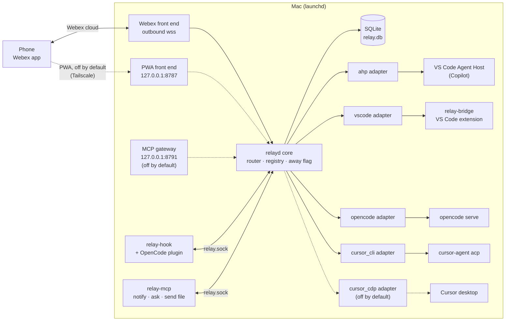
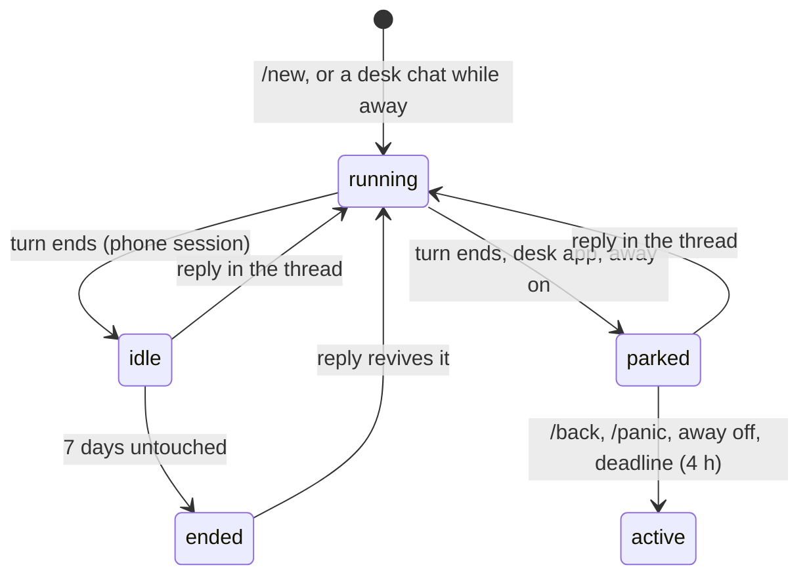
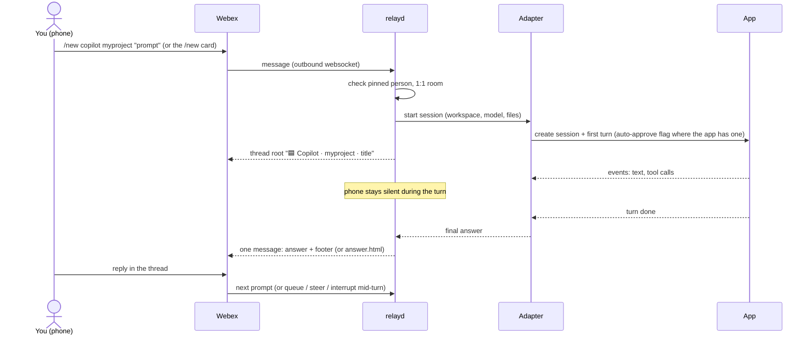
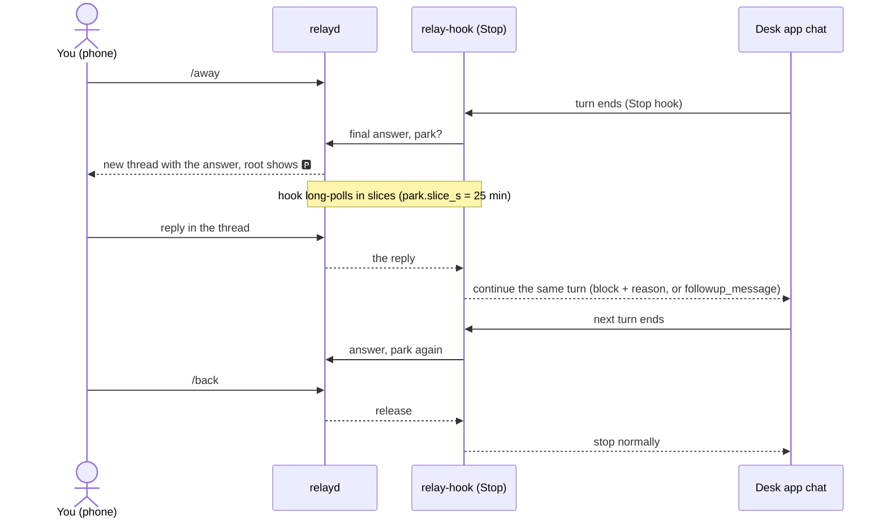
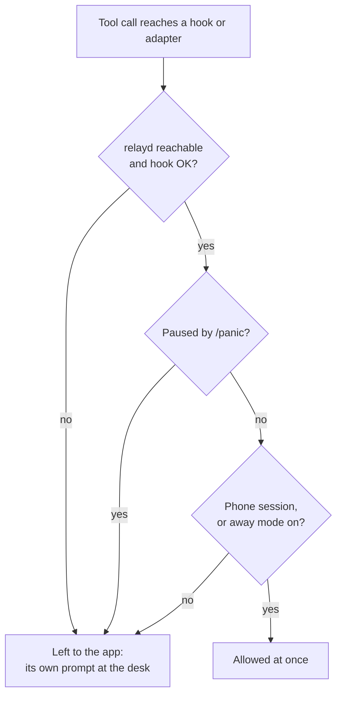

# Architecture

How the pieces fit and how a message moves. For commands and settings see [operations.md](operations.md);
for the original spec see [PLAN.md](PLAN.md) (where they differ, [deviations.md](deviations.md) wins).

## The pieces



| Piece | What it is | Code |
|---|---|---|
| `relayd` | The daemon: Webex connection, session registry, one adapter per app | `agent_relay/daemon.py`, `core/` |
| Webex front end | One bot, one 1:1 space, one thread per session | `frontends/webex/` |
| PWA | Optional browser UI with the same commands; loopback only | `frontends/pwa/` |
| MCP gateway | Optional loopback proxy that signs in to remote MCP servers once and holds their tokens; the sign-in link goes through Webex | `gateway/`, `sync/gateway.py` |
| Adapters | Start and drive sessions in each app | `adapters/` |
| `relay-hook` | Stdlib-only program installed into every app's hooks | `hook/relay_hook.py` |
| OpenCode plugin | The hook equivalent for OpenCode | `plugins/opencode/agent-relay.ts` |
| `relay-bridge` | VS Code extension for VS Code's own agent chats | `extensions/relay-bridge/` |
| `relay-mcp` | MCP server: `notify_phone`, `ask_phone`, `send_phone_file` | `mcp/` |
| Skills | `agent-relay-away` (`/away`, `/back`), `agent-relay-recall` | `skills/` |
| `relay` CLI | Install, doctor, config sync, skills dedupe, self-tests | `cli/` |

- Nothing listens on the network: relayd connects out to Webex; local peers use the Unix socket.
- Every app keeps working when relayd is down: hooks fall back to the app's own behaviour.

## Two planes

| Plane | Job | Done by |
|---|---|---|
| **Start plane** | Create a session from the phone; send prompts, stop, change model | Adapters |
| **Session plane** | Observe any session (desk or phone), answer its tool calls, park and continue it | `relay-hook`, the OpenCode plugin, adapters' event streams |

## Apps and how each is driven

| App | `/new` word | Start plane | Session plane | Parks? |
|---|---|---|---|---|
| VS Code Copilot (Agent Host) | `copilot` | AHP (JSON-RPC on the editor's socket) | AHP events + Copilot hooks | Yes |
| VS Code own agent ("Local") | `vscode` | `relay-bridge`; `code chat` fallback | Copilot hooks | Yes |
| Cursor CLI | `cursor` | `cursor-agent acp` over stdio | ACP events | No (idle, woken by a reply) |
| OpenCode | `opencode` | HTTP + SSE to `opencode serve` | SSE events + plugin | No (idle, woken by a reply) |
| Cursor desktop | `cursor-ide` (CDP only) | CDP, off by default | Cursor hooks | Yes |
| Copilot CLI | (desk only) | none | Copilot hooks | Yes |

## Session status

The thread's first line shows the status; it is edited quietly, never re-posted.



| Icon | Status |
|---|---|
| ⏳ | running |
| ✅ | idle |
| 🅿️ | parked (turn held open, waiting for your reply) |
| ▶️ | active (a parked turn was released) |
| ⚫ | ended |
| 🏝️ | added while away mode is on |

## Flow: a session started from the phone



- The final answer is what the agent said after its last tool call, not its narration.
- A long or rich answer goes as `answer.html` (see [user-guide.md](user-guide.md)).

## Flow: away mode and a desk chat

Away mode is one global flag that only you switch (`/away`, `/back`, `relay away on|off`, the skill).



Releases a parked turn: a reply (continues it), `/back`, `/panic`, away off, or `park.deadline_s` (4 h).

## How a tool call is answered

There are no approvals (D117). The relay either allows at once or leaves the call to the app.



- "Left to the app" means the hook returns `{}` (or the adapter gives no answer) (D124).
- Questions are different: `ask_phone`, AHP input requests, OpenCode questions and Cursor `ask_question`
  wait for your answer, up to `questions.deadline_s`.

## What reaches the phone

| Event | Phone sees |
|---|---|
| Turn running | Nothing (status line edited to ⏳) |
| Turn ends | One message: final answer + footer `⏱ 3m · 🔧 14 · 📝 4 files (+120 −8)` |
| Agent asks a question | A question card |
| Turn fails | One `⚠️` line |
| Desk session, away off | Nothing: the router withholds it |
| relayd start, app update, adapter crash | Nothing: log and `relay doctor` only |

## Where things live

| What | Path (under `RELAY_HOME` when set) |
|---|---|
| Settings | `~/.config/agent-relay/relay.toml`, `workspaces.toml` |
| Secrets | Login Keychain, service `agent-relay` (MCP secrets: `agent-relay-mcp`) |
| Session database | `~/Library/Application Support/agent-relay/relay.db` |
| IPC socket | `~/Library/Application Support/agent-relay/relay.sock` (`0600`) |
| Install manifest and backups | `~/Library/Application Support/agent-relay/install-manifest.json` |
| Logs | `~/Library/Logs/agent-relay/` (`relayd.log`, scrubbed) |
| Files from the phone | `<workspace>/.agent-relay/inbox/<session>/` |
| MCP server list | `~/.agents/mcp.yaml` |
| Skills | `~/.agents/skills/` |

Every home-relative path is built in `agent_relay/paths.py`, which honours `RELAY_HOME`.

## Repo layout

```text
agent_relay/
  paths.py settings.py log.py scrub.py ipc.py   foundations
  models/      wire formats and config (Pydantic)
  core/        router, registry, away flag, parking, hooks, inbox, workspaces
  frontends/   webex/, pwa/, rich.py (answer.html)
  adapters/    ahp/, vscode/, opencode/, cursor_cli/, cursor_cdp/
  hook/        relay_hook.py (stdlib only), shims, installers
  mcp/         relay-mcp
  sync/        mcp.yaml import and render, skills dedupe
  gateway/     MCP sign-in gateway: oauth, store, signin, app (proxy), service
  doctor/      checks and self-tests
  ops/         install, bundles, launchd, vsix
  cli/         the relay command
extensions/relay-bridge/   VS Code extension (TypeScript)
plugins/opencode/          OpenCode plugin (TypeScript)
skills/                    agent-relay-away, agent-relay-recall
patches/stepping-away/     replacement SKILL.md for the stepping-away skill
scripts/                   phone_e2e.py, card_check.py, e2e/
tests/                     unit, contract (fakes/), live (RELAY_LIVE=1)
```
