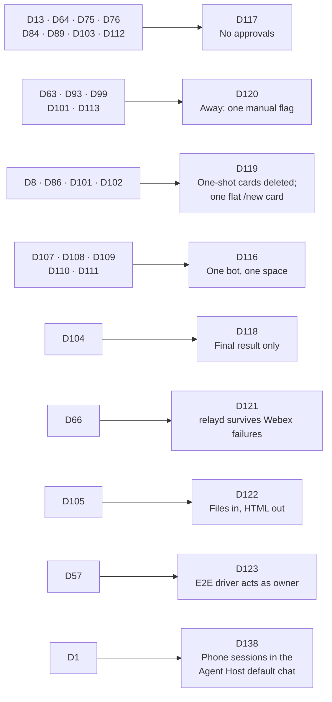

# Deviations

Every departure from [PLAN.md](PLAN.md): what the plan said, what was built, why, and where. Where this file and
the plan differ, this file wins. Spike evidence: [spikes.md](spikes.md).

- Entries are sorted by number; numbers are permanent (code and tests cite them).
- A `> Superseded by …` line marks an entry, or part of one, that a later entry replaced. The rest still holds.
- Entry shape: **Plan** (what the plan said; "addition" if it said nothing), **Built**, **Why**, **Where**.

## What the November round replaced

The big reversals (D116–D123) and the older entries they replace:

## By area

| Area | Entries |
|---|---|
| Core | D30, D59, D75, D76, D92, D93, D95, D98, D103, D106, D112, D113, D117, D120, D125 |
| Webex | D3, D8, D9, D10, D62, D65, D66, D86, D87, D88, D89, D94, D99, D100, D101, D102, D104, D105, D107, D108, D109, D110, D111, D114, D116, D118, D119, D121, D122, D127, D128, D143 |
| PWA | D51, D91 |
| AHP (VS Code Copilot) | D1, D2, D5, D15, D16, D17, D18, D19, D67, D80, D115, D138 |
| VS Code Local / relay-bridge | D6, D20, D21, D22, D23, D24, D70, D84, D85, D132 |
| OpenCode | D11, D12, D69, D81, D130, D144 |
| Cursor CLI | D25, D26, D27, D28, D29, D68, D82, D131 |
| Cursor CDP | D7, D31, D32, D33, D34, D35, D83, D133, D134 |
| Hooks and parking | D4, D13, D61, D63, D64, D77, D124, D129, D135, D137, D139, D140, D141, D142 |
| Skills and bundles | D37, D38, D39, D40, D41, D97 |
| MCP and config sync | D42, D43, D44, D45, D46, D47, D145 |
| Doctor and updates | D48, D49, D50 |
| Ops and install | D14, D52, D53, D54, D55, D56, D60, D71, D72, D74, D126 |
| Security | D58, D73, D78, D79, D90, D96, D145 |
| Testing | D36, D57, D123, D136 |

## Entries

### D1 · AHP chat URI and turn start

- **Plan:** AHP chat URIs `ahp-chat:/<uuid>`; `createChat.initialMessage` starts the turn.
- **Built:**
  - Chat URI is `ahp-chat://<chat-id>/<base64url(session URI)>`.
  - Turns start with a dispatched `chat/turnStarted` action.
  - Changed in D138: the turn goes to the session's default chat, not a second chat.
- **Why:** The editor host rejects the planned URI and does not run `initialMessage` (S1).
- **Where:** `adapters/ahp/`

### D2 · AHP sessions use folder isolation

- **Plan:** AHP sessions use the default isolation.
- **Built:** `config: {isolation: "folder"}` unless the user asks for isolation.
- **Why:** The default (`worktree`) created a branch in the user's repo during S1.
- **Where:** `adapters/ahp/`

### D3 · Vendored async Webex websocket client

- **Plan:** Use `webex_bot` if it works on 3.13.
- **Built:** Vendored async port of its websocket client (MIT notice kept).
- **Why:** It imports, but blocks its own loop and sends across loops (S8).
- **Where:** `frontends/webex/ws_client.py`

### D4 · Sliced parking instead of one long hook

- **Plan:** One long-blocking stop hook for the whole park deadline.
- **Built:** Sliced parking:
  - Each hook call blocks at most `park.slice_s` (25 min).
  - It then re-arms with "parking renewed" until `park.deadline_s`.
- **Why:** S2 could not be measured before G1; slices stay safely under any hook timeout.
- **Where:** `core/parking.py`

### D5 · Wake main sessions with `chat/turnStarted`

- **Plan:** Wake idle sessions with `agent_idle`.
- **Built:** Main sessions are woken with an AHP `chat/turnStarted`.
- **Why:** `agent_idle` fires only for background agents (S3).
- **Where:** `adapters/ahp/`, `core/parking.py`

### D6 · Local cold start opens workspace first

- **Plan:** Cold-start Local into a closed workspace directly.
- **Built:** Open the workspace first and wait for `relay-bridge` to register.
- **Why:** No direct command exists (S5 fallback).
- **Where:** `adapters/vscode_local/`

### D7 · Cursor CDP ships disabled

- **Plan:** Cursor CDP adapter verified live.
- **Built:** Ships disabled; enabling it is a config change after the live self-test.
- **Why:** S6 confirmed the fuses allow a debug port, but a live connect was not attempted.
- **Where:** `adapters/cursor_cdp/`

### D8 · Card outcome edits text, not body

> Superseded by D119: a finished one-shot card is deleted, not edited.

- **Plan:** "A card is edited once with its outcome".
- **Built:**
  - The card message's text is edited once with the outcome; the card body stays (Webex `PUT /messages` cannot change attachments).
  - Later clicks get "already answered": the first answer wins in the registry.
  - Changed in D86: every card also carries a one-use nonce, claimed only after its action succeeds, and each submit is re-checked on the server.
  - The card body is still not edited after a submit (open live check).
- **Why:** Webex API limitation.
- **Where:** `frontends/webex/renderer.py`, `core/service.py`

### D9 · Session root is an editable status line

- **Plan:** Session root is "the session card".
- **Built:** The root is an editable markdown status line (`app · workspace · model · status`).
- **Why:** Only text can be edited, and the root needs its 8-edit budget.
- **Where:** `frontends/webex/cards.py`

### D10 · Webex device cleanup by name

- **Plan:** Device cleanup unspecified.
- **Built:** Devices are registered as `agent-relay-relayd`; on start, every older device with that name is deleted.
- **Why:** Avoids touching registrations that other clients of the same bot token made.
- **Where:** `frontends/webex/ws_client.py`

### D11 · OpenCode never parks

- **Plan:** The OpenCode plugin forwards `session.idle`, which is used for parking.
- **Built:**
  - OpenCode never parks.
  - The adapter reads turn ends from each server's `/global/event` stream.
  - An idle session is woken with `prompt_async`.
- **Why:** The server accepts a prompt at any time, so holding a hook open would only add a timeout to lose.
- **Where:** `adapters/opencode/`

### D12 · One key per OpenCode server

- **Plan:** The plugin registers "its server" with `relayd`.
- **Built:**
  - Each registered server is its own key (`opencode.server:<url>`); the adapter follows every one.
  - A server that stops answering is forgotten.
- **Why:** One TUI can run beside the managed server; a single key would lose one of them.
- **Where:** `core/hooks.py`, `adapters/opencode/adapter.py`

### D13 · Phone sessions always reach the phone

> Partly superseded: the approvals part by D117; the away part by D120.

- **Plan:** Away mode decides what reaches the phone.
- **Built:**
  - Sessions started from the phone always reach it (approvals included), even with away mode off.
  - Desk sessions still need away mode.
  - Changed in D112: a phone chat the desk can also see is handed to the desk by away off or `/back`.
- **Why:** A phone session has nobody at the desk to approve its tools.
- **Where:** `core/hooks.py`, `adapters/opencode/adapter.py`

### D14 · OpenCode launcher reads Keychain

- **Plan:** The launchd agent runs `opencode serve` with the password from Keychain.
- **Built:** The agent runs `python -m agent_relay.ops.launchers opencode`, which reads Keychain and execs `opencode serve` on loopback.
- **Why:** A plist cannot read Keychain, and a password must never sit in a plist.
- **Where:** `ops/launchers.py`, `ops/launchd.py`

### D15 · AHP models for a selected subset

- **Plan:** Generate Pydantic models from the published AHP schemas.
- **Built:**
  - `adapters/ahp/codegen.py` generates models only for the definitions the adapter uses (`SELECTED`).
  - Source: the committed 0.10.0 schemas (AHP commit `6eec1b91`, the one VS Code 1.141 vendors in `.ahp-version`). 0.10.0 has no release tag; the host rejects 0.9.0 clients with "accepts ^0.10.0".
  - Everything else becomes `JsonValue`.
  - Integer enums become `int`, because AHP uses them as bitsets.
  - Models keep unknown fields.
  - `tests/adapters/test_ahp_schema.py` fails when `models.py` is stale.
- **Why:** Full models for about 1,600 definitions would be a 2 MB module, mostly unused. A new server field or part kind must not break parsing.
- **Where:** `adapters/ahp/codegen.py`, `adapters/ahp/models.py`

### D16 · AHP root via initial subscriptions

- **Plan:** Flow step 1: `subscribe ahp-root://` for agents, models and sessions.
- **Built:**
  - The root goes in `initialize.initialSubscriptions`; its snapshot gives agents and models.
  - Sessions come from `listSessions`, refreshed on `root/activeSessionsChanged`.
- **Why:** The root snapshot has no session list (S1 trace).
- **Where:** `adapters/ahp/adapter.py`

### D17 · Hooked Copilot sessions: AHP sends text only

- **Plan:** The AHP adapter maps tool calls and turn ends for every Copilot session.
- **Built:**
  - A session the hooks also report (`hooked`) gets only reply text from AHP.
  - Tool events, the final answer and parking stay with the hooks.
  - AHP asks for an approval only when the host itself waits for confirmation, and reuses an earlier phone decision for the same call id.
- **Why:** Both paths see the same session; mapping both would send everything twice and fight over parking.
- **Where:** `adapters/ahp/adapter.py`, `core/hooks.py`

### D18 · Hook-to-AHP session id match

- **Plan:** The relay refines Copilot CLI hook sessions into VS Code Copilot sessions.
- **Built:**
  - The adapter matches the hook's `session_id` to the AHP session id and switches the record's harness.
  - **Disproved live (C15):** the ids differ, so a phone-started session is linked by a workspace claim instead (D67).
  - The id match stays for any session where they do agree.
- **Why:** Hook payloads and the trace both use UUID session ids, but no run showed both for the same session.
- **Where:** `adapters/ahp/adapter.py`

### D19 · AHP adopts only running desk sessions

- **Plan:** Desk sessions reach the phone while away mode is on.
- **Built:** AHP adopts a desk session only if it is in progress (`status & 8`) and away mode is on for its workspace.
- **Why:** Adopting every stored session would flood the phone with old chats.
- **Where:** `adapters/ahp/adapter.py`

### D20 · Local session id from a workspace claim

- **Plan:** The Local adapter starts a session and knows its id.
- **Built:**
  - The adapter stores the session as `unclaimed-<uuid>` and records a workspace claim (`local_claim:<workspace>`, 120 s).
  - The first PascalCase Copilot hook from that workspace with no matching session takes the claim atomically (`kv_pop`); its id becomes the session's `harness_id`.
  - A prompt renews the claim until a hook links the chat.
  - Changed in D85: follow-up prompts go only to the window the chat was opened in.
- **Why:**
  - `workbench.action.chat.open` returns no chat or session id, so the hooks are the only source of the id.
  - Known gap: a desk chat started in the same workspace within the window could take the claim. The claim is single-use, so the phone chat then shows up as a separate session.
- **Where:** `core/claims.py`, `core/hooks.py`, `adapters/vscode_local/adapter.py`

### D21 · Bridge acts on the active chat only

- **Plan:** The bridge prompts, steers and cancels a given Local chat.
- **Built:**
  - The bridge acts on the window's **active** chat view.
  - Only chats the phone opened are prompted, woken or cancelled through it.
  - A desk Local chat keeps the queue path (delivered at its next tool call or stop).
  - A running chat is never prompted directly: the core queues the text as steering (since D98, as the session's queue mode says).
  - Changed in D84: the bridge no longer answers approvals; they stay on the hook path.
- **Why:** The chat commands have no chat-id argument; sending to a desk chat would land in whichever chat has focus.
- **Where:** `adapters/vscode_local/adapter.py`

### D22 · `preserveInput` keeps desk drafts

- **Plan:** `preserveInput` is used for steering.
- **Built:**
  - `preserveInput: true` is passed on every phone prompt into an existing chat, so a half-typed desk draft survives.
  - Steering itself goes through the hook queue (D21).
- **Why:** The command offers no mid-turn injection.
- **Where:** `extensions/relay-bridge/src/bridge.ts`

### D23 · `code chat` only for cold starts

- **Plan:** Fallback `code chat -m agent -r "<prompt>"`.
- **Built:**
  - Used only to cold-start a chat when no bridge window is connected.
  - Changed in D85: follow-up prompts no longer fall back to it; with the chat's own window gone they fail with "The VS Code window for this chat is closed".
  - It cannot pick a model, so the model is logged as ignored.
  - A prompt that starts with `-` gets a leading space so the CLI does not read it as an option.
- **Why:** Keeps phone chats usable without the extension.
- **Where:** `adapters/vscode_local/adapter.py`

### D24 · VSIX built without `vsce`

- **Plan:** Package the extension as a VSIX.
- **Built:**
  - `ops/vsix.py` writes the VSIX (manifest, content types, `package.json`, compiled `out/src`) with fixed timestamps; no `vsce`.
  - The extension compiles to CommonJS and declares `extensionKind: ["ui"]`.
- **Why:** Avoids a publisher toolchain for a private extension. `ui` keeps it on the Mac in remote windows, next to `relay.sock`.
- **Where:** `ops/vsix.py`, `extensions/relay-bridge/`

### D25 · Cursor hooks passive for ACP sessions

- **Plan:** Cursor hooks and ACP both report a phone-started Cursor CLI session.
- **Built:**
  - Hooks whose `conversation_id` matches a `cursor_cli` session are answered with `{}` (passive). ACP alone streams text, asks for approvals and ends turns.
  - If the ids differed, the hook side would register a separate desk-style Cursor session, which only shows up with away mode on.
  - **Observed live (C15):** the Cursor CLI smoke ran in `.scratch` with away mode on and produced one `cursor_cli` session, no `cursor` hook session and a single approval card.
  - Not confirmed: whether `cursor-agent acp` fires hooks at all is not logged, so the passive path itself is unverified.
- **Why:** The adapter already holds the permission request open over ACP; answering the same call twice would race.
- **Where:** `core/hooks.py`, `adapters/cursor_cli/adapter.py`

### D26 · Cursor CLI steering is queued

- **Plan:** Steering a running Cursor CLI turn.
- **Built:** ACP has no mid-turn input, so text sent while a turn runs is queued by the core and sent as the next `session/prompt` when the turn ends.
- **Why:** `session/prompt` is one call per turn; a second call while one is open is rejected.
- **Where:** `adapters/cursor_cli/adapter.py`

### D27 · Cursor CLI resume via `session/load`

- **Plan:** Resume a Cursor CLI session after `relayd` restarts or the CLI crashes.
- **Built:**
  - The record keeps the ACP session id (`extra.resume`).
  - The next prompt respawns `cursor-agent acp` and calls `session/load`.
  - A CLI without `loadSession` gets a clear error and the hint to `agent resume <id>` at the desk.
  - Changed in D82: an idle CLI process is also reaped after `cursor_cli.idle_s` and respawned the same way on the next prompt.
- **Why:** Keeps sessions alive across crashes without holding state in memory.
- **Where:** `adapters/cursor_cli/adapter.py`

### D28 · Cursor CLI model switch with fallback

- **Plan:** Model switch for a Cursor CLI session.
- **Built:**
  - `session/set_model` when the CLI accepts it.
  - Otherwise the process is marked stale; the next turn respawns with `--model` and `session/load`.
- **Why:** `set_model` is not in every ACP build.
- **Where:** `adapters/cursor_cli/adapter.py`

### D29 · Stop closes pending Cursor approvals

- **Plan:** Pending Cursor approvals on stop.
- **Built:** A phone stop cancels the turn, closes open approval and question cards as "answered elsewhere", and sends `cancelled` outcomes to the CLI.
- **Why:** ACP requires every open request to be answered after `session/cancel`.
- **Where:** `adapters/cursor_cli/adapter.py`

### D30 · `service.start` keeps adapter's phone record

- **Plan:** `service.start` copies the adapter's record.
- **Built:** If the adapter already stored the session as phone-origin, the core keeps that record instead of overwriting it.
- **Why:** A fast turn's `IDLE` status was being overwritten with `RUNNING`.
- **Where:** `core/service.py`

### D31 · CDP uses DOM click, not Playwright

- **Plan:** The CDP adapter clicks through Playwright.
- **Built:** Buttons get a DOM `click()` and the composer a DOM `focus()` before `Input.insertText`.
- **Why:** Playwright's pointer click waits for a rendered frame, which never comes while the Cursor window is hidden, occluded or the screen is locked.
- **Where:** `adapters/cursor_cdp/driver.py`

### D32 · CDP drives only the latest phone chat

- **Plan:** The CDP adapter drives any phone-started composer chat.
- **Built:**
  - Only the most recent phone chat (`cursor_cdp.active`) is driven, one turn at a time.
  - Older chats get "continue this one at the desk".
  - A second start while a turn runs is refused as busy.
  - Steering is queued and sent when the turn ends.
- **Why:** The composer is one shared surface without chat ids; typing into it for an older chat would land in whichever chat is open.
- **Where:** `adapters/cursor_cdp/adapter.py`

### D33 · Debug port only on a closed Cursor

- **Plan:** `relay` launches Cursor with the debug port.
- **Built:**
  - Cursor is started with `--remote-debugging-port=<port> --remote-debugging-address=127.0.0.1` only when it is closed.
  - A Cursor already running without the port is never restarted; the phone and `doctor` are told to quit it once.
- **Why:** Restarting would throw away the user's open desk session.
- **Where:** `adapters/cursor_cdp/connect.py`

### D34 · Document-wide MutationObserver for replies

- **Plan:** "Tokens come from a MutationObserver" on the reply.
- **Built:**
  - The observer watches the whole document (debounced 50 ms) and reports the last assistant message plus whether the stop button exists.
  - The turn ends when the stop button disappears.
  - A rewritten reply sends no repeated text; the final card carries the full text.
- **Why:** Cursor re-renders the message list; watching one node would miss replaced subtrees.
- **Where:** `adapters/cursor_cdp/driver.py`

### D35 · CDP selectors fixed live, version-gated

- **Plan:** Selectors verified against the running Cursor.
- **Built:**
  - `selectors.json` first held best-effort selectors that were wrong for Cursor 3.23.12: the first live self-test (C15) found `send`, `new_chat` and `model_picker` missing.
  - Version 2, rewritten from a read-only look at the live DOM: `.send-with-mode` for send and stop, the header "New Agent" link, the button around `.vscode-model-picker__trigger-text`. The self-test then passed.
  - First real phone prompt found a second fault: Cursor swaps the chat a moment after "New Agent" is clicked, so the baseline taken at once still counted the old chat's replies and the new reply came back empty. `new_chat` now waits until no assistant message is left on the page.
  - The idle send slot shows a microphone icon, not a send arrow, so `send` matches the button container, not an icon.
  - The model menu was then opened read-only: `/models cursor-ide` failed because `model_option` was a guess. Version 3 uses `li[data-testid^='model-item-']`, which finds the nine real models and leaves out the menu's "Add Models" row.
  - The adapter refuses to run until `relay selftest cursor-cdp` passes for the exact Cursor version (read from `Cursor/<v>` in `/json/version`) and selector-file version. C15 runs it (AC-24).
- **Why:** Keeps a wrong selector from typing into the wrong place.
- **Where:** `adapters/cursor_cdp/selectors.json`, `adapters/cursor_cdp/selftest.py`

### D36 · AC-23 fixture runs in real Chromium

- **Plan:** AC-23 runs against a saved DOM fixture.
- **Built:**
  - The fixture is loaded in a real headless Chromium started with a debug port; the adapter attaches over CDP exactly as it does to Cursor.
  - Binary: `RELAY_TEST_CHROMIUM`, else the newest cached Playwright Chromium, else Google Chrome.
  - `playwright install` is not run.
- **Why:** Exercises the real CDP path; installing browsers would write outside the repo.
- **Where:** `tests/adapters/cdp_rig.py`, `tests/fixtures/cursor_cdp/`

### D37 · `/away` and `/back` as command files

- **Plan:** `agent-relay-away` is user-invocable as `/away` and `/back`.
- **Built:**
  - One skill plus two command files, `away.md` and `back.md`, shipped in every bundle.
  - OpenCode's copies keep only `description` in the frontmatter.
  - Changed in D97: bundles also carry `agent-relay-recall`.
- **Why:** A skill has one name, so it cannot be two slash commands; commands are what Copilot CLI, Cursor and OpenCode expose as `/name`.
- **Where:** `skills/agent-relay-away/`, `agent_relay/ops/bundles.py`

### D38 · Cursor bundle is a local plugin

- **Plan:** Cursor bundle loaded through `pluginPaths`.
- **Built:**
  - A Cursor plugin (`.cursor-plugin/plugin.json` plus `skills/`, `commands/`, `hooks/hooks.json`, `mcp.json`) for `~/.cursor/plugins/local/agent-relay`.
  - Changed in D97: its `skills/` holds every skill under the repo's `skills/`.
- **Why:** Cursor's plugin reference documents that layout and folder; it documents no `pluginPaths` setting.
- **Where:** `agent_relay/ops/bundles.py`

### D39 · Bundles are self-sufficient, built per Mac

- **Plan:** Bundles carry `relay-hook` and the skill.
- **Built:**
  - They also carry `relay-mcp` and the `/away` and `/back` commands.
  - Changed in D97: and every skill under `skills/`, which `relay install` also links one by one into `~/.agents/skills`.
  - Hook and MCP commands use this checkout's interpreter, so a bundle is built per Mac (`dist/plugins/<harness>/agent-relay`).
  - `relay install` still writes hooks, skills and MCP config directly; bundles are the alternative for people who prefer the harness's plugin manager.
- **Why:** Bundles are only useful if a bundle alone makes a harness relay-ready. The relay never installs both.
- **Where:** `agent_relay/ops/bundles.py`

### D40 · Bundles: schema check plus loader dry run

- **Plan:** AC-33: "validates with the vendor's documented schema or loader dry run".
- **Built:** Both.
  - Vendors publish no JSON Schema for these files, so `tests/fixtures/schemas/` holds schemas transcribed from the docs (each cites its URL), closed so a typo fails.
  - The live suite installs the Copilot bundle with the real CLI and loads the OpenCode overlay with `opencode debug config` / `debug skill`, both under temporary `HOME`, `COPILOT_HOME` and `XDG_*`.
  - Cursor has no offline loader, so its bundle is schema-checked only.
- **Why:** The Copilot CLI accepts manifests its docs forbid (it installed one with no name), so a dry run alone proves too little.
- **Where:** `tests/ops/test_bundles.py`, `tests/live/test_bundle_loaders_live.py`

### D41 · `stepping-away` patched by whole-file hash

- **Plan:** `stepping-away` patched at G1, with a backup.
- **Built:**
  - The patch is the whole new `SKILL.md` in `patches/stepping-away/`, plus the sha256 of the file it replaces.
  - `relay install` applies it only when the installed file matches that hash (backup and manifest via `fileops`).
  - A skill edited since is reported and left alone.
  - `reference/away-mode.md` is kept; its Webex-posting notes are marked superseded in the new `SKILL.md` instead of editing the reference file.
  - Changed in D97: install links every relay skill into `~/.agents/skills`; `stepping-away` is still only patched, never linked.
- **Why:** A line diff would apply to a drifted skill and could garble it; replacing only a known file is safe and byte-exact to undo.
- **Where:** `patches/stepping-away/`, `agent_relay/ops/stepping_away.py`

### D42 · `ask_phone` returns outcome and reason

- **Plan:** `ask_phone` returns the answer, `timeout` or `denied`.
- **Built:**
  - Returns `{outcome, answer, reason}`; `outcome` is one of `answered`, `timeout`, `denied`.
  - `denied` covers: away mode off for a desk session, no relay session for the workspace, the relay paused, and a skipped question (`reason: "skipped (<by>)"`).
  - Workspace: `RELAY_WORKSPACE`, else the server's working directory, matched to the deepest live session containing it (busy sessions first).
  - While it waits, it sends MCP progress every 20 s.
- **Why:** The agent needs to know *why* it got no answer to pick the safe path. Progress keeps harness-side MCP timeouts from firing during a 15-minute wait.
- **Where:** `agent_relay/mcp/server.py`, `agent_relay/core/phone.py`, `agent_relay/daemon.py`

### D43 · Imported literal secrets move to Keychain

- **Plan:** `relay config import`: "secret values are left as env references".
- **Built:**
  - Existing env references stay references, translated per harness: `${env:X}`, `${X}`, `{env:X}`.
  - Today's files also hold **literal** secrets (a token in an `env` block, a bearer header, an OAuth client secret). Import moves each to the Keychain (service `agent-relay-mcp`, account `<server>.<location>`) and writes a `${keychain:…}` reference, so `mcp.yaml` holds no secret.
  - `sync` puts the literal back into each native file, because no harness can read the Keychain.
  - Diffs and output hide every revealed value.
  - A secret is a value under a secret-like key, or any value the scrubber would redact.
  - `import` without `--apply` stores nothing.
- **Why:** An env reference would need the secret exported in every shell and launch agent, which breaks GUI-launched apps. The Keychain is already where the relay keeps its own secrets.
- **Where:** `agent_relay/sync/secrets.py`, `agent_relay/sync/formats/`

### D44 · Conflicting servers kept as per-harness variants

- **Plan:** "Name conflicts are flagged, never dropped".
- **Built:**
  - A server whose command/URL/args/env/headers differ between harnesses keeps the first definition in harness order (VS Code, Copilot, Cursor, OpenCode).
  - Each other harness's definition is stored as a per-harness `variants` entry; `sync` renders each harness its own.
  - Import notes every conflict.
  - Harness-only fields (`inputs` ids, Copilot `tools`, Cursor `auth`/`envFile`, OpenCode `timeout`) ride along as per-harness `extras`; a matching core merges them.
- **Why:** Renaming a server would break prompts and allowlists that name it; keeping variants loses nothing and shows the conflict.
- **Where:** `agent_relay/sync/model.py`, `agent_relay/sync/catalog.py`

### D45 · Harness-specific references pin a server

- **Plan:** Every server rendered into every harness.
- **Built:**
  - A server whose values use a reference only one harness resolves (VS Code `${input:…}`, OpenCode `{file:…}`) is pinned to that harness and skipped elsewhere, with a note.
  - `sync` refuses to run when `mcp.yaml` is missing, since an empty catalog would empty every harness's list.
- **Why:** Rendering `${input:x}` into Cursor would start a server with that unresolved literal as its value.
- **Where:** `agent_relay/sync/model.py`, `agent_relay/sync/plan.py`

### D46 · Native files written as strict JSON

- **Plan:** Renderers produce valid JSON / JSONC.
- **Built:**
  - Every native file is written as strict JSON (valid JSONC too).
  - Comments and trailing commas in VS Code's `mcp.json` or `opencode.jsonc` are dropped on rewrite.
  - The first write backs the original up through `fileops`; `relay uninstall` restores it.
- **Why:** A comment-preserving JSONC writer would be a parser of its own for a cosmetic gain.
- **Where:** `agent_relay/sync/jsonc.py`

### D47 · Cursor desktop allowlist synced to CLI

- **Plan:** (addition, not in the plan) Cursor CLI permissions.
- **Built:**
  - `config sync` reads Cursor desktop's allowlist read-only from `state.vscdb` (`yoloCommandAllowlist`/`Denylist`, `webFetchDomainAllowlist`, `mcpAllowedTools`).
  - It renders them into `~/.cursor/cli-config.json` as `Shell(base:args*)`, `WebFetch(domain)` and `Mcp(server:tool)` tokens.
  - Tokens rendered last time are tracked in `cursor-cli-permissions.json`: a removal in the desktop is removed from the CLI, and hand-added tokens are kept.
  - Missing or unreadable files are skipped with a note.
- **Why:** One allowlist across desktop and CLI is what "configure once" means for Cursor; a blind overwrite would lose hand-added CLI rules.
- **Where:** `agent_relay/sync/cursor_permissions.py`

### D48 · Cursor CLI skew by build date

- **Plan:** "CLI skew" in `relay doctor`.
- **Built:**
  - Skew = the Cursor CLI's build date (from `cursor-agent --version`, `YYYY.MM.DD-…`) lags the desktop app's last update (the `Info.plist` modification time) by more than 14 days.
  - Fix: `cursor-agent update`, which the weekly launch agent runs.
  - Other CLIs report their version only.
- **Why:** Cursor's CLI and desktop version independently; the date is the only comparable field.
- **Where:** `agent_relay/doctor/local.py`

### D49 · Doctor split into local and relayd halves

- **Plan:** Doctor as one command.
- **Built:**

  | Half | Checks | Runs in |
  |---|---|---|
  | Local | versions, hooks, MCP and skills drift, Keychain, launchd | the CLI |
  | relayd | adapter health, the CDP gate, the Webex link, away mode | relayd, over a new `doctor` IPC op |

  - Without relayd, the CLI reports it as failing and still runs every local check.
  - `/doctor` runs both halves inside relayd.
  - Exit code 1 when any check fails.
- **Why:** Only relayd holds the live adapters and the websocket; a doctor that needs the daemon could not diagnose a dead daemon.
- **Where:** `agent_relay/doctor/`, `agent_relay/daemon.py`, `agent_relay/cli/doctor.py`

### D50 · Update handling and degraded adapters

- **Plan:** Update handling: re-run the self-test on a version change.
- **Built:**
  - The first sighting of an app only records its version (no baseline to compare).
  - An inconclusive self-test (app not running) does not record the new version, so the next 10-minute check retries.
  - A degraded adapter is retried every check and posts when it recovers.
  - Degraded means: no new sessions, model listing or model changes; `/stop` still works; a prompt to a running session is queued as steering instead of sent.
  - The Cursor CDP background self-test only attaches to a Cursor already listening on its debug port; it never launches Cursor.
- **Why:** Posting "VS Code updated" on every relayd start would be noise; blocking `/stop` on a degraded adapter would strand a running agent.
- **Where:** `agent_relay/core/updates.py`, `agent_relay/adapters/selftests.py`, `agent_relay/core/service.py`

### D51 · PWA auth, stream and shared handlers

- **Plan:** PWA: "SSE for raw tokens", "a bearer token from Keychain", "the same command set as Webex".
- **Built:**
  - Stream: SSE read with `fetch`, not `EventSource` (`EventSource` cannot send an `Authorization` header, and a token in the URL would reach logs and history).
  - The page and its assets are served without a token (they hold no data); every `/api` route sits behind one router-level bearer check (constant-time compare).
  - The token lives in `sessionStorage`, not `localStorage`.
  - The PWA runs the Webex `Handlers` unchanged against a hub that implements the same surface; card submissions share one function with Webex, so commands and wizard steps cannot drift.
  - It adds to Webex rather than replacing it: relayd still needs the bot token.
  - Approval and question prompts are drawn from the raw events; attachments (diffs) arrive as scrubbed text.
  - A missing token with `pwa.enabled = true` stops relayd at start (exit 2).
  - The bind address is a constant, not configuration.
- **Why:** A token in a URL leaks; a second command implementation would drift from Webex; a configurable host is one typo from listening on the LAN.
- **Where:** `agent_relay/frontends/pwa/`, `agent_relay/frontends/actions.py`, `agent_relay/frontends/surface.py`

### D52 · Uninstall restores, cleans backups, keeps state

- **Plan:** `relay uninstall` "restores every touched file from backup".
- **Built:**
  - Restores every file in the manifest. Changed in D72: only a file unchanged since the relay's last write; a changed one is unmerged, or left with its backup path reported.
  - Moves deduped skill folders back, boots out the launch agents and uninstalls relay-bridge.
  - Then deletes the backups it restored from, prunes empty backup folders and removes the manifest.
  - Relay state stays: `relay.toml`, `workspaces.toml`, the session database, logs and Keychain items. The final message says so.
- **Why:** A kept backup tree would make the next install back up the backup. Deleting the user's history and settings on uninstall would surprise them; Keychain items can be removed with Keychain Access if wanted.
- **Where:** `agent_relay/ops/install.py`, `agent_relay/cli/install.py`

### D53 · Launch agents installed only when useful

- **Plan:** `relay install` writes every launch agent.
- **Built:**
  - relayd is always installed.
  - The OpenCode server agent only while `adapters.opencode` is on.
  - The weekly `cursor-agent update` agent only when `cursor-agent` is present.
  - Each skip is a note in the plan.
  - Bootstrap is preceded by a bootout so a re-install reloads a changed plist. Changed in D74: only an agent whose plist changed is booted out and reloaded.
- **Why:** A launch agent for an unused app fails every start and fills the launchd log.
- **Where:** `agent_relay/ops/install.py`

### D54 · relay-bridge VSIX install and uninstall

- **Plan:** relay-bridge installed by `relay install`.
- **Built:**
  - The VSIX is built into a temporary folder, written to `app_support/relay-bridge.vsix` through `fileops`, and installed with `code --install-extension <vsix> --force`.
  - Skipped with a note when the extension has not been compiled (`npm run build`) or the `code` CLI is missing.
  - Uninstall runs `code --uninstall-extension agent-relay.relay-bridge` only if the VSIX is in the manifest.
- **Why:** The manifest can only undo files, so the VSIX itself is the tracked artefact; a missing toolchain must not block the rest of the install.
- **Where:** `agent_relay/ops/install.py`, `agent_relay/ops/vsix.py`

### D55 · `relay start` / `stop` go through launchd

- **Plan:** `relay start` / `relay stop`.
- **Built:**
  - `start` bootstraps the relayd agent if it is not loaded, then `kickstart -k`.
  - `stop` boots the agent out (relayd gets `SIGTERM` and drains), because the agent is `KeepAlive` and launchd would restart a killed relayd within seconds.
  - `stop` then waits (up to 10 s) until `launchctl print` no longer finds the service: the bootout returns first, and a `start` straight after it skipped the bootstrap and failed in `kickstart` (error 37, seen live).
  - `relay install --apply` waits the same way between each agent's bootout and bootstrap. Without the wait it failed with error 5 and left relayd and the OpenCode server unloaded (seen live); the plist stays, so it starts again at the next login.
  - Without the plist, `start` says to run `relay install --apply` (or `python -m agent_relay.daemon` in a terminal).
  - Changed in D74: `start` and `stop` also cover the OpenCode server agent, but not the weekly `cursor-agent update` agent.
- **Why:** A second relayd started outside launchd would fight the agent for the socket and the Webex websocket.
- **Where:** `agent_relay/cli/daemon.py`

### D56 · `relay config set` parses JSON

- **Plan:** `relay config set <key> <value>`.
- **Built:**
  - The value is parsed as JSON (`true`, `30`, `["*.md"]`), falling back to a plain string.
  - The key is `section.setting`.
  - An unknown key, or a value the config model rejects, leaves `relay.toml` unchanged.
- **Why:** One parser covers booleans, numbers and lists without per-key flags.
- **Where:** `agent_relay/cli/config.py`

### D57 · Live smoke test script (C15)

> Superseded by D123: `scripts/smoke_live.py` and `ops/smoke.py` are gone.

- **Plan:** (addition, not in the plan) The live smoke test, C15.
- **Built:**
  - `scripts/smoke_live.py` (needs `RELAY_LIVE=1` and a running relayd) walks each app through register, stream, approve, park, reply and back in the `scratch` workspace.
  - relayd's state is checked through a new read-only `sessions` IPC op; what only the phone shows (text streaming, the approval card, the reply landing) is confirmed by the person at the phone.
  - Prompt, one per app: "Run the shell command `echo relay-smoke`, then reply with exactly: OK", so there is a tool call to approve; the plan's bare "Reply with exactly: OK" has none.
  - `--record` appends the result table to `docs/operations.md`.
  - The `back` step counts an ended session as released, since the `sessions` op leaves ended sessions out.
  - OpenCode (D11) and the Cursor CLI (driven over ACP) never park, so for them `park`, `reply` and `back` become `idle` (the turn ends idle) and `reply` (the thread reply wakes the idle agent).
- **Why:** The phone side cannot be observed from the Mac; an approval step needs a tool call.
- **Where:** `agent_relay/ops/smoke.py`, `scripts/smoke_live.py`, `agent_relay/daemon.py`

### D58 · Gaps closed while mapping §5.10

> Partly superseded by D117: the "Allow for session" and allowlist-pattern parts.

- **Plan:** (addition, not in the plan) Gaps closed while mapping §5.10.
- **Built:**
  - IPC `away off` now releases sessions parked in that workspace, as `/away off` from the phone already did.
  - The paused message pointed at a `/resume` command that never existed; it now says `/away on`.
  - "Allow for session" grants are deleted when the session ends and ignored for an ended session.
  - Webex attachments are scrubbed (text only; binary is refused).
  - `debug_bodies` now does what the plan says: scrubbed, truncated bodies at DEBUG only.
  - An approval allowlist pattern with fewer than two literal characters (`*`, `?*`) is rejected as a global auto-approve.
- **Why:** Each was a control the plan states that the code did not yet enforce.
- **Where:** `agent_relay/core/service.py`, `agent_relay/core/phone.py`, `agent_relay/core/registry.py`, `agent_relay/core/approvals.py`, `agent_relay/frontends/webex/api.py`, `agent_relay/log.py`, `agent_relay/models/config.py`

### D59 · relayd logging and "Mac online" post

> Partly superseded by D118: the "Mac online" post (nothing is posted at start).

- **Plan:** (addition, not in the plan) relayd logs and the "Mac online" post.
- **Built:**
  - Under launchd, relayd logs to its rotating file only; the console handler is added only when stderr is a terminal, since launchd's `relayd.err.log` is never rotated.
  - Once ready, relayd posts "Mac online" to the bot room with the sessions it recovered and, if `/panic` left the pause flag, how to resume.
- **Why:** An unrotated stderr copy grows without bound; after a reboot the phone otherwise cannot tell the Mac is back.
- **Where:** `agent_relay/daemon.py`

### D60 · `relay ws`, `relay away`, `relay status`

- **Plan:** (addition, not in the plan) `relay ws`, `relay away`, `relay status`.
- **Built:**
  - `ws add/rm/list` edit `workspaces.toml` (a name must be new, a path must be a folder).
  - `away on/off [--workspace]` and `status [--json]` talk to relayd over IPC and fail with "start it with `relay start`" when it is not running.
  - Changed in D94: a name must match `[A-Za-z0-9._-]{1,40}`, here and on the phone.
  - D95 adds `.code-workspace` files made from the phone.
- **Why:** The plan uses `relay away on|off --workspace` (§5.6) and workspaces in `/new`, but defines no CLI to manage them.
- **Where:** `agent_relay/cli/workspaces.py`, `agent_relay/cli/daemon.py`

### D61 · Cursor hook always prints valid JSON

- **Plan:** AC-25: with away mode off or relayd down, `relay-hook` "exits 0 with no output".
- **Built:**

  | Harness | Output when relayd is down, has no opinion, or the payload is unreadable |
  |---|---|
  | Copilot, OpenCode | exit 0, no output (as planned) |
  | Cursor, `preToolUse` / `beforeShellExecution` / `beforeMCPExecution` | `{"permission": "allow"}` |
  | Cursor, every other event | `{}` |

  - Found at G1: the first real install blocked every tool call in Cursor. Those three events are `failClosed` (AC-30); Cursor treats a fail-closed hook with no output as a failure, and blocks any permission hook on missing or invalid JSON.
  - `tests/hook/test_relay_hook.py` now runs the exact command line the installer writes, for every Cursor event, with relayd down.
  - Changed in D81: the OpenCode plugin denies when its socket drops after connecting (mid-approval); a relayd it never reached still means allow.
- **Why:**
  - Cursor merges hook answers as deny over ask over allow, so `allow` defers to every other hook and is the "no opinion" answer in Cursor's own examples.
  - **Checked live (C15), partly:** with away mode off, `touch` inside and outside the workspace ran without a prompt. It ran the same way with the relay's `preToolUse` and `beforeShellExecution` entries removed from `~/.cursor/hooks.json` (an A/B run, restored byte for byte). So the relay changed nothing for commands this Cursor's sandboxed auto-run already allows.
  - Still open: no command was found that this Cursor would prompt for on its own under these settings, so "`allow` never skips Cursor's own prompt" is unproven.
- **Where:** `agent_relay/hook/relay_hook.py`, `agent_relay/hook/installers/cursor.py`

### D62 · `/new` third word is a model only if known

- **Plan:** `/new [app] [ws] [model] ["prompt"]`.
- **Built:**
  - The third word is the model only if the app lists a model with that id or label (or it is `default` / `-`).
  - Otherwise it starts the prompt, and the session uses the default (sticky) model without asking. A one-line `/new` that carries a prompt never asks for a model.
  - A sticky model the app no longer lists is ignored; the model card lists each id once.
  - Found in the first live smoke run: `/new local scratch Run the shell command …` started a chat with the model `Run`, which VS Code rejected, and `Run` then stuck as the default.
- **Why:** An unquoted prompt is what people type on a phone; model names are a short list the adapter already knows.
- **Where:** `agent_relay/frontends/webex/handlers.py`

### D63 · Bare `/away` means on; no false "Parked"

> Partly superseded by D120: bare `/away` behaviour (`/away` and `/back` are plain global toggles). The stop-hook part stays.

- **Plan:** `/away [on|off]`; park on stop "with away mode on".
- **Built:**
  - A bare `/away` turns away mode on, as the desk `/away` skill does (`/doctor` shows the state).
  - Changed in D99: at the top level a bare `/away` sends a card instead; in a thread it still means on.
  - A stop with away mode off ends the turn idle before anything is announced. The stop hook used to post "🅿️ Parked" and then release at once, so the phone said parked while nothing was.
  - Found in the second live smoke run.
- **Why:** One word meaning two things on the phone and at the desk is a trap. A phone session needs no parking to take its next prompt, because the adapter starts that turn.
- **Where:** `agent_relay/frontends/webex/handlers.py`, `agent_relay/core/parking.py`

### D64 · Away off hands approvals back to desk

> Superseded by D117: there are no approvals to hand back.

- **Plan:** (addition, not in the plan) Away mode off hands waiting approvals back to the desk.
- **Built:**
  - Turning away mode off resolves the open hook-held approvals of desk sessions it now covers with decision `desk`.
  - The waiting hook answers with no opinion, so the app prompts at the desk as it would have with away mode off; the card reads "Away mode off; answer it at the desk".
  - Phone sessions keep theirs (D13); adapter-held requests already show their own desk prompt.
  - Found in the second live smoke run: a top-level `/away` gated the Cursor chat driving the test, and its tool calls kept waiting for the phone after away mode went off.
- **Why:** Someone back at the desk should not wait out a 10-minute phone deadline on their own machine.
- **Where:** `agent_relay/core/service.py`, `agent_relay/core/approvals.py`, `agent_relay/core/hooks.py`

### D65 · `/back` releases any parked session

- **Plan:** `/back` is hidden for an app that lacks the `park` capability.
- **Built:**
  - `/back` in a thread releases the session whenever it is parked, whatever its app declares; otherwise it says "That session is not parked."
  - `/back` is no longer in `COMMAND_REQUIRES`.
  - No adapter declared `park`, so `/back` in a thread was refused for every app. Found in the third live smoke run: VS Code Local parked and then answered `/back` with "does not support parking".
- **Why:** Relay's stop hook parks hooked sessions, including Cursor desk sessions with no adapter at all, so the session's status is the only honest test.
- **Where:** `agent_relay/frontends/webex/handlers.py`, `agent_relay/models/capabilities.py`

### D66 · Webex websocket survives HTTP failures

> Partly superseded by D121: "a rejected token still stops relayd".

- **Plan:** (addition, not in the plan) The Webex websocket survives HTTP failures.
- **Built:**
  - Any `httpx` error, including at the first device registration, is retried with the same backoff as a dropped socket.
  - A failed message-id lookup skips that message and leaves it to the next catch-up (AC-9).
  - A failed catch-up is logged and the socket keeps listening.
  - A rejected token still stops relayd.
  - When a task does stop relayd, the log names the exception type and carries the traceback.
  - Found the morning after the first live night: the Mac slept, the socket reconnected on wake, and an `httpx` timeout 40 s later stopped relayd with a blank `webex-ws stopped:` line. launchd restarted it, and the restart idles every parked session.
- **Why:** Waking from sleep brings the network back in pieces, and a restart throws away parked sessions.
- **Where:** `agent_relay/frontends/webex/ws_client.py`, `agent_relay/daemon.py`

### D67 · Phone Copilot session linked by workspace claim

- **Plan:** (addition, not in the plan) A phone-started VS Code Copilot session is linked to its hooks by a workspace claim.
- **Built:**
  - Starting an Agent Host session leaves the same workspace claim a Local chat does.
  - The first unmatched VS Code hook in that workspace takes it and records an alias from the hook's session id to the session; later hooks with that id find the session through the alias.
  - The session keeps its Agent Host id and is marked hooked; its approvals, tool lines, parking and final reply all land in its one thread.
  - A `SessionEnd` hook on such a session is ignored: the Copilot CLI process behind an Agent Host session exits at every turn the phone delivers, while the session lives on in the Agent Host.
  - Found by the C15 smoke test: the hooks' `session_id` differed from the Agent Host's, so one phone turn opened two threads, with the approval card and the park notice in a second `copilot_cli` session.
- **Why:**
  - D18's id match never fires live, and a split thread hides the approval from the conversation it belongs to.
  - Changed in D138: the claim is still how hooks reach a phone session, but the session is now also listed in VS Code (its turns run in the default chat), so a desk user can open it. The hooks' ids and the claim are unchanged.
- **Where:** `agent_relay/core/claims.py`, `agent_relay/core/hooks.py`, `agent_relay/adapters/ahp/adapter.py`

### D68 · Lone Cursor CLI tool argument as plain text

- **Plan:** (addition, not in the plan) Cursor CLI tool lines and approval cards show a lone argument as plain text.
- **Built:**
  - When a tool's ACP `rawInput` has a single string argument (a command, a path), the phone shows that string, or nothing when it repeats the tool's title.
  - Other inputs stay JSON.
  - Found by the C15 smoke test, where `echo relay-smoke` showed as `echo relay-smoke: {"command": "echo relay-smoke"}`.
- **Why:** JSON wrapped around one value is noise on a phone screen.
- **Where:** `agent_relay/adapters/cursor_cli/mapping.py`

### D69 · OpenCode plugin file exports only the plugin

- **Plan:** (addition, not in the plan) The OpenCode plugin file exports only the plugin.
- **Built:**
  - Helpers (`socketPath`, `encodeFrame`, `request`, `hook`, `decisionOf`) are properties of the plugin function, not module exports; a test pins that every export is the plugin.
  - Cause: OpenCode calls every exported function of a plugin file as a plugin. With relayd down, `hook` and `request` resolved to `null`, OpenCode's config hook read `null.config`, and every instance route of that OpenCode server (models, sessions) answered HTTP 500.
  - Found because AC-20's own server, started with a temporary `RELAY_HOME`, could not reach relayd.
  - Separately, the scrubber now redacts Hugging Face tokens and a bare `"key"` field, which is how OpenCode's `/config/providers` returns provider API keys.
- **Why:** The plugin promised to fail open when relayd is down, and instead took the user's OpenCode down with it.
- **Where:** `plugins/opencode/agent-relay.ts`, `agent_relay/scrub.py`

### D70 · Harness renamed `vscode_local` to `vscode`

- **Plan:** The harness for VS Code's own agent chats is `vscode_local`, typed as `local` from the phone.
- **Built:** It is `vscode` everywhere:
  - the harness value;
  - the adapter package (`adapters/vscode/`, `VsCodeAdapter`);
  - the config keys `adapters.vscode` and `park.vscode_max_continuations`;
  - the session `extra` keys `vscode_window`/`vscode_via`;
  - the workspace claim key `vscode_claim:`;
  - the phone word `/new vscode …`.
  - `vscode` used to be an alias for the Copilot harness; that harness is `copilot` (also `vscode-copilot`, `ahp`).
  - `local` and `vscode-local` are no longer accepted.
  - Existing registry rows and `relay.toml` were migrated once by hand when the rename landed.
- **Why:** "Local" is VS Code's internal name for its built-in agent and meant nothing on the phone; `vscode` is what a person types.
- **Where:** `agent_relay/models/events.py`, `agent_relay/core/service.py`, `agent_relay/adapters/vscode/`

### D71 · Launch agent label prefix

- **Plan:** Launch agent labels under the original reverse-DNS prefix.
- **Built:** `io.github.cyberquill.agent-relay.*`, the prefix of the GitHub account that hosts the repository.
- **Why:** Labels should name the project's own namespace.
- **Where:** `agent_relay/ops/launchd.py`

### D72 · Uninstall restores only unchanged files

- **Plan:** `relay uninstall` restores every touched file from backup, byte for byte (AC-27, D52).
- **Built:**
  - The manifest records the sha256 of what the relay last wrote.
  - Uninstall restores a file only if it is still that file.
  - A file changed since is unmerged where the relay knows how (Cursor `hooks.json`, the MCP configs: only the relay's own entries are removed); otherwise it is left as it is, with its backup path reported.
  - A file the relay created is removed only when unchanged.
  - The manifest is saved after every write.
- **Why:** Restoring a stale backup over a file the user or an app edited since would throw that work away.
- **Where:** `agent_relay/fileops.py`, `agent_relay/ops/install.py`

### D73 · Private backups and safe atomic writes

- **Plan:** (addition, not in the plan) Backups and writes.
- **Built:**
  - Backup files are `0600` in `0700` folders.
  - `atomic_write` creates its temporary file with `O_EXCL` at the final mode, so the file is never wider than asked, even for a moment.
  - It writes through a symlink, keeping the link.
- **Why:** A backup of a hooks or MCP file can hold secrets; replacing a symlink would cut the user's dotfile link.
- **Where:** `agent_relay/fileops.py`

### D74 · Install reloads only changed launch agents

- **Plan:** `relay install` reloads every launch agent; `start`/`stop` act on relayd.
- **Built:**
  - Only an agent whose plist changed is booted out and bootstrapped again.
  - `start` and `stop` cover relayd and the OpenCode server agent, not the weekly `cursor-agent update` agent.
- **Why:** A re-install restarted relayd for nothing and dropped parked sessions. The OpenCode server is part of the running relay; the update job is not.
- **Where:** `agent_relay/ops/install.py`, `agent_relay/cli/daemon.py`

### D75 · Undeliverable answers go back to pending

> Partly superseded by D117: still true for questions; decisions are gone.

- **Plan:** (addition, not in the plan) An answer that cannot reach the app.
- **Built:**
  - Delivering a decision or answer to an adapter that is not connected (or fails) raises `DeliveryError`; the request goes back to pending so the phone can answer again.
  - The sweep keeps going past such a request and gives up on an app that stays unreachable.
- **Why:** The card used to say "answered" while the agent never got the answer.
- **Where:** `agent_relay/core/approvals.py`, `agent_relay/core/service/approvals.py`

### D76 · Recent decisions keyed by session

> Superseded by D117: `approved_recent` is gone; migration 5 deletes the old keys.

- **Plan:** (addition, not in the plan) Reusing a recent decision.
- **Built:**
  - `approved_recent` is keyed by session and expires after 60 s.
  - Housekeeping prunes old `approved_recent` and `card.nonce` entries.
- **Why:** An approval for one session could otherwise answer the same tool call in another.
- **Where:** `agent_relay/core/registry.py`, `agent_relay/core/housekeeping.py`

### D77 · Parking uses the full block limit

- **Plan:** AC-32: Copilot's 8-block cap.
- **Built:**
  - Parking stops when `blocks >= limit`, so the full limit of blocks is used (it stopped one early).
  - The never-read `wake_needed` flag is gone.
- **Why:** Off by one; a dead flag misleads the next reader.
- **Where:** `agent_relay/core/parking.py`

### D78 · Scrubbed tracebacks, locked-Keychain error

- **Plan:** (addition, not in the plan) Errors that carry secrets.
- **Built:**
  - `ScrubFormatter` scrubs tracebacks as well as messages.
  - A locked Keychain raises `KeychainLockedError`; relayd, `relay doctor` and `relay setup bot` say "locked" instead of "missing".
- **Why:** A traceback can quote a token; "missing" sent people to re-add a token that was there.
- **Where:** `agent_relay/log.py`, `agent_relay/settings.py`, `agent_relay/doctor/local.py`

### D79 · `/diff` without external drivers, capped

- **Plan:** `/diff` shows the changes.
- **Built:** `git diff` runs with `--no-ext-diff --no-textconv`, and the output is capped.
- **Why:** A repo's own diff driver or textconv is a command the phone would run; an unbounded diff can exhaust memory.
- **Where:** `agent_relay/core/service/sessions.py`

### D80 · AHP reconciles state on reconnect

- **Plan:** (addition, not in the plan) AHP after a reconnect.
- **Built:**
  - Reconciles each tracked session's turn state on reconnect.
  - Unsubscribes when a session is released or ends.
  - Follows `listSessions`'s `nextCursor` (at most 50 pages).
- **Why:** A turn that ended while disconnected stayed "running"; subscriptions leaked; sessions past the first page were never seen.
- **Where:** `agent_relay/adapters/ahp/adapter.py`

### D81 · OpenCode plugin denies on mid-approval drop

- **Plan:** AC-25 / D61: the OpenCode plugin fails open.
- **Built:**
  - Still allows when relayd is unreachable from the start.
  - Denies when the socket drops after connecting, during an approval.
- **Why:** A drop mid-approval means relayd took the request and may have shown it; allowing would skip a pending phone decision.
- **Where:** `plugins/opencode/agent-relay.ts`

### D82 · Cursor CLI reaps idle processes

- **Plan:** D27: one Cursor CLI process per session, kept.
- **Built:**
  - A process idle for `cursor_cli.idle_s` (900 s) is reaped and respawned with `session/load` on the next prompt.
  - Turns take a per-session lock.
  - Any turn failure sets the session idle, posts the error and drops the process.
- **Why:** Idle `cursor-agent` processes added up; a failed turn left the session "running".
- **Where:** `agent_relay/adapters/cursor_cli/adapter.py`, `agent_relay/models/config.py`

### D83 · CDP clears a turn that never starts

- **Plan:** (addition, not in the plan) A CDP turn that never starts.
- **Built:** If the composer does not show a running turn within `cdp.start_deadline_s` (20 s), the turn is cleared and the composer emptied.
- **Why:** A prompt that never sent left the session busy forever.
- **Where:** `agent_relay/adapters/cursor_cdp/adapter.py`, `agent_relay/adapters/cursor_cdp/driver.py`

### D84 · VS Code adapter no longer approves

> Moot after D117: no approvals on any path.

- **Plan:** The vscode adapter approves tools through the bridge.
- **Built:**
  - It no longer declares `approve`; the bridge's `acceptTool` and `skipTool` commands are removed.
  - Approvals stay on the hook path.
- **Why:** Those commands act on whichever chat has focus, which may not be the chat that asked.
- **Where:** `agent_relay/adapters/vscode/adapter.py`, `extensions/relay-bridge/src/bridge.ts`

### D85 · Follow-ups only to the chat's own window

- **Plan:** D20–D23: follow-ups go to any bridge window for the workspace, else `code chat -r`.
- **Built:**
  - A follow-up goes only to the window recorded when the chat was opened (`vscode_window`).
  - If that window is gone the prompt fails with "The VS Code window for this chat is closed. Start a new chat with /new."
  - `code chat -r` remains only for a cold start.
  - A window reload gives the window a new id, so it ends follow-ups too.
- **Why:** Another window, or the CLI, would open a different chat and lose the conversation.
- **Where:** `agent_relay/adapters/vscode/adapter.py`

### D86 · One-use card nonce, server re-validation

- **Plan:** D8: the first answer wins.
- **Built:**
  - Each card carries a one-use nonce (`card.nonce:<n>` in the registry).
  - A submit claims it only after the action succeeds; a failure that did nothing gives it back so the card can be tapped again.
  - The server re-validates every submitted value (session, choice, length) rather than trusting the card.
- **Why:** A double tap or a second device could act twice; a failed tap used to burn the card.
- **Where:** `agent_relay/frontends/actions.py`, `agent_relay/frontends/card_state.py`, `agent_relay/frontends/webex/bot.py`

### D87 · Ordered per-room message tasks

- **Plan:** (addition, not in the plan) Handling order.
- **Built:**
  - Webex messages are handled as ordered tasks per room, so one slow command does not block the socket.
  - `/panic` and `/stop` bypass the queue.
- **Why:** A stop that waits behind the turn it should stop is no stop.
- **Where:** `agent_relay/frontends/webex/bot.py`

### D88 · Quotes split only at token boundaries

- **Plan:** AC-11: quotes in commands.
- **Built:** A quote opens or closes an argument only at a token boundary, so `don't` stays one word.
- **Why:** Apostrophes in plain prompts broke parsing.
- **Where:** `agent_relay/frontends/commands.py`

### D89 · Card size check and urgent text line

> Partly superseded by D117: the approval-card parts are gone; the size check stays for question cards.

- **Plan:** AC-13: no message exceeds a Webex limit.
- **Built:**
  - A card plus its text must fit 22,740 bytes, checked before sending.
  - The text line next to a card is what a notification shows, so it names the urgent part ("Approval needed: …").
  - Approval details keep the head and the tail of a long command; the card says when it auto-denies.
- **Why:** Webex refused oversized cards; a notification showing only a card is useless; the end of a command is often the dangerous part.
- **Where:** `agent_relay/frontends/webex/cards/common.py`, `agent_relay/frontends/request_cards.py`, `agent_relay/hook/shims.py`

### D90 · URLs in agent text become code spans

- **Plan:** (addition, not in the plan) Links in agent text.
- **Built:** `links.py` turns URLs in agent output into code spans before posting; the relay's own messages are left alone.
- **Why:** A prompt-injected link would be one tap away from the phone.
- **Where:** `agent_relay/frontends/webex/links.py`

### D91 · PWA renders the Webex cards

- **Plan:** D51: the PWA draws prompts from raw events.
- **Built:**
  - The PWA renders the same cards as Webex, with monospace details.
  - Every submit carries the card's nonce.
- **Why:** One card definition for both front ends; a PWA submit must be checked like a Webex one.
- **Where:** `agent_relay/frontends/pwa/static/app.js`, `agent_relay/frontends/pwa/hub.py`

### D92 · `release_session` on end; timeouts configurable

- **Plan:** (addition, not in the plan) Ending a session.
- **Built:**
  - Lifecycle calls `Adapter.release_session` when a session ends, so AHP unsubscribes at once.
  - `cursor_cli.idle_s` and `cdp.start_deadline_s` are settings in `relay.toml`.
- **Why:** Release used to wait for the next reconnect; the timeouts are a matter of taste.
- **Where:** `agent_relay/core/lifecycle.py`, `agent_relay/adapters/base.py`, `agent_relay/models/config.py`

### D93 · Away mode follows the screen lock

> Superseded by D120: no screen-lock trigger; `core/presence.py` is deleted.

- **Plan:** (addition, not in the plan) Away mode follows the screen lock.
- **Built:**
  - With `presence.auto_away_on_lock` (default on), locking the screen turns global away mode on; unlocking turns it off, but only if the relay turned it on (marker `away.auto=lock`).
  - `/panic` or a manual global change clears the marker; a lock while paused does nothing.
  - A notice is posted at the top level only when a session is live.
  - Lock state comes from `ioreg -n Root -d1 -a` every `presence.poll_s` (10 s), with no shell and a 5 s timeout; its output is never logged. Changed in D113: CoreGraphics is read first.
- **Why:** Locking the Mac is what people do when they walk away.
- **Where:** `agent_relay/core/presence.py`, `agent_relay/daemon.py`

### D94 · `/ws` menu card for workspaces

- **Plan:** (addition, not in the plan) Workspaces from the phone.
- **Built:**
  - With `ws.roots` set, a top-level `/ws` sends a menu card: add a folder under a root, clone a repo, or add a repo to a workspace.
  - In a thread, and with no roots, `/ws` only lists.
  - Names match `[A-Za-z0-9._-]{1,40}` (the CLI too).
  - A config change needs `relay start`.
- **Why:** Starting work on a new repo should not need the desk.
- **Where:** `agent_relay/frontends/webex/commands/ws.py`, `agent_relay/frontends/webex/cards/ws.py`, `agent_relay/core/workspaces.py`

### D95 · Adding a repo writes a `.code-workspace`

- **Plan:** D60: a workspace is a folder or a `.code-workspace` file.
- **Built:**
  - Adding a repo to a plain workspace writes `<root>/<name>.code-workspace` with both folders, sets `file`, and keeps `path` as the first folder.
  - Rewriting an existing `.code-workspace` keeps its other keys but drops comments.
- **Why:** A multi-root window is how VS Code holds two folders; a JSONC writer is not worth it.
- **Where:** `agent_relay/core/workspaces.py`

### D96 · Restricted, sandboxed clone from the phone

- **Plan:** (addition, not in the plan) Cloning from the phone.
- **Built:**
  - Only `https://<host>/<owner>/<repo>` or `git@<host>:<owner>/<repo>` with a host in `ws.clone_hosts`.
  - `git clone -- <url> <target>` runs without a shell, with only `HOME`, `PATH`, `SSH_AUTH_SOCK` and `GIT_TERMINAL_PROMPT=0`, in its own process group, under `ws.clone_timeout_s`; on timeout the group is killed.
  - Output is scrubbed and cut to its last lines; a failed or partial clone is removed.
- **Why:** A URL from the phone is untrusted input to a program that can run hooks and prompt for credentials.
- **Where:** `agent_relay/core/workspaces.py`

### D97 · Ship every skill; add `agent-relay-recall`

- **Plan:** Bundles and install ship `agent-relay-away`.
- **Built:**
  - Bundles ship every folder under `skills/` (`skill_dirs()`); install links each into `~/.agents/skills` (`skill_links()`).
  - New `agent-relay-recall` skill tells an agent where earlier transcripts live. It reads, and never resumes.

  | App | Transcript location |
  |---|---|
  | VS Code | `chatSessions/*.jsonl` + `workspace.json`, and `emptyWindowChatSessions` |
  | Copilot CLI | `session-state/<id>/events.jsonl` + `workspace.yaml` |
  | Cursor | `~/.cursor/projects/<slug>/agent-transcripts` + `state.vscdb` (very large; `composerHeaders`, `cursorDiskKV`) |
  | OpenCode | `~/.local/share/opencode/opencode.db` |

- **Why:** Resuming desk chats from the phone was dropped; reading the old transcript in a new chat covers the need.
- **Where:** `skills/agent-relay-recall/`, `agent_relay/ops/bundles.py`, `agent_relay/ops/install.py`

### D98 · Per-session queue mode for mid-turn text

- **Plan:** Text sent mid-turn steers the turn.
- **Built:**
  - Each session has a queue mode:
    - `queue` (default, `queue.default_mode`): waits and sends as the next turn.
    - `steer`: nudges the running turn.
    - `interrupt`: stops it and sends.
  - `/queue [queue|steer|interrupt|clear]` sets or clears it; a bare `/queue` sends a card listing what waits (each removable).
  - `/steer <message>` steers once whatever the mode.
  - The thread's status line shows the queued count and mode.
- **Why:** Steering was effectively the default, and it splices half a thought into a running turn.
- **Where:** `agent_relay/core/service/queue.py`, `agent_relay/frontends/webex/commands/queue.py`, `agent_relay/frontends/webex/cards/queue.py`

### D99 · Bare `/away` sends a scope card

> Superseded by D120: the scope card is deleted.

- **Plan:** D63: a bare `/away` means on.
- **Built:**
  - At the top level it sends a card: pick all workspaces or one (each with its state), then On or Off.
  - In a thread it still turns away mode on for that session's workspace.
- **Why:** A global switch is easy to flip by mistake (it gated the test chat in D64).
- **Where:** `agent_relay/frontends/webex/commands/away.py`, `agent_relay/frontends/webex/cards/away_scope.py`

### D100 · `/panic` asks for confirmation

- **Plan:** `/panic` acts at once.
- **Built:** `/panic` sends a confirm card good for 60 s; `/panic now` skips it.
- **Why:** A stray tap on the phone should not cancel every running turn.
- **Where:** `agent_relay/frontends/webex/commands/away.py`, `agent_relay/frontends/webex/cards/panic_confirm.py`

### D101 · `/sessions` dashboard card and `/digest`

> Partly superseded by D120: the Away button is gone; the dashboard has Status, Diff, Stop, Back.

- **Plan:** `/sessions` lists sessions.
- **Built:**
  - A dashboard card: pick a session (status icon, app emoji, name), then Status, Diff, Stop, Back or Away.
  - Its nonce stays valid for 15 minutes rather than one tap.
  - `/digest` sums up every session in one message, grouped by what needs you.
- **Why:** A list you cannot act on means typing into each thread.
- **Where:** `agent_relay/frontends/webex/commands/sessions.py`, `agent_relay/frontends/webex/cards/dashboard.py`, `agent_relay/frontends/webex/commands/digest.py`

### D102 · `/new` as one card with show-cards

> Superseded by D119: one flat card, no show-cards, no `webex.new_card_layout`.

- **Plan:** `/new` asks for each missing part with a card.
- **Built:**
  - `/new` is one card: workspace, prompt, away toggle, then one sub-card per app with its models.
  - `webex.new_card_layout = "two"` splits it into app, workspace and prompt, then the model, for a phone that mishandles show-cards.
  - A bare `/model` in a thread sends a model picker.
- **Why:** Four round trips per session was slow on a phone.
- **Where:** `agent_relay/frontends/webex/cards/new_session.py`, `agent_relay/frontends/webex/cards/model_switch.py`, `agent_relay/models/config.py`

### D103 · Workspace grant and deny with reason

> Superseded by D117: no approval card, grants or deny-with-reason.

- **Plan:** Approval options: Allow, Allow for session, Deny.
- **Built:**
  - Also "Allow this tool in this workspace for 4 h" (`approvals.workspace_grant_s`). The grant outlives the session, matches the tool exactly and covers folders under the workspace.
  - A "Deny with reason" button, whose text (scrubbed, capped) reaches the agent.
- **Why:** Approving the same tool in every new session was the commonest tap; a bare deny gives the agent nothing to change.
- **Where:** `agent_relay/core/approvals.py`, `agent_relay/core/service/approvals.py`, `agent_relay/frontends/webex/cards/approval.py`

### D104 · Progress message and completion card

> Superseded by D118: one message per turn, no progress message, no completion card.

- **Plan:** Tool calls as 🔧 lines.
- **Built:**
  - A turn's tool calls go into one progress message, edited at most every `renderer.progress_edit_interval_s` (30 s); when its edits run out a new one takes over.
  - The turn ends with a completion card: duration, tool calls, changed files, and Diff, Continue, Back (hooked sessions) and, with `renderer.quick_reply`, a reply box.
- **Why:** A line per tool call buried the reply.
- **Where:** `agent_relay/frontends/webex/renderer.py`, `agent_relay/frontends/webex/cards/completion.py`

### D105 · Photos and files from the phone

> Partly superseded by D122: the top-level refusal and the `answer.md` mention.

- **Plan:** (addition, not in the plan) Files from the phone.
- **Built:**
  - A photo or file sent in a thread, or with `/new`, is saved under `<workspace>/<attachments.inbox_dir>/<session>/`:
    - default `.agent-relay/inbox`, modes `0700`/`0600`;
    - kept out of `git status` through `.git/info/exclude`;
    - up to `attachments.max_bytes` (20 MB).
  - The Copilot Agent Host, OpenCode and the Cursor CLI receive it natively; other apps get its path in the prompt.
  - A files-only message waits `attachments.hold_s` (600 s) for its text.
  - Folders go a day after their session ended.
- **Why:** Screenshots are how people show an error from a phone.
- **Where:** `agent_relay/core/inbox.py`, `agent_relay/frontends/webex/attachments.py`

### D106 · Reply in an ended thread revives it

- **Plan:** (addition, not in the plan) A reply in an ended session's thread.
- **Built:**
  - It revives the session (lifecycle ENDED to IDLE) and starts a turn.
  - If the app cannot resume it, the session stays ended and the reply says why.
  - Resuming chats started at the desk is dropped (D97 covers reading them).
- **Why:** An old thread is where people naturally reply.
- **Where:** `agent_relay/core/lifecycle.py`, `agent_relay/core/service/sessions.py`

### D107 · Optional one Webex bot per app

> Superseded by D116: one bot, one space.

- **Plan:** One Webex bot.
- **Built:**
  - `[webex.bots]` maps `control`, `vscode`, `cursor`, `opencode` to a Keychain account in service `agent-relay` (default `webex-bot-<name>`; control stays `webex-bot-token`).
  - Accounts must be distinct, one word, and not another secret's (`pwa-token`, `opencode-password`).
  - Which bot serves which app:

    | Bot | Apps |
    |---|---|
    | `vscode` | `vscode`, `vscode_copilot`, `copilot_cli` |
    | `cursor` | `cursor`, `cursor_cli`, `cursor_cdp` |
    | `opencode` | `opencode` |
    | `control` | any app without a configured bot |

  - relayd runs one websocket and front end per bot in one process, each with the same allowed person.
  - With no `webex.bots`, everything stays in the single bot's space.
- **Why:** One space per app keeps notifications and threads apart on the phone.
- **Where:** `agent_relay/models/config.py`, `agent_relay/frontends/webex/bots.py`, `agent_relay/frontends/webex/routing.py`, `agent_relay/daemon.py`

### D108 · Session stays in its bot's space

> Superseded by D116.

- **Plan:** (addition, not in the plan) Which space a session lives in.
- **Built:**
  - A thread stays with the bot that created it: the bot is stored on the session (`webex_bot` column, a registry migration).
  - A thread made before several bots keeps using control, as does one whose bot was removed from config.
  - Control keeps bare registry keys; app bots add `:<bot>` (room id, last seen, seen-message markers, hello marker).
  - `/panic`, `/away`, `/back` work in every space.
  - In an app space, `/new`, `/sessions`, `/digest`, `/apps` and the new-session card show only that app; `/new` there for another app is refused ("has its own space; start it there").
  - `/new` from control for an app with its own bot opens the thread in that space and says "🧵 Started in the <App> space."
  - Thread commands follow the session's bot.
- **Why:** A thread cannot move between spaces, and the upgrade must not strand existing threads.
- **Where:** `agent_relay/core/registry.py`, `agent_relay/frontends/webex/routing.py`, `agent_relay/frontends/webex/handlers.py`

### D109 · `relay setup bot` reads the token from stdin

> Superseded by D116: `relay setup token --stdin`; `relay setup bot` is gone.

- **Plan:** (addition, not in the plan) Storing a bot token.
- **Built:**
  - `relay setup bot <name> --stdin` reads the token from stdin only; it refuses a terminal, empty or multi-word input, an unknown bot, or a missing `--stdin`.
  - Stores the token in the Keychain and never prints it.
  - Prints `relay config set webex.bots.<name> <account>` when the map lacks the bot; that command adds an entry.
- **Why:** A token in argv lands in shell history and `ps`.
- **Where:** `agent_relay/cli/setup.py`, `agent_relay/cli/config.py`, `agent_relay/settings.py`

### D110 · Per-bot hello and doctor checks

> Superseded by D116: no per-bot hello, one Webex check in doctor.

- **Plan:** (addition, not in the plan) Bringing a new bot up.
- **Built:**
  - On first start each app bot posts a one-time hello to the allowed email, which creates its 1:1 space.
  - Doctor runs one Keychain and one websocket check per bot (`webex-bot-vscode (vscode bot)`, `websocket (cursor)`); single-bot output is unchanged.
  - A configured app bot without a token stops relayd with exit 2 and `pbpaste | relay setup bot <name> --stdin`.
- **Why:** A bot cannot post into a space that does not exist yet; a missing token should fail loudly at start.
- **Where:** `agent_relay/daemon.py`, `agent_relay/frontends/webex/bot.py`, `agent_relay/doctor/`

### D111 · Bot tokens copied, never read off page

> Superseded by D116: the three app bots are retired; the owner deletes them at developer.webex.com.

- **Plan:** L13: the agent reads each bot token off its creation page.
- **Built:**
  - Three bots created on developer.webex.com on 2026-10-13, default icons, description "agent-relay bot for <app> sessions (personal)":
    - "Relay · VS Code" (@brbharad-relay-vscode)
    - "Relay · Cursor" (@brbharad-relay-cursor)
    - "Relay · OpenCode" (@brbharad-relay-opencode)
  - Tokens moved with the page's "Copy Token" button and `pbpaste | relay setup bot <name> --stdin`; then the clipboard was overwritten.
  - After a restart all four websockets connected and each app bot opened its space.
  - A brand-new bot logs `WDM device list failed: HTTP 404` once before it registers its first device; harmless.
- **Why:** A page snapshot puts the token in the agent transcript. The first bot's token did appear in one snapshot, so regenerate it if that transcript is ever shared.
- **Where:** `docs/user-guide.md`, `docs/operations.md`

### D112 · Phone sessions hand over to the desk

> Partly superseded by D117: the hand-back of open approvals is gone. The hand-over of phone chats to the desk stays, with the global flag of D120.

- **Plan:** D13: a phone session always reaches the phone.
- **Built:**
  - A phone session of an app with a desk window (`vscode`, `vscode_copilot`, `cursor_cdp`) is handed to the desk by away off for a scope that holds any of its folders, or by `/back` in its thread.
  - It keeps `extra.at_desk`; its open hook-held approvals return to the desk prompt; away mode decides for it from then on.
  - OpenCode and Cursor CLI sessions stay with the phone.
  - A multi-root VS Code phone session records every folder in `extra.folders`, so `--workspace` on any of them matches.
- **Why:**
  - A VS Code chat opened with `/new` also shows on the desktop. With away off and the user at the desk, every tool call still waited on the phone and was denied at the deadline (2026-10-15).
  - The session's `workspace` was the window's first folder, so a scoped away off for another folder never matched.
- **Where:** `core/away.py`, `core/hooks.py`, `core/phone.py`, `core/service/away.py`, `adapters/vscode/adapter.py`

### D113 · Lock state from CoreGraphics first

> Superseded by D120 together with D93.

- **Plan:** D93: the lock state comes from `ioreg`.
- **Built:**
  - Read from `CGSessionCopyCurrentDictionary` in-process (`kCGSSessionOnConsoleKey`, `CGSSessionScreenIsLocked`).
  - `ioreg` is still asked when CoreGraphics returns no session or one that is not on the console.
- **Why:** Measured on this Mac (2026-10-15):
  - one `ioreg` probe cost about 10 ms of relayd CPU to parse its 211 KB plist plus 21 ms in the child;
  - about 0.3 % of a core at the default 10 s, half of it in children `ps` does not show;
  - the in-process read costs about 30 µs.
- **Where:** `agent_relay/core/presence.py`, `agent_relay/doctor/local.py`

### D114 · Renderer tick sleeps when idle

- **Plan:** (addition, not in the plan) The renderer's 1 s tick.
- **Built:**
  - The tick waits while the renderer has no threads.
  - A thread whose session has ended, with nothing left to post and its root showing the end, is forgotten.
  - A later event reopens it from the stored root id without posting a new root.
- **Why:** The tick woke relayd every second for its whole life, and every thread was re-read every 5 s forever, so it never went quiet once one session had been to the phone.
- **Where:** `agent_relay/frontends/webex/renderer.py`, `agent_relay/frontends/webex/bot.py`

### D115 · AHP version negotiated, not string-compared

- **Plan:** D15, D50: the AHP self-test compares `code agent endpoints`' `protocolVersion` with the relay's.
- **Built:**
  - `protocolVersion` there is the newest version the host speaks, not the only one.
  - Discovery takes any socket endpoint.
  - The adapter offers `SUPPORTED_VERSIONS` in `initialize`; it is a protocol mismatch only when the host answers `-32005` (UnsupportedProtocolVersion) or picks a version the relay does not speak.
  - The self-test runs that same handshake on a throwaway connection with no subscriptions.
- **Why:**
  - VS Code 1.143 advertises AHP 1.1.0 and still accepts 0.9.0, 0.10.0, 1.0.0 and 1.1.0 (probed live 2026-10-23), so the string comparison paused a working adapter.
  - The adapter also offered the advertised version, which would have made the host speak a protocol the generated models do not describe.
- **Where:** `adapters/ahp/endpoints.py`, `adapters/ahp/rpc.py`, `adapters/ahp/adapter.py`, `adapters/selftests.py`

### D116 · One bot, one space

- **Plan:** D107–D111: optional one bot per app, each with its own space.
- **Built:** One bot and one 1:1 space (U1).
  - **Deleted:** `frontends/webex/bots.py` and `routing.py`, with `BotScope`, `BotRenderers`, the per-bot websocket loop, `preflight_bots`, the per-bot hello, `BotItem`/`bot_account`/`configured_bots`, `WebexConfig.bots` and the doctor's per-bot checks.
  - `/sessions`, `/digest` and `/apps` list everything.
  - Registry keys `webex.room_id`, `webex.last_seen` and `webex.seen:*` lose their `:<bot>` suffix.
  - `relay setup bot <name>` becomes `relay setup token --stdin` (control token only; the secret never reaches argv or output).
  - **Legacy keys:** a leftover `webex.bots`, `renderer.*` (flush/progress/quick-reply), `approvals.*`, `presence.*` or `webex.new_card_layout` is ignored with one warning. `relay doctor` lists it with the `relay config unset <key>` command that removes it. `relay config unset` is new and also works on keys the model no longer knows.
  - **Migration 5** is a clean slate (U12):
    - sets `webex_thread_id` to NULL on app-bot sessions;
    - deletes the `:vscode`, `:cursor` and `:opencode` kv keys and the retired approval grants (`allow_session:`, `allow_ws:`, `approved_recent:`);
    - expires every open `pending` row, marks queued messages consumed and ends every session.
    - The plan said "expire open pending rows in app rooms"; the table stores no room and every session is ended anyway, so all open rows are orphaned and all are expired.
    - The `webex_bot` column stays, unused (migrations are append-only).
  - Keychain items `webex-bot-vscode`, `webex-bot-cursor` and `webex-bot-opencode` were deleted on 2026-11-21 (U13); the owner deletes the bots on developer.webex.com.
- **Why:**
  - Three of four bot tokens had gone dead and the one bad token killed relayd (F1, 8 days down).
  - One space is what the owner wants (U1); with per-app spaces every notification and thread lived in a place that was never opened.
  - Evidence: `tests/core/test_registry.py::test_migration_5_forgets_the_app_bots_and_ends_every_session`, `tests/test_settings.py::test_a_config_with_every_legacy_key_loads_with_one_warning`, `tests/test_setup_token.py`, `tests/frontends/test_renderer.py::test_the_root_posts_once_and_is_then_only_edited`
- **Where:** `agent_relay/frontends/webex/bot.py`, `agent_relay/models/config.py`, `agent_relay/settings.py`, `agent_relay/cli/setup.py`, `agent_relay/cli/config.py`, `agent_relay/core/registry.py`, `agent_relay/doctor/`

### D117 · No approvals: every relay-answered tool call allowed

- **Plan:** PLAN §5 approvals (manual by default, "never a global auto-approve"), D64, D103.
- **Built:** No approvals (U2, U3). Every tool call the relay answers is allowed at once, with no card and no wait.
  - **Hooks:** `HookService._approve` returns the harness's own allow output.
  - **Adapter-held requests** (AHP `ToolAsk`, OpenCode `permission.asked`, Cursor CLI `request_permission` and `create_plan`) are answered `allow` by `ApprovalBroker.intercept` before any sink sees them, so no `ApprovalRequested` reaches a renderer.
  - **Who answers:** the relay answers only for phone-held sessions and, while away, desk sessions. A desk session at the desk, and everything while `/panic` has paused the relay, is left to the app's own prompt (`{}` for hooks, no answer for adapters).
  - **No deny list:** the safety net is `/panic` and the away skill's "never do while away" list.
  - **Removed:** the approval card and action, session and workspace grants, deny with a reason, `approved_recent`, the approval deadline sweeper, the D64/D112 hand-back of an approval to the desk, `approvals.*` settings (legacy-ignored), `RelayService.answer_approval`.
  - **Models:** `ApprovalResolved.decision` is `allow|deny` (no `desk`); `ResolvedBy` gains `auto`.
  - **Questions unchanged:** `ask_phone`, AHP input, OpenCode question, Cursor `ask_question`; `questions.deadline_s` is the only deadline left.
  - `/digest` counts only open questions ("Waiting for you"); the panic card no longer mentions approvals.
- **Why:**
  - F7: 68 approval cards, 33 answered by phone, every one an allow; 21 (31 %) timed out and were auto-denied, which stalled the turn. They were friction, not control.
  - Anyone who controls the Webex account could already run anything through a prompt, so the card only slowed the owner down.
  - Evidence: `tests/core/test_no_approvals.py` (replaces `test_no_global_auto_approve`: `test_relay_never_posts_an_approval_card`, `test_every_relay_answered_tool_call_is_allowed`, `test_desk_sessions_at_the_desk_are_left_to_the_app`), `tests/core/test_approvals.py`, `tests/core/test_hooks.py`, `tests/frontends/test_no_approval_card.py`, `tests/hook/test_shims.py::test_allow_output_per_format`
- **Where:** `agent_relay/core/hooks.py`, `agent_relay/core/approvals.py`, `agent_relay/core/service/approvals.py`, `agent_relay/hook/outputs.py`, `agent_relay/adapters/`, `agent_relay/frontends/request_cards.py`

### D118 · One message per turn: the final result

- **Plan:** PLAN §5.2 streaming (text chunks, 🔧 progress, completion card); D104.
- **Built:** The phone shows only the final result of a turn, questions, blocking errors and replies to its own commands (U4).
  - **Events:** `TextDelta` is buffered and never flushed mid-turn; `ToolStarted` only counts (and resets the buffered segment); `ToolFinished` is ignored.
  - **`TurnCompleted` posts one message:** the final text plus the footer `⏱ 3m 5s · 🔧 14 · 📝 4 files (+120 −8)` (parts left out when empty; a turn with no text says `✅ Done.`).
  - **Final text is the last assistant message only:**
    - adapters clear their turn buffer at every tool call (AHP `ActionMapper`, OpenCode `_Turn.retire_text`, Cursor CLI `live.text`);
    - `hook/transcript.py` takes only the text after the last tool call;
    - Cursor hooks drop an `afterAgentResponse` that a tool hook follows;
    - CDP already did this.
  - The renderer prefers `TurnCompleted.text`, then its buffered last segment. Hook and CDP turns still report `None` for no text, adapters `""`; the renderer treats both alike.
  - Stop notes ("Stopped from the phone") are appended, which fixes F9.
  - `ErrorEvent` posts one `⚠️` line and fully resets the turn (it used to carry tool counts into the next turn).
  - **Not posted:** `SessionParked`, `SessionReleased`, adapter crashes, the parking limit, update and self-test results (kept in the log and under `/doctor` → Updates, kv `updates.notice:<harness>`), or "Mac online" at start.
  - **Thread root** is posted once and then only edited: ⏳ running, ✅ idle, 🅿️ parked, ▶️ active, ⚫ ended, `· 🏝️ away` while away mode is on. A desk session has no thread until its first final result, question or error.
  - **Removed:** the progress message, idle flush, completion card and its actions, `renderer.flush_bytes`, `flush_idle_s`, `progress_edit_interval_s`, `quick_reply` (legacy-ignored).
  - The PWA keeps the text since the last tool call and shows it at `turn.completed`.
  - `/diff` stays a command.
- **Why:**
  - F8: one turn posted 4–10 messages, and every new message notifies the phone (edits do not).
  - F9: AHP, OpenCode and Cursor CLI streamed the whole turn, narration included, and ignored `TurnCompleted.text` once text had streamed, so stop notes were lost.
  - Evidence: `tests/frontends/test_renderer.py::test_a_turn_posts_nothing_until_it_completes_and_then_one_message`, `::test_every_app_shows_only_its_last_message`, `tests/frontends/test_renderer_status.py`, `tests/adapters/test_ahp_units.py::test_turn_text_is_only_what_follows_the_last_tool_call` (and the same-named OpenCode and Cursor CLI tests), `tests/hook/test_transcript.py::test_only_the_text_after_the_last_tool_call_is_the_reply`, `tests/test_daemon.py::test_nothing_is_posted_at_the_top_level_when_relayd_starts`
- **Where:** `agent_relay/frontends/webex/renderer.py`, `agent_relay/adapters/`, `agent_relay/hook/transcript.py`, `agent_relay/core/updates.py`, `agent_relay/daemon.py`, `agent_relay/frontends/pwa/static/app.js`

### D119 · One-shot cards deleted; flat `/new` and `/model`

- **Plan:** D8, D86 (edit a card once); D101–D102: a two-layout `/new` with show-cards and a wizard.
- **Built:** One-shot cards are deleted after use, and `/new` and `/model` are rebuilt (U6).
  - **Card deletion:** a card whose action returns `done` is deleted generically in `WebexFrontend.handle_action`. The reusable kinds `sessions` and `queue` stay; a failed tap leaves the card and gives the nonce back.
  - **Question cards** are deleted when answered or closed; if Webex refuses the delete, the card text is edited to say how it ended.
  - **`/new` is one flat card:**
    - Workspace (last used preselected);
    - Agent: one list of `harness:model` entries grouped by app, "Default" first then up to 8 models per app, 40 in all, last used app and model preselected;
    - a required, labelled, multiline Prompt;
    - Start.
  - **Gone from `/new`:** `Action.ShowCard`, dependent input, the away toggle, `webex.new_card_layout`, the wizard (`carry_fields`, `WIZARD_FIELDS`, `new_details`, `new_model`, `show_card`).
  - **Model discovery:** lists for all apps are fetched concurrently (3 s each, 5 s health checks side by side) through one shared 10-minute cache (`core/service/discovery.py`). An app that is down or slow is left out and named in one subtle line ("Not available: OpenCode (down)").
  - **Cursor CDP** never opens Cursor's model menu for a card: it offers only the list saved by an explicit `/models cursor-ide` (kv `models.cursor_cdp`), else "Default".
  - **On Start:**
    - the agent value is checked again against the offer stored under the card's nonce, so a forged value is refused;
    - a failure before a session exists raises `RelayError` (nonce restored, `⚠️` reply, card stays tappable; the `new` action is now retryable); after the session exists the tap counts as done;
    - "Default" means the app's own default: the sticky model is cleared first (before, it silently meant the last model used).
  - **`/model`** uses the same cache, preselects the current model, and replies `Model → <id> from the next turn.` A typed `/model x` goes through the same check (id or label, utility models hidden).
  - The dashboard lost its Away button.
  - **Other cards:** approval, completion, away-scope deleted; question, `/sessions`, `/queue`, `/panic` confirm and `/ws` kept.
  - **Three checks guard card JSON:**
    - a unit subset check of every builder with maximal inputs (`tests/frontends/card_spec.py`: AC 1.3 element set, no `ToggleVisibility`, 22,740 bytes, unique input ids);
    - a live post of every card (`scripts/card_check.py`; Webex answers 400 to bad cards);
    - the E2E driver.
- **Why:**
  - The old card was built app by app (a 5 s health check and an untimed `models()` each, called twice; Cursor CDP opened the desktop menu on every `/new`).
  - It silently degraded to text when too big, stayed tappable after submit, died on a failed start (`new` was non-retryable) and carried a second layout and a wizard.
  - Webex card edits are capped and unreliable; deleting the message is the reliable pattern.
  - Evidence: `tests/frontends/test_new_card.py`, `tests/frontends/test_model_switch.py`, `tests/frontends/test_card_delete.py`, `tests/frontends/test_card_spec.py`, `tests/core/test_discovery.py`.
  - Not yet run live: `scripts/card_check.py`, the Android look, E2E scenarios 2 and 6.
- **Where:** `agent_relay/frontends/webex/cards/`, `agent_relay/frontends/webex/handlers.py`, `agent_relay/frontends/webex/bot.py`, `agent_relay/frontends/actions.py`, `agent_relay/core/service/discovery.py`, `scripts/card_check.py`

### D120 · Away mode is one manual global flag

- **Plan:** D93, D113 (screen-lock presence), D99 (scope card), D63, PLAN §5.6 per-workspace away.
- **Built:** Away mode is one global flag, switched by hand (U5).
  - **Switches:** only `/away`, `/back` (in a thread or at the top level, where they now mean the same), `relay away on|off` and the skill's `/away` and `/back`.
  - **Gone:** per-workspace scopes, the `away.auto` marker, `core/presence.py` (CoreGraphics and `ioreg` probes, the poller), the `presence.*` settings (legacy-ignored), the doctor's Presence section, the `/new` away toggle, the away-scope card and the dashboard's Away button.
  - `--workspace` and every `workspace` argument are accepted and ignored, for old skill copies; migration 6 collapses the `away` table to the `*` row.
  - Sleep is not a trigger either: a sleeping Mac answers nothing anyway.
  - **The router gates every desk-session event**, not only adoption:
    - events of `origin=desk` sessions are withheld from presentation sinks (renderer, PWA hub) while away is off;
    - phone-held sessions always pass;
    - gates and bookkeeping sinks (the question broker, subscribed with `desk=True`) still see everything;
    - this closes the leak where an adopted AHP, OpenCode or CDP chat kept streaming after away went off.
  - `/back` or away off still releases parked chats and hands desk-visible phone chats to the desk (D112).
  - `/panic` forces away off and pauses; `/away` resumes.
  - `/status` and the thread root show 🏝️ while away; nothing is posted when it flips.
  - Parking, `notify_phone`, `ask_phone` and `send_phone_file` stay. The parking-limit notice is log only.
  - The `agent-relay-away` skill (and the patched `stepping-away`) say `relay away on|off`, no longer promise "tool use and approvals", and add "rich output: write HTML, `send_phone_file` it".
- **Why:**
  - The lock trigger was unreliable and surprising; a manual global switch is what the owner wants.
  - AHP, OpenCode and CDP checked away only when they adopted a session, so a desk chat kept streaming to the phone after `/back`; an unlock did not undo a manual away.
  - Evidence: `tests/core/test_away_global.py::test_an_adopted_desk_chat_stops_streaming_the_moment_away_goes_off`, `::test_a_legacy_workspace_argument_switches_the_global_flag`, `::test_panic_pauses_forces_away_off_and_closes_questions`, `tests/core/test_registry.py::test_migration_6_collapses_away_to_the_global_row`, `tests/frontends/test_flows.py::test_away_is_one_global_switch_from_the_top_level_or_a_thread`
- **Where:** `agent_relay/core/away.py`, `agent_relay/core/router.py`, `agent_relay/core/service/away.py`, `agent_relay/frontends/webex/commands/away.py`, `agent_relay/core/registry.py`, `skills/agent-relay-away/`, `patches/stepping-away/SKILL.md`

### D121 · relayd stays up when Webex fails

- **Plan:** PLAN §5 / §6: a rejected Webex token stops relayd (D66: "a rejected token still stops relayd").
- **Built:** relayd stays up when Webex fails (P1).
  - The Webex front end is built and run by `WebexHost.run` (`frontends/webex/host.py`) under exponential backoff, 1 s to 300 s.
  - A 401 or 403, a `DeviceError`, any other HTTP error, a transport error or a timeout, at start or at run time, never exits:
    - the IPC socket keeps serving (hooks fail open fast);
    - the state is logged once per change and shown by `relay doctor` and `/doctor`;
    - the stored token is read again before every attempt, so `relay setup token` takes effect within the backoff, without a restart.
  - Events that arrive while no front end is attached are dropped.
  - A missing token, a locked Keychain and a missing `allowed_email` still exit 2.
  - `relay doctor` tests the token with `GET /people/me` instead of only checking that the Keychain item exists, and says `Webex token rejected (401): pbpaste | relay setup token --stdin`.
  - `relayd.err.log` is truncated at start when over 10 MiB (`daemon.trim_err_log`); tracebacks go to the rotating `relayd.log`.
  - At start relayd reconciles sessions (`running` with no live turn becomes `idle`); housekeeping ends idle sessions older than 7 days; both go through `Lifecycle.transition`.
- **Why:**
  - F1: relayd crash-looped for 8 days on one 401, the error log reached 112 MB, and doctor said OK for dead tokens because it looked only for the Keychain item.
  - F6: 16 sessions were `running` with no live turn.
  - Evidence: `tests/test_daemon.py::test_startup_401_keeps_relayd_up`, `tests/frontends/test_host.py`, `tests/doctor/test_local.py::test_doctor_reports_rejected_token`, `tests/test_daemon.py::test_err_log_truncated_when_over_10mb`, `tests/core/test_housekeeping.py::test_start_up_marks_running_sessions_idle_and_touches_nothing_else`, `::test_idle_sessions_untouched_for_seven_days_are_ended`
- **Where:** `agent_relay/frontends/webex/host.py`, `agent_relay/daemon.py`, `agent_relay/doctor/`, `agent_relay/core/housekeeping.py`

### D122 · Files in, HTML out

- **Plan:** PLAN §5 files in a thread only, `answer.md`; D105.
- **Built:** Files in and HTML out (U7).
  - **(a) Top-level files are held, not refused.** Always downloaded to private staging (`<app-support>/inbox-staging/`, `0700`/`0600`) and held for `attachments.hold_s` (600 s). The next `/new`, from the card or the one-liner, takes every held file and moves it into the new session's `.agent-relay/inbox`. The `/new` card says "📎 N files will be attached"; a start that fails recoverably puts the files back.
  - **(b) Failed downloads are reported.** A failed or unsupported download gets one `⚠️ Skipped name (reason)` line instead of being skipped silently.
  - **(c) Replies to a parked desk session** carry the paths in the continuation text (`Attached file: <path>`; hooks cannot carry files). A files-only reply goes at once as `Files from the phone:` plus the paths.
  - **(d) Long or rich answers become HTML.**
    - A final answer over `renderer.max_message_bytes`, or "rich" (a table, 3 or more fenced blocks, over 60 lines), is posted as one message: a preview of at most 1.5 KB plus a self-contained `answer.html`. It replaces `answer.md`.
    - `renderer.html_threshold` is `auto` (default), `always` or `never`.
    - `/diff` over 200 lines is one message with `changes.html` (coloured unified diff) and no `changes.diff`; 200 lines or fewer stays `changes.diff`.
    - The HTML (`agent_relay/frontends/rich.py`, shared by Webex and the PWA, rendered with `markdown-it-py`, a new dependency) escapes raw HTML (`html=False`), has no script and no external resource (CSP `default-src 'none'; style-src 'unsafe-inline'; img-src data:`), keeps links as text with no `href` (D90), and goes through `scrub` three times (source, HTML, preview).
    - If rendering raises, the answer falls back to text chunks.
  - **(e) New relay-mcp tool `send_phone_file(path, caption?)`.**
    - The path (relative to the workspace, absolute or `~/…`) must resolve inside the session's workspace with symlinks followed, be a regular file and not exceed `attachments.max_bytes`.
    - Text is scrubbed; binary goes through as is.
    - Honoured only for phone-held or away sessions (like `notify_phone`); reaches relayd as the IPC op `send_file`.
- **Why:**
  - The owner works from a phone: attaching a file before `/new` is natural, a Markdown file does not render on Android, and an agent that writes a report needs a way to hand it over.
  - Files in was built in October and never verified live.
  - Evidence: `tests/test_rich.py`, `tests/core/test_send_file.py`, `tests/core/test_inbox.py`, `tests/frontends/test_attachments_intake.py`, `tests/mcp/test_relay_mcp.py`, `tests/frontends/test_renderer.py::test_a_long_answer_is_one_message_with_answer_html`, `tests/test_daemon.py::test_send_file_goes_to_the_session_thread_and_stays_inside_the_workspace`.
  - Open live checks: whether Webex Android opens `answer.html` in the app or hands it to the browser (and that the CSP survives either), and one image and one PDF per app.
- **Where:** `agent_relay/frontends/rich.py`, `agent_relay/frontends/text.py`, `agent_relay/core/send_file.py`, `agent_relay/core/inbox.py`, `agent_relay/frontends/webex/attachments.py`, `agent_relay/frontends/webex/renderer.py`, `agent_relay/mcp/server.py`, `agent_relay/daemon.py`

### D123 · E2E driver acts as the owner

- **Plan:** PLAN §7 / D57: live smoke test with `scripts/smoke_live.py`, one prompt `Reply with exactly: OK` per adapter.
- **Built:** The E2E driver acts as the owner (U8).
  - `scripts/phone_e2e.py` (`RELAY_LIVE=1`) sends messages as the owner, with the OAuth person token `webex-cli` already keeps, to the 1:1 room "Brij Copilot Agent", and asserts on the bot's replies.
  - **Nine scenarios:**

    | # | Scenario |
    |---|---|
    | 1 | `/help` |
    | 2 | `/new` card |
    | 3 | thread reply |
    | 4 | file reply |
    | 5 | long table |
    | 6 | `/model` card |
    | 7 | a shell command with no approval card |
    | 8 | `/away` with a desk chat |
    | 9 | `/panic` |

  - **Token:** read through `webex-cli`'s `get_access_token()`, sent only to `https://webexapis.com/v1/` with no redirects, never printed or stored.
  - **Card submit** is `POST /attachment/actions`. The scope is probed once; without it the card scenarios fall back to typed commands (rows `2b`, `6b`, `9b`) and the card row is `SKIP`.
  - **Live-session limits:** only in `scratch`, at most 3 per adapter per run (`SessionBudget`), prompt `Reply with exactly: OK`, except three fixed prompts:
    - scenario 4 asks the agent to list the names of the attached files;
    - scenario 5 asks for three Markdown tables (n, n² and n³ for 1..12; the first 12 primes; the 12 months with their days) "without using any tools";
    - scenario 7 asks to run `echo relay-e2e-$((6*7))` and reply with its output. The plan said `echo relay-e2e-ok`; the computed `relay-e2e-42` cannot appear in the prompt text, so seeing it proves the command ran.
    - Prompts 4, 5 and 7 are replies inside the scenario 2 session, not extra sessions.
  - The driver refuses a room whose other member is not an `@webex.bot` account, deletes the messages it posted at the end (relay threads and cards stay), and exits 0, 1 or 2 (2: no `RELAY_LIVE=1` or bad arguments).
  - `scripts/smoke_live.py` and `agent_relay/ops/smoke.py` are deleted.
  - `scripts/card_check.py` posts each card to the space, expects HTTP 200 and deletes it.
- **Why:**
  - Card taps and file uploads can only be checked end to end through Webex; a script that needs a person at the phone at each step (D57) was never run again after October.
  - AGENTS.md allows live sessions only in `.scratch`, with that prompt, at most 3 per adapter; the three other prompts need their own text to prove their point.
  - Evidence (offline only so far): `tests/test_e2e_driver.py` (every scenario passes against a well-behaved fake relay and fails against 14 misbehaving ones), `tests/live/test_phone_e2e.py::test_an_error_from_webex_never_carries_the_token`, `::test_the_token_is_only_ever_sent_to_webexapis`.
  - Live results are filled in under *Live results* in [testing.md](testing.md).
- **Where:** `scripts/phone_e2e.py`, `scripts/e2e/`, `scripts/card_check.py`, `tests/e2e_world.py`

### D124 · A failing hook defers to the app

- **Plan:** AC-30: approvals fail closed on every harness.
- **Built:**
  - A hook that fails (relayd down, an exception in the handler, an unreadable payload) returns `{}` and leaves the call to the app's own prompt; it no longer denies.
  - Cursor's three fail-closed events still answer `{"permission": "allow"}` when relayd is unreachable (D61), the one valid "no opinion" there.
  - The OpenCode plugin is unchanged: it allows when relayd was never reachable and denies when the socket drops after connecting (D81), since relayd may still hold the request.
- **Why:**
  - With no approvals (D117) there is nothing for a failing hook to protect; denying every tool call whenever relayd hiccups would be the F7 stall again.
  - Evidence: `tests/core/test_hooks.py::test_a_hook_failure_leaves_the_tool_call_to_the_app`
- **Where:** `agent_relay/core/hooks.py`

### D125 · Phone sessions use each app's auto-approve

- **Plan:** PLAN §5 had no per-app auto-approve.
- **Built:** Phone sessions are launched with the app's own auto-approve where one exists (U2); none of it verified live yet.

  | App | Flag |
  |---|---|
  | Cursor CLI | `--force` before `acp` (`CursorCliAdapter.argv`) |
  | AHP | `createSession` carries `config.autoApprove = "autoApprove"` (a free dict in the generated models; values `default\|assisted\|autoApprove` come from the recorded schema in `tests/fixtures/ahp/ok_turn.trace.json`) |
  | OpenCode | permission replies are `always` instead of `once` |

  - The D117 intercept allows every request regardless, so a flag the app ignores or refuses changes nothing visible.
  - Open live checks: whether `cursor-agent --force acp` stops `session/request_permission`, and whether VS Code 1.147 accepts `autoApprove`.
- **Why:** The app's own flag keeps a turn from stopping at all; the intercept is the fallback.
- **Where:** `agent_relay/adapters/cursor_cli/adapter.py`, `agent_relay/adapters/ahp/adapter.py`, `agent_relay/adapters/opencode/`

### D126 · `uv.lock` edited by hand offline

- **Plan:** PLAN §5.2: `uv.lock` is produced by `uv lock`.
- **Built:**
  - `markdown-it-py>=3` was added to `pyproject.toml` and the two `uv.lock` lines were edited by hand, because `uv lock --offline` could not run in this round.
  - The package was already in the lock as a dependency of `rich` (4.2.0, importable in `.venv`); `uv lock --offline --check` passes.
- **Why:** No network from the development agents (AGENTS.md safety). Run `uv lock` once online to let uv rewrite the file.
- **Where:** `pyproject.toml`, `uv.lock`

### D127 · Nothing posted at the top level

- **Plan:** PLAN §5.7: the daemon posts "Mac online" and update notices.
- **Built:**
  - Nothing is posted at the top level except replies to what the owner just did ("📨 Queued (N waiting)", `/stop` replying "⏹️ Stopped", command replies).
  - Update and self-test outcomes, the parking limit and adapter crashes go to the log; `/doctor` lists the outcomes under Updates (D118).
- **Why:** Every new message pings the phone; none of these needs an answer.
- **Where:** `agent_relay/core/updates.py`, `agent_relay/core/parking.py`, `agent_relay/frontends/webex/renderer.py`

### D128 · Catch-up drops messages older than 30 min

- **Plan:** PLAN §5 catch-up after a reconnect: every message since the last one seen is processed.
- **Built:** Catch-up drops a message older than 30 min (`CATCH_UP_MAX_AGE_S`). It is marked seen and logged, never run.
- **Why:**
  - Live, a restart replayed some 70 old messages from the room (the test driver's `/new`, `/away`, `/back`, and earlier chat), because the stored last-seen id was not among the newest 500, and each got a reply on the phone.
  - A user does not want an hour-old command run on a restart. Messages from a short outage are still caught up.
- **Where:** `agent_relay/frontends/webex/bot.py` (`_too_old`, `catch_up`), `tests/frontends/test_ws_client.py::test_catch_up_drops_messages_that_are_too_old_and_runs_the_fresh_ones`

### D129 · Copilot telemetry is never the reply

- **Plan:** PLAN §5.2: the Copilot Stop hook takes the last assistant entry of the transcript.
- **Built:** Telemetry entries are never the reply, and only the newest turn counts.
  - `hook/transcript.py` skips Copilot CLI events with a dotted type other than `assistant.message` (`model.response`, `model.messages_snapshot`, `hook.*`, `session.*`).
  - It reads only the entries after the newest `user.message`.
  - The stop hook looks again for up to 3 s (`transcript.wait_for_reply`) while the transcript has no reply yet; if the reply is still not there the renderer uses the streamed text.
- **Why:**
  - Live, every Copilot follow-up turn was posted as `{"frustration":false,"confidence":"high",...}`. The CLI runs a side classifier (gpt-5.4-nano) on each follow-up and writes its answer as a `model.response` with `role: assistant`; the stop hook can run before the final `assistant.message` is on disk.
  - Replaying the real `events.jsonl` cut just before each `assistant.message` returned the JSON every time; with the fix it returns nothing.
  - The VS Code app (also a Copilot CLI backend) was posted as "✅ Done." with no text for the same reason, hence the 3 s wait.
- **Where:** `agent_relay/hook/transcript.py`, `tests/hook/test_transcript.py::test_copilot_model_call_telemetry_is_never_the_reply`, `::test_wait_for_reply_sees_a_reply_written_after_the_hook_ran`

### D130 · OpenCode reopens a silent event stream

- **Plan:** PLAN §5 OpenCode: the adapter follows `/global/event` and reconnects when the stream closes.
- **Built:**
  - A stream that is silent for 60 s is closed and opened again (`STREAM_SILENCE_S`; there was no read timeout).
  - OpenCode sends `server.heartbeat` about every 10 s.
- **Why:** Live, launchd restarted relayd and the OpenCode server together. relayd's connection was taken while the server was still starting and never got a byte, so a whole turn ran with nothing reaching the phone until relayd was restarted by hand.
- **Where:** `agent_relay/adapters/opencode/client.py`, `tests/adapters/test_opencode.py::test_a_silent_event_stream_times_out_so_it_is_opened_again`

### D131 · Cursor CLI images get a naming text block

- **Plan:** PLAN §5 files: an image goes to Cursor CLI as an ACP `image` block.
- **Built:** A text block after each image names it ("(the image above is shot.png)").
- **Why:** An ACP image block has no name and Cursor copies it under a UUID, so asked for "the file names", the agent answered `d9f95c27-….png`. The phone user knows the file by its own name.
- **Where:** `agent_relay/adapters/cursor_cli/blocks.py`, `tests/adapters/test_attachments.py`

### D132 · Bridge model selector names the vendor

- **Plan:** PLAN §5 VS Code: the bridge opens a chat with `modelSelector: {id}`.
- **Built:** The selector also names the vendor (`relay-bridge` looks the id up in `selectChatModels()` first).
- **Why:**
  - Live, after `/model` the next prompt to a VS Code chat never arrived and no error came back.
  - VS Code resolves a selector with no vendor by refreshing the models of every vendor (`selectLanguageModels`), which is the likely place it waited.
  - **Not verified live:** the three VS Code sessions the cap allows were used, and the new VSIX needs a window reload.
- **Where:** `extensions/relay-bridge/src/bridge.ts` (`withVendor`), `extensions/relay-bridge/test/bridge.test.ts`

### D133 · CDP selectors v4 for Cursor 3.31.15

- **Plan:** `selectors.json` v3 (Cursor 3.23 to 3.30.8): `messages` required, `assistant_message` = `[data-message-role='ai']`, `model_option` = `li[data-testid^='model-item-']`.
- **Built:** Selectors v4 for Cursor 3.31.15.

  | Selector | v4 | Reason |
  |---|---|---|
  | `messages` | optional | Cursor renders `.conversations` only once a chat has a message, so the self-test failed on an empty chat |
  | `assistant_message` | `[data-message-role='ai'][data-message-kind='assistant']` | tool and thinking rows are also role `ai` (kinds `tool`, `thinking`), so the last `ai` row was not the reply |
  | `model_option` | also matches `[role='listbox'] [role='option']` | the driver names an option by its first line (a hovered row adds an "Edit" action) and skips "More Models" |
  | send button | unchanged | the self-test already passes when it is a mic while the composer is empty (`.send-with-mode .anysphere-icon-button` matches in every state) |

- **Why:**
  - Live on 2026-11-21: the self-test failed on `messages` and on `send`; `/new cursor-ide` answered `✅ Done.` with no text; `/models cursor-ide` said the menu did not open. Probing the DOM over CDP showed the three differences above.
  - After the change the self-test passes, `/new cursor-ide scratch "Reply with exactly: OK"` answers `OK`, and `/models cursor-ide` lists the picker's models.
  - Evidence: `tests/adapters/test_cursor_cdp_units.py::test_shipped_selectors_load_and_mark_the_essentials_required`, `::test_a_model_option_is_named_by_its_first_line`, `tests/fixtures/cursor_cdp/composer.html` (now marks the reply `data-message-kind="assistant"`)
- **Where:** `agent_relay/adapters/cursor_cdp/selectors.json`, `agent_relay/adapters/cursor_cdp/driver.py`

### D134 · CDP-opened Cursor chats are claimed

- **Plan:** `core/hooks.py` linked hooks to a phone chat only for VS Code and the Agent Host; the CDP adapter detected a new reply by the number of assistant rows.
- **Built:** A Cursor chat the CDP adapter opens is claimed.
  - **(a) Claim:** `core/claims.py` has a `cursor` scope. `CursorCdpAdapter.start_session` claims the workspace before it clicks "new chat", and the first unmatched Cursor hook there is aliased to the phone's session (waiting up to 5 s for the adapter's session record, because that hook fires as the chat opens). `CURSOR_CDP` joins `ACP_OWNED`, so its hooks are ignored.
  - **(b) New reply detection:** by its `data-message-id` (the snapshot carries the ids); by the row count only when the page gives no ids.
  - **(c) `new_chat` wait:** a 100 ms poll, not `raf`. A hidden or occluded window fires no animation frames, so the wait timed out (found when the screen was locked and the fixture tests failed).
- **Why:** Live on 2026-11-21:
  - (a) every `/new cursor-ide` also made a second, desk-style thread (`cursor · .scratch · 🅿️ parked`) from Cursor's own hooks. The open item "does a CDP chat register as a second desk session" is answered yes.
  - (b) after a few turns Cursor unmounts old rows, so the count fell while a reply arrived and the turn ended with `✅ Done.` and no text.
  - After the fix scenarios 2 to 7 pass on Cursor 3.31.15.
  - Evidence: `tests/core/test_hooks.py::test_cursor_hooks_of_a_chat_the_phone_opened_join_it_and_register_no_second_session`, `::test_a_cursor_hook_that_beats_the_cdp_session_record_still_joins_it`, `::test_a_cdp_claim_is_not_taken_by_a_vscode_hook`, `tests/adapters/test_cursor_cdp_units.py::test_a_reply_is_new_by_its_message_id_when_older_rows_leave_the_page`
- **Where:** `agent_relay/core/claims.py`, `agent_relay/core/hooks.py`, `agent_relay/adapters/cursor_cdp/adapter.py`, `agent_relay/adapters/cursor_cdp/driver.py`

### D135 · Parked desk chat shows the phone message

> Superseded in part by D141: the Agent Host's `Stop` and `PostToolUse` arrive snake case, not camelCase.

- **Plan:** D120 / PLAN §5.3: a phone message reaches a parked desk chat only as the Stop hook's continuation text.
- **Built:** The desk chat also shows it.

  | Hook format | Behaviour |
  |---|---|
  | VS Code (snake and camel case alike; the VS Code Agent Host sends camelCase `agentStop`) | the continuation and the steering or wake-up context carry `systemMessage: "📱 <message>"` (whitespace collapsed, at most 500 characters), which VS Code draws as a hook line in the chat |
  | Cursor | unchanged: its `followup_message` is already a visible user message |
  | Copilot CLI | gets the same key and may ignore it |

- **Why:**
  - Live, scenario 8 on VS Code: the desk showed `OKBACK` in one bubble and never the phone's message.
  - `systemMessage` renders in the bundled VS Code workbench (`.chat-hook-message`, shown when the hook has no `stopReason`). **Not yet confirmed live for a Stop hook.**
  - The first build only covered snake case, so the Agent Host's `agentStop` output had no `systemMessage` and the desk still showed `OKBACK`. Asking the agent to "start on a new line" cannot work: leading newlines are trimmed.
  - Evidence: `tests/core/test_phone_notice.py`, `tests/core/test_hooks.py::test_steering_goes_out_on_next_post_tool`
- **Where:** `agent_relay/core/parking.py`, `agent_relay/core/hooks.py`, `agent_relay/hook/outputs.py`

### D136 · E2E scenario 10 and small cleanups

- **Plan:** D123: nine E2E scenarios.
- **Built:**
  - Scenario 10 (`/stop` a long turn, then a follow-up) joins the per-app scenarios; it runs after 7, before 8 and 9.
  - Housekeeping also drops `card.offer:` keys a day after it first saw them without a live nonce.
  - `HookService` and `ParkManager` lose their unused `broker` and `notify` parameters.
- **Why:**
  - `/stop` had never been run live on a real app; it passes on all five phone apps (2026-11-21).
  - A card that was never submitted left its offer in the registry for ever.
  - The two parameters did nothing since D117.
- **Where:** `tests/test_e2e_driver.py` (the fake relay stops on `/stop`; `stop_ignored` fails scenario 10), `tests/core/test_housekeeping.py`, live report in `docs/testing.md`

### D137 · camelCase hooks ask the agent to echo

> Superseded in part by D141: the echo follows the session's app, not the hook's casing.

- **Plan:** D135: the camelCase hook formats carry `systemMessage`.
- **Built:**
  - Live, the Agent Host ignored it (2026-11-21 21:34): the Copilot SDK reads only `decision` and `reason` from an `agentStop` hook (it queues `reason` as a hidden user message) and `additionalContext` elsewhere, so the desk chat still showed only the agent's reply.
  - For camelCase hooks (Agent Host, Copilot CLI) the hook text now ends with `Start your reply with this line, exactly as written:` and the `📱 …` line, so the agent says it and the desk sees it.
  - `systemMessage` is still sent (harmless).
  - The snake format (VS Code's own agent, which renders `systemMessage` itself) is unchanged.
- **Why:** The only channel those two hosts give a hook is text the model reads.
- **Where:** `tests/core/test_phone_notice.py`; SDK source in VS Code's `copilot/sdk/index.js`; confirm live by a desk round trip in an Agent Host chat

### D138 · Phone Copilot session uses its default chat

- **Plan:** D1, S1 correction 2: `createSession`, then `createChat` for a second chat, and every turn runs there.
- **Built:** A phone-started Copilot session runs in its own default chat and carries its workspace.
  - **(a) Default chat:**
    - `start_session` no longer calls `createChat`. The adapter subscribes to the session, reads `defaultChat` from its snapshot (VS Code 1.147: `ahp-chat:/<uuid>`; `uris.chat_uri(uris.DEFAULT_CHAT, session)` only as a fallback for a host that names none), subscribes to that chat, and sends the first `chat/turnStarted` there.
    - It is stored as the session's chat, so wake, steer and park read it unchanged.
    - Because `ahp-chat:/<uuid>` names no session, the adapter keeps a chat-to-session map (`_chat_owner`, filled at start, attach and subscribe) for routing notifications. Before this, an adopted desk session with such a default chat streamed nothing.
    - A session the host cannot open is disposed (`disposeSession`) and no record is made.
  - **(b) Workspace file:**
    - With `StartRequest.workspace_file` set (the `file` of the workspace in `workspaces.toml`), `createSession` carries what VS Code sends for a desk session: `_meta.multiRoot.workspaceFile` (the file's URI) and every folder of the `.code-workspace` file as `workingDirectories` (`code_workspace_folders`).
    - Without a file: the one folder and no `_meta`, as before.
    - A file that cannot be read refuses the start (`AdapterUnavailableError`, nothing sent).
    - A phone session with a workspace file shows only in the window for that file, like a desk session; without it, in any window that holds the folder.
- **Why:** Live, 2026-11-22: none of the 8 sessions started from the phone appeared in VS Code.
  - Probing the Agent Host showed each default chat with `turns: []` while the turns sat in the peer chat the relay created.
  - VS Code's session list leaves out a session still in lifecycle `creating` whose default chat has no turn and no active turn (`_isIdleProvisionalSession` in the bundled workbench and agent host).
  - A session is matched to a window by `_meta.multiRoot.workspaceFile`, else by a working directory that is one of the window's folders.
  - The fake Agent Host now behaves the same way (`provisional`: a session is listed only after a turn starts in its default chat).
  - Sessions already started in a second chat cannot be moved; their transcript stays in the Copilot CLI's `events.jsonl`.
  - The first live attempt used the plan's `default` chat URI and failed with `Resource not found`; the snapshot's `defaultChat` is what works.
  - Evidence: `tests/adapters/test_ahp.py::test_phone_session_replays_the_recorded_turn`, `::test_a_phone_session_shows_up_in_the_session_list_after_its_first_turn`, `::test_a_session_whose_default_chat_has_no_turn_is_left_out_of_the_list`, `::test_a_workspace_file_sends_its_uri_and_every_folder`, `::test_a_workspace_without_a_file_sends_no_workspace_file`, `::test_an_unreadable_workspace_file_refuses_the_session`, `::test_the_default_chat_is_the_one_the_host_names_not_a_guessed_uri`, `::test_an_adopted_desk_session_with_a_uuid_default_chat_streams`, `::test_a_session_the_host_cannot_open_is_disposed_and_never_recorded`.
  - Live results (`.scratch` and `rms-oncall`) are in `docs/testing.md`.
- **Where:** `agent_relay/adapters/ahp/adapter.py`, `tests/fakes/ahp.py`

### D139 · Tool-requesting message is narration, not reply

- **Plan:** D129: the Copilot stop hook reads the newest assistant entry of the newest turn, waiting only while none is found.
- **Built:**
  - A newest `assistant.message` that asks for a tool is narration, not the reply: `last_reply` returns nothing for it.
  - `wait_for_reply` keeps looking (now up to 6 s, was 3 s) until the closing message (no `toolRequests`) is on disk.
  - If the closing message never arrives, the renderer falls back to the streamed text as before.
- **Why:** Live, 2026-11-22: the VS Code Agent Host ran `agentStop` before the closing `assistant.message` reached `events.jsonl`.
  - D129 found the previous message of the same turn ("Ledger written. Checking…", which came before a tool call), took it for the reply and never waited. The phone got that line instead of the 7,054-character triage, and again after turn 2 ("Now recording all the writes…" instead of a 2,830-character summary).
  - Replaying the real `events.jsonl` cut one line before the closing message returns the narration under D129 and nothing under D139; with the closing line it returns the triage.
  - Evidence: `tests/hook/test_transcript.py::test_narration_before_a_tool_call_is_not_the_reply_when_the_closing_message_is_not_on_disk`, `::test_wait_for_reply_waits_for_the_closing_message_behind_narration`
- **Where:** `agent_relay/hook/transcript.py`

### D140 · Agent Host desk chat labelled from its transcript

- **Plan:** (addition, not in the plan) A desk session's app comes from its hook payload; the Agent Host adapter renames a `copilot_cli` session to `vscode_copilot` only when it lists that session (D67).
- **Built:**
  - At a Copilot stop hook, a `copilot_cli` session whose `events.jsonl` (the hook's `transcript_path`) contains `"clientName":"vscode-agent-host"` in its first 512 KB becomes `vscode_copilot`: the same change the adapter makes, made before the stop publishes the turn.
  - A desk session's thread opens at that first final result, so the root names the right app; the session key (`copilot_cli:<id>`) stays.
- **Why:**
  - Live, scenario 8 on VS Code (2026-11-21): the thread root of a VS Code Agent Host desk chat said `copilot_cli`. Its hooks are the Copilot CLI's (same events and fields), so the payload cannot tell them apart.
  - The transcripts on this Mac (137 sessions): all 103 Agent Host ones name the client in their first `system.message`, 57–170 KB in; no Copilot CLI one names a client. It is written after the first `user.message`, so `SessionStart` is too early and the stop is the first hook that can see it.
  - Every recorded `agentStop` (1,518 of 1,518, both runtimes) carries `transcriptPath`, which answers the D118 question for Copilot.
  - Evidence: `tests/core/test_hooks.py::test_an_agent_host_desk_chat_takes_its_label_from_its_transcript_at_its_first_stop`, `::test_a_copilot_cli_session_keeps_its_label_at_a_stop`, `tests/hook/test_transcript.py::test_an_agent_host_transcript_names_its_client_and_a_copilot_cli_one_does_not`
- **Where:** `agent_relay/core/hooks.py`, `agent_relay/hook/transcript.py`

### D141 · The phone-line echo follows the app

- **Plan:** D137: camelCase hooks (taken to be the Agent Host and the Copilot CLI) ask the agent to start its reply with the `📱 …` line; the snake format (taken to be VS Code's own agent) gets `systemMessage` only.
- **Built:**
  - `outputs.continue_with` and `outputs.add_context` take `echo`; `core/hooks.py` sets it for a session whose app is the Copilot runtime (`copilot_cli`, `vscode_copilot`) in every hook casing, and never for VS Code's own agent, Cursor or OpenCode.
  - A snake-case `Stop` carries the echoed text in both `reason` and `hookSpecificOutput.reason`; a snake-case `PostToolUse` in `additionalContext`. `systemMessage` is still sent.
- **Why:**
  - `relay install` writes `Stop`, `PostToolUse`, `PreToolUse`, `SessionStart` and `SubagentStop` in PascalCase (`hook/installers/copilot.py`), so the Copilot runtime calls them with snake-case payloads; only its own events (`permissionRequest`, `notification`, `sessionEnd`, `errorOccurred`) are camelCase. D137 therefore never reached a park continuation.
  - Live evidence: relayd restarted on the D137 code at 21:38:51 on 2026-11-21. An Agent Host desk chat registered at 22:49:52 from a PascalCase `SessionStart`, parked, and took the phone's `Reply with exactly: BACK`. Its `events.jsonl` records the hook output `{"decision": "block", "reason": "Message from the user, sent from their phone:\n\nReply with exactly: BACK"}`, with no echo line, and the reply `BACK`.
  - The Copilot runtime keeps only `decision` and `reason` from that output (the same record), so `systemMessage` never reaches its chat.
  - Evidence: `tests/core/test_phone_notice.py::test_the_echo_follows_the_app_not_the_hook_casing`, `tests/core/test_hooks.py::test_a_parked_agent_host_desk_chat_is_asked_to_echo_the_phone_line`, `::test_a_parked_vscode_chat_shows_the_phone_line_itself_and_is_not_asked_to_echo`
- **Where:** `agent_relay/hook/outputs.py`, `agent_relay/core/hooks.py`; confirm live by a desk round trip in an Agent Host chat

### D142 · A Cursor chat's reply comes from its transcript when `afterAgentResponse` sends none

- **Plan:** D118: the final text of a Cursor desk chat is the last `afterAgentResponse` text, carried by the `stop` hook.
- **Built:**
  - When a Cursor `stop` has no text and no `transcript_path`, `core/hooks.py` looks the chat up by its conversation id: `~/.cursor/projects/*/agent-transcripts/<id>/<id>.jsonl` (`transcript.cursor_transcript`, through `paths.cursor_dir()`; ids with `/` are refused).
  - `transcript._this_turn` cuts at the last `role: "user"` entry as well as at `user.message`, so a Cursor transcript yields only the current turn.
- **Why:** live on the Cursor CLI (2026-11-22), a desk chat's phone reply had no text (`✅ Done.` missing): `afterAgentResponse` is cleared when a tool hook follows it, and the CLI does not always send one at the end. The transcript has the answer.
- **Evidence:** `tests/hook/test_transcript.py::test_a_cursor_chat_transcript_is_found_by_its_conversation_id`, `tests/core/test_hooks.py::test_a_cursor_stop_without_response_text_reads_the_reply_from_the_chat_transcript`; live: a Cursor CLI desk chat in `.scratch` parked, took the phone's message, and its reply reached the thread
- **Where:** `agent_relay/hook/transcript.py`, `agent_relay/core/hooks.py`

### D143 · `send_phone_file` delivers images, PDFs and archives

- **Plan:** D122 and `docs/security.md`: text is scrubbed, binary goes byte for byte.
- **Built:** `WebexApi.create_message` ran `scrub_attachment` on every file, which refuses non-UTF-8, so a PNG, JPG, HEIC, PDF or zip failed with `ValueError` and the agent saw `delivered: false`. It now calls `scrub_upload(content, mime)`: text types are scrubbed, other types go through unchanged; a text type that is not UTF-8 goes through as `validate_file` already treats it. `scrub_attachment` is unchanged.
- **Why:** found live on 2026-11-22. An OpenCode phone session asked to send 10 sample files delivered the 5 text ones and failed the other 5. Earlier live runs only sent `answer.html` out, and images and PDFs only in.
- **Evidence:** `tests/frontends/test_upload_scrub.py`; live after the fix: all 10 delivered, each downloaded back from Webex byte-identical (sha256) to the source; the Webex app previews JPG, PNG and PDF and shows HTML, zip, HEIC and CSV as file chips.
- **Where:** `agent_relay/frontends/webex/api.py`

### D144 · OpenCode gets only images and PDFs as file parts

- **Plan:** D131 and the attachments design: a file sent from the phone goes to an app that takes files as a native file part of any type.
- **Built:** `models.attachments.takes_inline(mime)` is true for PNG, JPEG, GIF, WebP and PDF. OpenCode's `prompt` sends those as file parts and every other file as an `Attached file: <path>` line in the text. `Adapter.takes_file` (default true, OpenCode overrides) makes the `📎 name (attached)` receipt say `(as a path)` for the rest.
- **Why:** found live on 2026-11-22 with OpenCode: a zip failed the turn (`file part media type application/zip functionality not supported`); a HEIC raised `ImageDecodeError` and left the session busy until `/stop`; a CSV worked on one model and, once in the history, failed every later turn on a GitHub Copilot model (`text/csv` not supported). As a path, the agent read the CSV (sum 47) and listed the zip with its own tools.
- **Evidence:** `tests/adapters/test_attachments.py::test_opencode_gets_text_zip_and_heic_as_paths_not_file_parts`, `::test_opencode_prompts_carry_images_and_pdfs_as_file_parts`; live: JPG described, CSV `47`, zip listed, HEIC no longer wedges the session. A PDF is still sent as a part; one model answered that it cannot read PDFs
- **Where:** `agent_relay/models/attachments.py`, `agent_relay/adapters/opencode/client.py`, `agent_relay/adapters/opencode/adapter.py`, `agent_relay/adapters/base.py`, `agent_relay/frontends/webex/handlers.py`

### D145 · MCP servers that need a browser sign-in go through a relay gateway

- **Plan:** `docs/PLAN.md` §5 covers the MCP list (`relay config sync`) and the Webex front end; neither signs in to an MCP server.
- **Built:**
  - `gateway/`: relayd runs a loopback reverse proxy (`gateway.enabled`, port 8791, over the same server class as the PWA). `/mcp/<name>` forwards to the real server with its OAuth access token. Apps send only a gateway key (`X-Relay-Gateway-Key`, Keychain `agent-relay-mcp`/`gateway.key`, rendered as `${keychain:gateway.key}`).
  - OAuth 2.1 as a public client: discovery (RFC 9728, 8414), dynamic registration (RFC 7591), PKCE S256, refresh with one lock per server. Tokens, client and discovery are one Keychain item per server (`agent-relay-gateway`).
  - The sign-in link is posted to the Webex space. The browser's redirect goes to a loopback address the phone cannot open, so the owner pastes that address back; `Handlers.text` finishes the sign-in from it. At the Mac the same link ends on the gateway's own `/oauth/callback`.
  - `relay gateway add|remove|status|client|signout` flags servers in `mcp.yaml` (`gateway`, `gateway_url`); `relay config sync` renders those servers as the gateway address in every app; `relay config import` keeps their real address. `/mcp` shows state and starts or ends a sign-in.
  - `scrub.py` redacts `code=` and `id_token=` values and no longer redacts a link's `state`, `code_challenge` and `client_id`.
- **Why:** an `rms_ack` phone chat failed on 2026-11-21: the Agent Host takes MCP tokens from an open VS Code window, and the push for `mcp.atlassian.com` failed (`Authentication failed for resource`), after which every session logged `MCP server 'atlassian' requires authentication`. Atlassian has no device-code flow, and a desktop client's redirect cannot reach a phone, so one relay-owned sign-in that every app shares, driven by a pasted address, works for any OAuth server.
- **Not done:** pre-registered clients are stored (`relay gateway client`) but nothing is pre-registered for Webex or GitHub, which do not allow open registration; the paste-back message cannot be deleted by the bot; a server that needs no OAuth (API token) needs no gateway.
- **Evidence:** `tests/gateway/` (a fake MCP server with OAuth: discovery, registration, PKCE, refresh, 401 retry, streaming, key check), `tests/sync/test_gateway_sync.py`, `tests/frontends/test_mcp_command.py`, `tests/test_scrub.py`
- **Where:** `agent_relay/gateway/`, `agent_relay/sync/gateway.py`, `agent_relay/sync/plan.py`, `agent_relay/cli/gateway.py`, `agent_relay/frontends/webex/commands/mcp.py`, `agent_relay/daemon.py`, `agent_relay/scrub.py`
