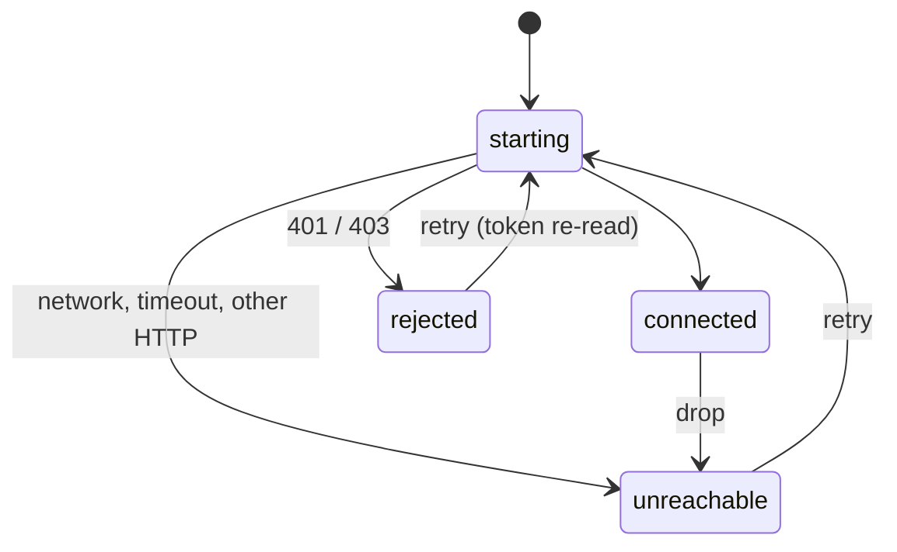
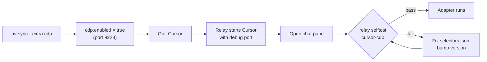
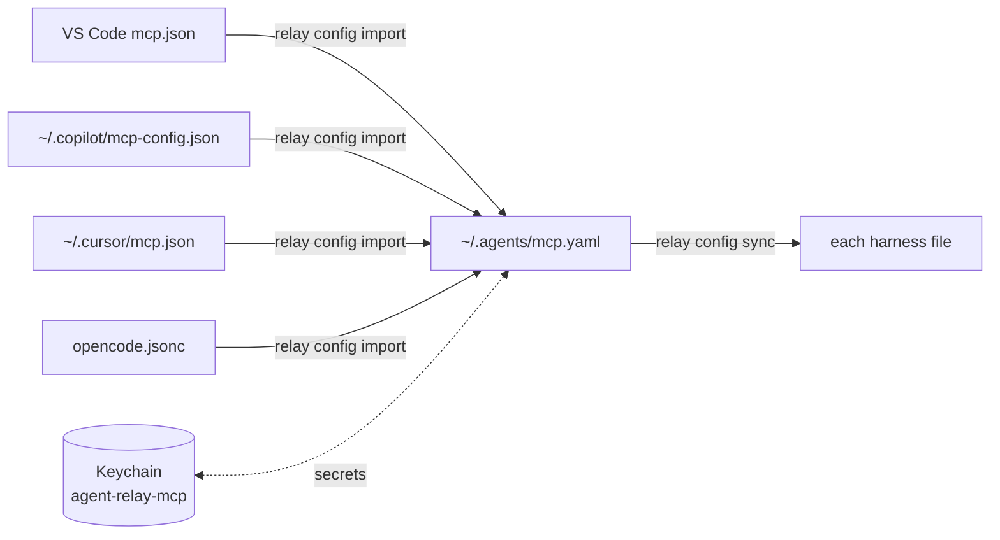
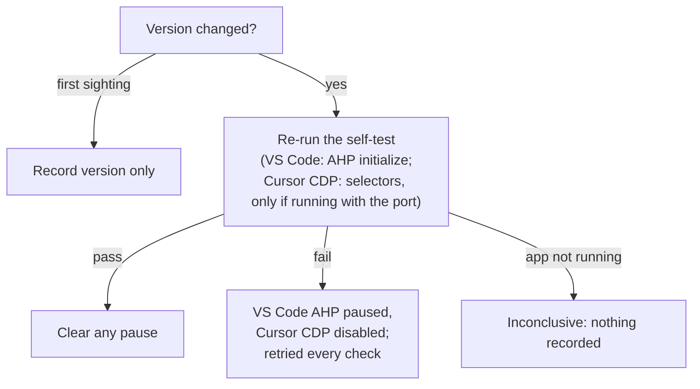

# Operations

Reference for every `relay` command, setting and component. First-time setup: [setup.md](setup.md).
Tests and live runs: [testing.md](testing.md).

## `relay` commands

Run as `uv run relay …` from the checkout. Every write command is a dry run without `--apply`.

| Command | Does |
|---|---|
| `relay install [--diff] [--apply]` | Hooks, MCP sync, skills, launch agents, relay-bridge ([below](#install-and-uninstall)) |
| `relay uninstall [--apply]` | Undo the install |
| `relay start` / `stop` | Load and (re)start / unload the launch agents (start again at next login) |
| `relay status [--json]` | Sessions, parked turns, open questions, adapter health |
| `relay away on\|off` | The one global away flag (`--workspace` accepted and ignored) |
| `relay doctor [--json]` | Health checks with fixes ([below](#relay-doctor-and-doctor)) |
| `relay setup token --stdin` | Store the Webex bot token |
| `relay ws add <name> <path>` / `list` / `rm <name>` | Workspaces |
| `relay config show` / `set <key> <value>` / `unset <key>` | `relay.toml` settings |
| `relay config import [--apply]` / `sync [--apply]` | One MCP server list ([below](#one-mcp-server-list)) |
| `relay skills dedupe [--apply]` | One copy of each skill ([below](#one-copy-of-each-skill)) |
| `relay selftest cursor-cdp` | Open the Cursor CDP gate ([below](#cursor-desktop-cdp-off-by-default)) |
| `relay pwa expose` | Print the `tailscale serve` command for the PWA |

Without `relay install`, run the daemon in a terminal: `uv run python -m agent_relay.daemon`.

## Install and uninstall

```bash
relay install            # dry run: every file, link, move and command
relay install --diff     # same, with a diff per file (secrets hidden)
relay install --apply
relay uninstall          # dry run
relay uninstall --apply
```

What install touches:

| Target | Change |
|---|---|
| `~/.copilot/hooks/agent-relay.json` | Copilot hooks (VS Code, Agent Host, Copilot CLI) |
| `~/.cursor/hooks.json` | Relay entries merged in; others (e.g. `git-ai`) kept |
| `~/.config/opencode/plugins/agent-relay.ts` | OpenCode plugin |
| MCP configs (VS Code `mcp.json`, `~/.copilot/mcp-config.json`, `~/.cursor/mcp.json`, `opencode.jsonc`) | Imported and synced through `~/.agents/mcp.yaml` |
| `~/.agents/skills/agent-relay-away`, `agent-relay-recall` | Linked from `skills/` |
| `~/.agents/skills/stepping-away/SKILL.md` | Patched ([below](#the-stepping-away-patch)) |
| Per-app skill folders | Duplicates moved to a backup |
| `~/Library/LaunchAgents/io.github.cyberquill.agent-relay.*.plist` | Launch agents (table below) |
| VS Code | `relay-bridge` VSIX installed |

| Launch agent | When |
|---|---|
| `relayd` | Always |
| OpenCode server | While `adapters.opencode` is on |
| Weekly `cursor-agent update` | When `cursor-agent` is installed |

Install guarantees:

- Every touched file is backed up first and listed in the manifest
  (`$RELAY_HOME/Library/Application Support/agent-relay/install-manifest.json`, with the sha256 of each file the relay wrote).
- Backups are `0600` in `0700` folders.
- Idempotent: a second run changes nothing; only a launch agent whose plist changed is reloaded.
- If a path it would link is a real folder, it stops before writing anything.

Uninstall:

| File state | Result |
|---|---|
| Still what the relay last wrote | Restored from backup |
| Changed since, and the relay knows how to unmerge (Cursor `hooks.json`, MCP configs) | Only the relay's entries removed |
| Changed since, otherwise | Left alone; backup path in the report |

- Then: skill folders moved back, launch agents booted out, relay-bridge uninstalled.
- Kept: `relay.toml`, `workspaces.toml`, session history, logs, Keychain items (service names `agent-relay*`; remove in Keychain Access).
- With `adapters.opencode` off, `relay start` boots out an installed OpenCode server and `launchctl disable`s it; turning the adapter on and `relay start` re-enables it.

## Running relayd

- Posts nothing when it starts: restarts, updates and adapter crashes go only to the log and `/doctor`.
- At start, sessions left `running` with no live turn become `idle`.
- Housekeeping ends idle sessions untouched for 7 days.

### Webex failures never stop relayd



- Retries back off from 1 s doubling to 5 min; one log line per change of state.
- Meanwhile the IPC socket keeps serving, so hooks fail open at once and desk apps are not slowed.
- The token is re-read before every attempt: after `pbpaste | relay setup token --stdin` the next retry uses it (≤ ~5 min, no restart).
- `relay doctor` tests the token itself (`GET /people/me`), not just that the Keychain item exists.
- Still fatal (exit 2 with the fixing command): missing token, locked Keychain, missing `webex.allowed_email`.

### Logs

| File | Notes |
|---|---|
| `~/Library/Logs/agent-relay/relayd.log` | Rotating, with tracebacks, scrubbed |
| `~/Library/Logs/agent-relay/relayd.err.log` | launchd's stderr, never rotated; truncated at start when over 10 MiB |

## Workspaces

```bash
relay ws add scratch ~/code/agent-relay/.scratch
relay ws add myapp ~/code/myapp.code-workspace
relay ws list
relay ws rm scratch
```

A workspace is a folder or a multi-root `.code-workspace` file (stored in `workspaces.toml` with a `file` key). For a file:

- `vscode` chats go to the window that has every one of its folders open; `code <file>` opens it when none does.
- Other harnesses, and the claim linking a phone chat to its hooks, use the file's **first folder** (the working directory VS Code reports for a multi-root window).

## Settings

```bash
relay config show
relay config set cdp.enabled true          # values are JSON, else a string
relay config set ws.roots '["~/code"]'     # arrays are JSON
relay config unset webex.bots              # remove a key the relay no longer knows
```

- A rejected value (unknown key, bad value) leaves `relay.toml` unchanged.
- Restart relayd (`relay start`) after a change.

| Setting | Default | What it does |
|---|---|---|
| `queue.default_mode` | `queue` | Mid-turn messages: `queue` (next turn), `steer` (nudge), `interrupt` (stop, then send). `/queue` sets it per session |
| `questions.deadline_s` | `600` | How long a question to the phone waits (the only deadline left) |
| `park.deadline_s` | `14400` | How long a parked turn waits before release (4 h) |
| `park.slice_s` | `1500` | Longest single hook block while parked; must not exceed `park.deadline_s` |
| `renderer.html_threshold` | `auto` | When an answer goes as `answer.html`: `auto` (over `max_message_bytes`, a table, ≥ 3 code blocks, > 60 lines), `always`, `never` |
| `renderer.max_message_bytes` | `6144` | Largest text message; also the `auto` HTML size threshold |
| `attachments.enabled` | `true` | Accept photos and files in a thread or `/new` |
| `attachments.max_bytes` | `20971520` | Largest file in (and largest `send_phone_file` out): 20 MB |
| `attachments.hold_s` | `600` | Wait for a files-only message's text, and for the next `/new` after a top-level file |
| `attachments.inbox_dir` | `.agent-relay/inbox` | Where files land, relative to the workspace; must stay inside it |
| `ws.roots` | `[]` | Folders `/ws` may add workspaces under; `/ws` only lists while empty |
| `ws.clone_hosts` | `["github.com"]` | Hosts `/ws` may clone from |
| `ws.clone_timeout_s` | `300` | A slower clone is killed and removed |
| `ws.list_depth` | `2` | How deep `/ws` looks under each root (1–4) |
| `cursor_cli.idle_s` | `900` | Idle `cursor-agent` process is stopped, respawned on the next prompt |
| `cdp.enabled` / `cdp.port` | `false` / `9223` | Cursor CDP adapter |
| `cdp.start_deadline_s` | `20` | A CDP turn not started by then is cleared |
| `pwa.enabled` / `pwa.port` | `false` / `8787` | Browser front end |
| `adapters.ahp` / `vscode` / `opencode` / `cursor_cli` | `true` | Set `false` to silence an app you never use |

**Legacy settings** removed in the November round are still accepted in an old `relay.toml`: relayd ignores
them with one warning, and `relay doctor` prints the `relay config unset <key>` for each.

`webex.bots`, `webex.new_card_layout`, `approvals.*`, `presence.*`, `renderer.flush_bytes`, `flush_idle_s`,
`progress_edit_interval_s`, `quick_reply`.

## The Webex token (one bot, one space)

1. Create a bot at developer.webex.com (**Create a New App → Bot**); set `webex.allowed_email`.
2. **Copy Token**, then `pbpaste | relay setup token --stdin`. Overwrite the clipboard afterwards.
   - Stored in the Keychain: service `agent-relay`, account `webex-bot-token`; never printed.
   - Refuses: a terminal on stdin, empty or multi-word input, a missing `--stdin`.
3. `relay start`, then `relay doctor`: Webex says connected.

- To replace a rejected token, repeat step 2; a running relayd picks it up on its next retry.
- A brand-new bot logs `WDM device list failed: HTTP 404` once before registering its first device: harmless.

**Retired per-app bots (D116).** Migration 5, on the first start after the November round:

- clears thread ids of sessions in the old app spaces and deletes their `:vscode`, `:cursor`, `:opencode` registry keys;
- expires their open questions and **ends every existing session** (the next event opens a fresh thread; old threads stay readable in the retired spaces).
- Keychain items `webex-bot-vscode`, `webex-bot-cursor`, `webex-bot-opencode` were deleted on 2026-11-21; delete the bots themselves at developer.webex.com.

## relay-bridge (`vscode` chats)

- VS Code extension in every window (`onStartupFinished`, `extensionKind: ui`).
- Keeps one connection to `relay.sock`: `relayBridge.socketPath` setting, then `RELAY_SOCKET`, then
  `$RELAY_HOME/Library/Application Support/agent-relay/relay.sock`.
- Reconnects with backoff (1 s doubling to 30 s) while relayd is down.

Protocol (length-prefixed JSON frames, as for every IPC peer):

| Direction | Frame |
|---|---|
| window → relayd | `{op: "bridge.register", protocol: 1, window_id, folders, version, vscode_version}` |
| relayd → window | `{ok: true, protocol: 1}`, then commands `{id, cmd, args}` |
| window → relayd | Replies `{id, ok: true, result}` or `{id, ok: false, error}` |
| window → relayd | Events `{event: "folders", folders}`, `{event: "turn.done"}`, `{event: "error", message}` |

- Commands: `ping`, `models`, `start {query, model}` (new VS Code agent chat), `prompt {query, model}`, `cancel`.
- The bridge answers no permissions: with no approvals (D117) the relay's hooks allow every call they answer.
- A follow-up goes only to the window the chat was opened in. Closed or reloaded (new id): "The VS Code window for this chat is closed".
- Without the extension: a new chat falls back to `code chat -m agent -r "<prompt>"` in the workspace; follow-ups do not work. `relay doctor` says which path is active.

```bash
cd extensions/relay-bridge && npm ci && npm run build && npm test
uv run python -c "from pathlib import Path; from agent_relay.ops.vsix import build_vsix; build_vsix(Path('build/relay-bridge.vsix'))"
```

## Cursor CLI (ACP)

- Runs `cursor-agent --workspace <ws> [--model <m>] [--worktree] --force acp`, ACP over stdio.
- `--force` is the CLI's own auto-approve; whether it silences `session/request_permission` is not verified live,
  and the relay allows any request that still arrives (D125).
- Log in once: `cursor-agent login`.
- Survives a relayd restart or CLI crash: the next prompt respawns the CLI and calls `session/load`.
- Idle process stopped after `cursor_cli.idle_s` (900 s), respawned the same way.
- At the desk: `agent resume <id>` (id on the session card).

## Cursor desktop (CDP, off by default)

Types phone prompts into Cursor's own composer, so the chat appears at the desk. Fragile by design.



- Cursor is started with `--remote-debugging-port=<port> --remote-debugging-address=127.0.0.1`; the relay never restarts a Cursor that is already open.
- The self-test checks every selector in `selectors.json` against the running Cursor (launching it with the port only if closed) and records a pass per Cursor version and per `selectors.json` version.
- After a Cursor update the adapter refuses to run (doctor says why) until the self-test passes again.
- With `cdp.enabled` off, `relay selftest cursor-cdp` refuses and opens nothing.
- Selector fix: edit `agent_relay/adapters/cursor_cdp/selectors.json`, bump its `version`, rerun the self-test.
- The debug port is loopback only, and only while Cursor runs with it.
- Models: the `/new` and `/model` cards never open Cursor's model menu. `/models cursor-ide` opens it once and stores the list (registry key `models.cursor_cdp`); until then cards offer only "Default".
- DOM fixture tests need Chromium: newest Playwright Chromium in `~/Library/Caches/ms-playwright`, Google Chrome, or `RELAY_TEST_CHROMIUM`.

## relay-mcp

A stdio MCP server that agents call to reach the phone. It finds the session from `RELAY_WORKSPACE` (or its
working directory): the deepest live session containing it, busy sessions first.

| Tool | Returns | Notes |
|---|---|---|
| `notify_phone(text)` | `{delivered, reason}` | Posts one line |
| `ask_phone(question, options, timeout_s)` | `{outcome, answer, reason}`; `outcome` = `answered`, `timeout` or `denied` | Blocks ≤ 900 s; progress notification every 20 s |
| `send_phone_file(path, caption?)` | `{delivered, reason, error}` | Path must resolve inside the session's workspace (symlinks followed, see [security.md](security.md)); ≤ `attachments.max_bytes`; text scrubbed. For a report: write HTML, send it |

- All three refuse (`delivered: false` or `denied`) when the relay is paused, no session is live for the workspace, or a desk session is not in away mode.
- relayd down: the tools tell the agent to run `relay start`.
- Logs only to `~/Library/Logs/agent-relay/`; stdout belongs to MCP.

## Away mode, skills and plugin bundles

- Away mode is manual and global. Only these switch it: `/away`, `/back` (phone, thread or top level), `relay away on|off`, the skill's two commands. Nothing reacts to screen lock or sleep.
- `skills/agent-relay-away/SKILL.md` holds the away-mode contract; `commands/away.md` and `back.md` run `relay away on` / `off` (an old copy passing `--workspace` still works).

`relay install` writes hooks, skills and MCP config into each harness directly. To use a harness's plugin
manager instead, build bundles (to `dist/plugins/<harness>/agent-relay`, pointing at this checkout's Python):

```bash
uv run python -c "from pathlib import Path; from agent_relay.ops.bundles import build_all; \
from agent_relay.models.config import RelayConfig; print(build_all(Path('dist/plugins'), RelayConfig()))"
```

| Harness | Install the bundle |
|---|---|
| Copilot CLI | `copilot plugin install dist/plugins/copilot/agent-relay` |
| Cursor | Copy `dist/plugins/cursor/agent-relay` to `~/.cursor/plugins/local/agent-relay`, restart Cursor |
| OpenCode | Copy the contents of `dist/plugins/opencode/agent-relay` into `~/.config/opencode/` |

Use one route per harness, never both: hooks would fire twice.

## The `stepping-away` patch

- `relay install` replaces `~/.agents/skills/stepping-away/SKILL.md` with `patches/stepping-away/SKILL.md`
  (no Webex posting, same decision rules, points to `agent-relay-away`).
- Only when the installed file's sha256 matches `patches/stepping-away/base.sha256`. The original is backed up; `relay uninstall` restores it byte for byte.
- Edited since? Install leaves it alone and says so: merge by hand.
- A copy from the pre-November patch matches neither, so install and doctor report it as drifted. Refresh: restore the original (or delete the installed file), then `relay install --apply`.

## The PWA (off by default)

A browser front end with the same commands as Webex, for use over Tailscale. Not a replacement: relayd still needs the bot token.

1. Token: `security add-generic-password -U -s agent-relay -a pwa-token -w` (a long random value, e.g. `openssl rand -base64 32`).
2. `pwa.enabled = true` in `relay.toml` (`pwa.port` 8787), restart relayd. Without the token relayd refuses to start and names the command.
3. Open `http://127.0.0.1:8787`, paste the token (kept for the browser tab only).
4. From the phone: `relay pwa expose` prints the `tailscale serve` command. The relay never runs it, and never uses Funnel.

- Listens on 127.0.0.1 only (not configurable). Every `/api` route answers 401 without the token.
- One event stream carries each turn's final result (text since the last tool call, shown at turn end) and questions, scrubbed.
- No approval cards, no per-tool progress lines.

## One MCP server list

`~/.agents/mcp.yaml` is the single list of MCP servers. Edit it, then render it everywhere.



```sh
relay config import            # dry run: what would go into mcp.yaml
relay config import --apply    # once, or after adding a server in an app
relay config sync              # diff of every harness file against mcp.yaml
relay config sync --apply      # write; the first write of each file keeps a backup
```

| Topic | Rule |
|---|---|
| Sources | Union of the four files above; the `agent-relay` server (relay-mcp) is always added |
| Secrets | A literal secret (token in `env`, `Authorization` header, OAuth client secret) moves to the Keychain (`agent-relay-mcp`); `mcp.yaml` keeps `${keychain:server.location}`. `sync` writes the literal back (apps cannot read the Keychain); diffs show `<redacted>`. `${env:NAME}` stays a reference |
| Conflicts | A server whose command or URL differs keeps each app's definition (`variants`); import lists every conflict |
| App-only references | `${input:…}` (VS Code) or `{file:…}` (OpenCode): rendered only into that app |
| Comments | VS Code `mcp.json` and `opencode.jsonc` are rewritten as plain JSON; comments dropped (backup keeps them; uninstall restores) |
| Cursor CLI permissions | `sync` copies Cursor desktop's allowlist (shell commands, web domains, MCP tools) into `~/.cursor/cli-config.json`. Hand-added CLI rules stay; a rule removed in the desktop is removed from the CLI |
| Safety | `sync` refuses before the first `import` (an empty list would remove every server) |

## One copy of each skill

```sh
relay skills dedupe            # what would move
relay skills dedupe --apply
```

- A folder under `~/.copilot/skills`, `~/.cursor/skills`, `~/.claude/skills` or `~/.config/opencode/skills`
  moves to `~/.agents/.skill-dup-backup/<timestamp>/<harness>/<name>` only when byte-identical to `~/.agents/skills/<name>`.
- Symlinks are compared by target, never followed. A different copy is listed and kept.

## `relay doctor` and `/doctor`

```sh
relay doctor          # grouped, one line per check with its fix
relay doctor --json   # {"ok", "counts", "checks": [{area, name, status, detail, fix}]}
```

- Status per check: `ok`, `info`, `warn`, `fail`. Exit 1 when any check fails.
- Without relayd: the daemon check fails, local checks still run. `/doctor` runs everything inside relayd.

| Area | Checks |
|---|---|
| relayd | Daemon answers on its socket |
| Adapters | Health; a degraded adapter shows the update that broke it; the Cursor CDP gate (why closed, or which self-test opened it) |
| Webex | Connection (connected / token rejected (401) with the fix / unreachable / starting); the token via `GET /people/me` |
| Away mode | The global flag, the `/panic` pause, open questions |
| Updates | Last app-update self-test per app (log and registry only, never posted) |
| Legacy settings | Removed keys still in `relay.toml`, with `relay config unset <key>` |
| Versions | VS Code, Cursor, Cursor CLI, OpenCode, Copilot CLI; Cursor CLI > 14 days older than the desktop app |
| Hooks | Copilot hooks, Cursor hooks, OpenCode plugin installed and matching what install would write now |
| Config | `~/.agents/mcp.yaml` exists; every harness file matches it |
| Skills | Duplicates, the `agent-relay-away` link, the `stepping-away` patch |
| Keychain | Bot token; OpenCode password (adapter on); PWA token (PWA on); a locked Keychain is reported as locked |
| launchd | Each relay launch agent loaded |

## App updates

relayd checks VS Code's and Cursor's `Info.plist` every 10 minutes.



- Outcome goes to the log and the registry (`updates.notice:<app>`); doctor shows it under *Updates*. Nothing is posted.
- While failed: new sessions, model lists and model changes are refused with the reason; `/stop` works; a prompt to a running session is queued as steering.
