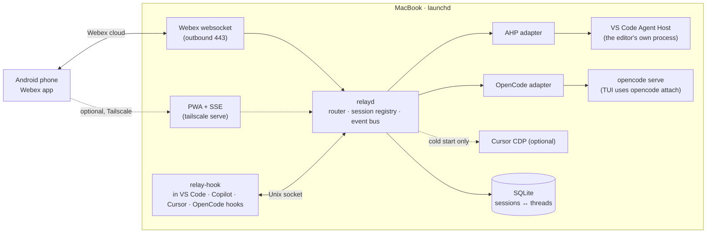

# Controlling desktop coding agents from a phone

Drive VS Code Copilot, Cursor and OpenCode on the MacBook from an Android phone. Each one runs in the
same harness the desktop UI uses, and you choose the model and workspace from the phone.

> Research snapshot: 2026-10-03. Tested on this Mac with VS Code 1.140, Cursor 3.23, OpenCode 1.18.15,
> a VPN client and macOS 27. Anything marked **verify** still needs a short spike.

---

## TL;DR

- **Build one small daemon, `relayd`.** It runs under launchd on the Mac. The **phone talks to it
  through a Webex bot** over an outbound websocket, so there is no inbound port, no VPN and no Tailscale.
- **The daemon never runs an agent of its own.** It attaches to the harness each desktop app already runs:

  | App | How `relayd` attaches |
  |---|---|
  | VS Code | the Agent Host Protocol socket the editor already publishes |
  | OpenCode | the `opencode serve` server the TUI attaches to |
  | Cursor | Cursor's own hooks for sessions started at the desk (with "parked" sessions); the Cursor CLI (`agent acp`) for sessions started from the phone; no UI scripting |

- **Hooks do most of the work inside each session.** A single `relay-hook` binary is installed into
  every harness's hook system, the same way `git-ai` already is on this Mac. It handles observing,
  approving, steering and keeping a session alive waiting for the phone. That removes the VS Code
  extension and most of the Cursor UI scripting ([§5](#5-hooks-skills-and-plugins-the-lighter-path)).
- **Each agent session is one Webex thread.** Replying in a thread steers that session. Cards handle
  choosing the app, workspace and model, and approving tool calls.
- **Support both VS Code harnesses.** Local is **not formally deprecated**: VS Code 1.140 lists no
  deprecations, and Local is still getting features. Its in-product setting texts do say it "will be
  removed in a future release", with no date ([§4](#4-adapters-how-each-harness-is-driven)). Prefer
  the Copilot harness for work you'll steer from the phone, because sessions survive window crashes
  and the vendor remote features come with it.
- **Tailscale is optional.** Add it only if you want a richer PWA with true
  token-by-token streaming. It works badly alongside a VPN client anyway (see [§10](#10-will-tailscale-work-behind-a-vpn)).

---

## 1. Design principles (from your constraints)

| Constraint | Rule in the design |
|---|---|
| Control each agent independently | One adapter per harness, one queue per session, one Webex thread per session. If one adapter fails, the others keep working. |
| Same harness as the desktop | Adapters attach to the running desktop harness. They never spawn a CLI clone. |
| Choose the model | Every adapter lists the harness's own live model list and passes the choice through natively. |
| Stream responses | Normalised event bus → renderer for each front end (Webex, or the PWA). |
| Choose app and workspace | A workspace allowlist plus windows discovered live; the relay opens the app if needed. |
| Mac never sleeps | `pmset disablesleep 1` (assumed), with `relayd` under launchd `KeepAlive`. |

---

## 2. What already exists (off the shelf)

| Tool | Covers | Same desktop harness? | Gate | Verdict |
|---|---|---|---|---|
| **Copilot remote control** (GitHub Mobile / github.com) | Copilot CLI and VS Code **Copilot-harness** sessions: prompt, approve, answer, switch mode, cancel | Yes, the CLI or Agent Host keeps running locally | Org/enterprise policy *"Store local sessions in the Cloud" = View and control* | **Use it if the policy is on.** It doesn't cover the Local harness. |
| **VS Code Agents window in the browser** (`code tunnel` → `insiders.vscode.dev/agents`) | Agent Host sessions (Copilot, Claude, Codex harnesses) | Yes, AHP to your Mac | Microsoft dev tunnels must not be blocked | Good backup GUI. The Insiders web client is clunky on a phone. |
| **Cursor Remote Control** (`/remote-control`) | Cursor **Agents Window** sessions; Android uses the `cursor.com/agents` PWA | Partly: the **agent loop moves to Cursor's cloud**, tools still run locally | Admin toggle on Teams/Enterprise, plus cloud data storage (not Legacy Privacy Mode) | Doesn't cover the classic editor chat you use |
| **`opencode web` / `opencode serve`** | OpenCode | Yes, the TUI is a client of the same server | Needs a network path (Tailscale) for the phone | Strong; `relayd` reuses its API |
| **Happy**, **claude-code-telegram**, Omnara, vibe-kanban | Claude Code / Codex CLIs, or their own runtimes | No, a separate CLI harness | n/a | Good reference designs, wrong harnesses |
| **Screen Sharing / VNC over Tailscale** | Everything | Yes, it is literally the desktop | Tailscale and Screen Sharing both need to be allowed | Zero drift, poor phone UX. Last-resort fallback. |

**Gap:** nothing off the shelf unifies all three apps behind one Webex interface while keeping the
desktop harness. That gap is what `relayd` fills.

---

## 3. Architecture



**`relayd`** is Python 3.13 managed with uv, uses about 1–2k lines plus the `relay-hook` binary, and
runs as a single instance behind a file lock.

| Part | Job |
|---|---|
| Front ends | Webex bot (primary) and the PWA (optional). Both reduce to the same commands. |
| Router | Maps a session to an adapter and serialises the work for each session. |
| Registry (SQLite) | `session_id ↔ webex_thread_id ↔ harness session/chat id`, sticky model, workspace, last seen message id. Survives restarts. |
| Event bus | Normalised events: `text.delta`, `tool.start/end`, `approval.request`, `question`, `turn.done`, `error`. |
| Adapters | The common interface: `list_workspaces · list_models · start · send · steer · approve · answer · cancel · status`. |

---

## 4. Adapters: how each harness is driven

| | **VS Code, Copilot harness** (preferred) | **VS Code, Local harness** (supported) | **Cursor, classic chat** | **OpenCode** |
|---|---|---|---|---|
| Channel | AHP JSON-RPC on the editor's Unix socket, found with `code agent endpoints` *(verified on this Mac: protocol 0.9.0, socket and token)* | `code chat` CLI *(verified in 1.140)* plus hooks; the `relay-bridge` extension only if the model must be picked from the phone | `~/.cursor/hooks.json` scripts, plus CDP on `127.0.0.1` (launch with `--remote-debugging-port`) | HTTP and SSE to `opencode serve` on `127.0.0.1`, protected by `OPENCODE_SERVER_PASSWORD` |
| Same harness as the desktop? | **Yes**: the same process, and sessions appear in VS Code | **Yes**: it drives the window's own chat | **Yes**: the real composer | **Yes**: the TUI attaches to the same server |
| Send prompt | `createSession` → `createChat {initialMessage}` / `chat/turnStarted` | `code chat -m agent -r "<prompt>"`, run from the workspace. With the extension: `chat.newLocalChat` → `chat.open {query, mode, modelSelector, blockOnResponse, preserveInput}` | CDP: focus the composer, insert the text, send. Mid-turn steering goes through the `stop` hook's `followup_message`. | `POST /session/:id/prompt_async` |
| Pick model | `model` on the AHP `Message` | `modelSelector` / `chat.changeModel {vendor,id,family}` | CDP drives the model dropdown | `{providerID, modelID}` per message |
| Stream | `chat/delta`, `chat/toolCall*` (**tokens**) | Local hooks `PreToolUse`/`PostToolUse`/`Stop` + `transcript_path` (**milestones**) | Hooks `afterAgentResponse`/`afterAgentThought`/tool hooks (milestones); CDP `MutationObserver` for tokens | `/global/event` → `message.part.updated` (**tokens**) |
| Approvals and questions | `chat/toolCallConfirmed`, `chat/inputRequested` → `chat/inputCompleted` | A `PreToolUse` hook blocks until the phone answers (raise `timeout`), or `chat.acceptTool`/`skipTool` | `beforeShellExecution`/`beforeMCPExecution` return `allow`/`deny` | `permission.asked` → `POST /permission/:id/reply` |
| Cancel | `chat/turnCancelled` | `workbench.action.chat.cancel` | CDP stop button | `POST /session/:id/abort` |
| Workspace | Session `workingDirectories` (plus an optional worktree) | One window per workspace (`code -n <path>`) | One window per workspace (`cursor -n <path>`); CDP target per window | `?directory=<path>` on every call |
| Fragility | **Low**: versioned protocol, chat channel marked *Stable* | **Medium**: removal announced in the product, no date given | **High**: DOM changes on updates | **Low**: OpenAPI at `GET /doc` |

> **Superseded in part by [§5](#5-hooks-skills-and-plugins-the-lighter-path).**
> - The Local harness needs no extension for most work. `code chat` starts a session, and hooks plus
>   parked sessions cover the rest. Keep the extension only to pick the model from the phone.
> - Cursor uses CDP only to cold-start a chat or switch its model.

**Status of the Local harness (checked 2026-10-03)**

| Signal | Says "going away" | Says "not soon" |
|---|---|---|
| VS Code 1.140 setting texts (`nls.messages.json`) | "This setting and the Local agent harness will be removed in a future release", on 4 settings used only by Local (instruction, skill, agent and mode file locations) | No date or version is given |
| 1.140 release notes | The Copilot harness is the headline; it "might already be the default" | "Deprecated features and settings: **None**" |
| Feature work | MCP migration prompts to move to the Copilot harness; profile `mcp.json` and `.vscode/mcp.json` labelled deprecated | 1.140 adds Local-only features (OTel identity capture, managed Auto tier) |
| Parity | — | The Copilot harness lacks extension-provided tools outside windows, `${input:}` variables, `envFile`, MCP dev mode and custom OAuth. Handoffs can only be started from Local. Docs still recommend Local for extension tools and bring-your-own-key models. |

**Verdict:** your read is right for planning purposes. Local is announced for eventual removal but
still actively developed, and blocked on parity. Treat it as fully supported. Because both harnesses
read the same `~/.copilot/hooks`, the relay barely changes when you eventually switch.

**Why prefer the Copilot harness for work you'll steer from the phone**

- The Agent Host owns sessions independently of windows. A renderer out-of-memory crash, which this
  Mac has had, no longer kills a running agent.
- AHP is built for many clients. The phone and the desktop see the same live state, and the first
  answer to an approval wins.
- The same harness unlocks Copilot remote control and the browser Agents window for free.
- Cost: move user-level customisations from the VS Code profile to `~/.copilot` (see [§9](#9-would-copilot-cli-style-harnesses-make-life-easier)).

**Cursor, ranked options**

1. **Hooks plus parked sessions** ([§5](#5-hooks-skills-and-plugins-the-lighter-path)) for sessions
   started at the desk. They are supported and documented, and cover observing, approving, steering,
   and continuing after a turn ends.
2. **Cursor CLI in ACP mode** (`agent acp`) for sessions **started from the phone**. Of all the
   sessions in this design, these are the only ones that run in a sibling of the desktop harness
   rather than the desktop harness itself; see the drift table below.
3. If the Cursor admin enables Remote Control, use the Agents Window plus the `cursor.com/agents` PWA.
4. **CDP**, only if you need a phone-started chat to appear *inside the desktop composer*. Keep it
   behind `selectors.json` and a self-test.

**Cursor CLI (`agent` / `cursor-agent`) as the Cursor start plane**

| | Detail |
|---|---|
| Protocol | `agent acp`: JSON-RPC over stdio. `session/new` → `session/prompt`. Streams `session/update` (`agent_message_chunk`, so **tokens**). Approvals via `session/request_permission`. Questions via `cursor/ask_question`. Stop with `session/cancel`. |
| Model | `--model` or the ACP session model; the list comes from `agent models` (same account as the desktop) |
| Workspace | `--workspace <path>`; `--worktree [name]` isolates edits under `~/.cursor/worktrees/`, shared with editor worktrees |
| Resume | `--resume <chatId>`, `agent ls`; `&` hands off to a Cloud Agent |
| Fragility | **Low**: documented flags and protocol. It replaces CDP entirely. |

**What the CLI shares with the desktop, and where it drifts** (checked on this Mac)

| Aspect | Shared | Differs |
|---|---|---|
| Account, models | Yes | — |
| MCP | `~/.cursor/mcp.json` and the project `mcp.json` | Team-dashboard MCP servers aren't available in ACP |
| Rules, `AGENTS.md`, skills | Yes (`.cursor/rules`, `AGENTS.md`/`CLAUDE.md`, `~/.agents/skills`) | — |
| Hooks | Reads `hooks.json` | Only `workspaceOpen` is documented to fire in the CLI (**verify** the rest). ACP's own permission requests make approval hooks unnecessary here. |
| Approval rules | — | Separate `~/.cursor/cli-config.json` (`approvalMode`, `permissions`, `sandbox`) vs the IDE's auto-run settings |
| Release train | — | Separate binary and updater: CLI `2026.07.17` vs desktop `3.23` on this Mac |
| Sessions | Worktree folder | CLI chats live in `agent ls`, **not the desktop chat panel** (**verify** the Agents Window) |
| Tools | Files, search, shell, web | IDE-only pieces such as editor diagnostics, the browser tool and the review UI (**verify**) |

**Mitigations:**
- Render `cli-config.json` permissions from the same source as the IDE allowlist.
- `/doctor` flags CLI and desktop version skew, and a weekly launchd `agent update` keeps the CLI current.
- Back at the desk, continue with `agent resume <id>` in Cursor's integrated terminal.

**How this compares with Copilot:** Copilot CLI *is* the VS Code Copilot harness runtime, and VS Code
can adopt its sessions. Cursor's CLI is a sibling client with its own sessions. It is a **bounded
exception** to the "no parallel harness" rule: drift is low and listed above, and it applies only to
sessions started from the phone.

---

## 5. Hooks, skills and plugins: the lighter path

Split the problem into two planes:

- **Start plane:** opening a brand-new session from the phone. This needs a protocol. AHP and the
  OpenCode HTTP API provide one; Cursor has none.
- **Session plane:** observing, approving, steering and keeping a session alive. **Each harness's
  own documented hooks can do all of this, with no UI automation.**

### What hooks and plugins can do, per harness

| Capability | VS Code Local | Copilot harness / CLI | Cursor | OpenCode plugin |
|---|---|---|---|---|
| Register the session automatically (one Webex thread each) | `SessionStart` | `sessionStart` | `sessionStart` | `event` → `session.created` |
| Observe tool calls | `PreToolUse` / `PostToolUse` | `preToolUse` / `postToolUse` / `postToolUseFailure` | `postToolUse`, `afterShellExecution`, `afterMCPExecution`, `afterFileEdit` | `tool.execute.after`; `message.part.updated` gives **tokens** |
| Final answer text | Read `transcript_path` (unstable format) | Read `transcriptPath` | **`afterAgentResponse.text`** | `message.updated` |
| Approve from the phone | `PreToolUse` → `permissionDecision` | **`permissionRequest` → `behavior`** (+ `interrupt`) | `beforeShellExecution` / `beforeMCPExecution` → `permission`, with `failClosed: true` | `tool.execute.before` (no timeout; throw to deny), or `permission.asked` + the reply API |
| Steer mid-turn | `PostToolUse` `additionalContext` | `postToolUse` `additionalContext` (≤ 10 KB) | `postToolUse` `additional_context` | `noReply` prompt |
| Continue once a turn ends | `Stop` `block` + `reason` (**verify** that the reason reaches the model) | `agentStop` `block`; **the reason is the next prompt**; capped at 8 in a row | `stop` → **`followup_message`**; `loop_limit: null` means no cap | `session.idle` → `promptAsync` |
| Wake an idle session | No | `notification` (`agent_idle`, `permission_prompt`) → `additionalContext`, injected as a user message (**verify** for the main agent) | No | Yes, `promptAsync` |
| Start a new session | No | No | No | Yes, `session.create` |
| Timeout | Default 30 s; no documented maximum | Default 30 s; **a timeout falls back to the normal prompt (fails open)** | Set per script; `failClosed` option | None; it waits indefinitely |

OpenCode 1.x's documented `permission.ask` plugin hook is never called (issue #7006). Use
`tool.execute.before` or the permission events instead.

### Optimisation 1: one `relay-hook`, installed everywhere

- **Precedent on this Mac:** `git-ai` already installs itself into Cursor `hooks.json`,
  `~/.copilot/hooks/git-ai.json` (which both VS Code harnesses and Copilot CLI read) and
  `~/.config/opencode/plugins/git-ai.ts`. Copy that pattern: `relay install` writes the same files
  idempotently.
- **Coexistence:** several hooks can run on the same event, and the most restrictive permission wins,
  so `relay-hook` and `git-ai` don't interfere.
- **Payload formats:** small shims translate each format (Copilot camelCase or PascalCase, Cursor,
  OpenCode) into `relayd`'s event bus.
- **Speed:** it runs on every tool call, so it must be fast. If away mode is off or `relayd` is down,
  it exits 0 within milliseconds.
- **Deterministic fail-closed:** `relay-hook` enforces its own deadline, shorter than the harness
  timeout, and returns an explicit **deny**. That makes approvals fail closed even on Copilot, whose
  own timeout fails open.

### Optimisation 2: parked sessions (replaces most of CDP and the VS Code extension)

```mermaid
sequenceDiagram
  participant A as Desktop agent<br/>(Cursor · Copilot · Local)
  participant H as relay-hook<br/>(stop hook)
  participant R as relayd
  participant P as Phone (Webex)
  A->>H: turn ends (stop / agentStop / Stop)
  H->>R: register, then wait (blocks; no tokens spent)
  R->>P: summary + "reply to continue"
  P->>R: "now add tests for the retry path"
  R-->>H: message
  H-->>A: followup_message / block + reason
  A->>A: next turn, same desktop chat, same harness and model
```

- **How it works:** start the session at your desk, or from the phone through the start plane, then
  type `/away`. Each time a turn ends, the stop hook holds the session open and waits for the phone.
- **To release it:** send `/back` from the phone, or press Stop on the desktop. The hook also returns
  nothing once away mode is off.
- **Cost:** waiting is free because the hook process is what blocks, not the model. Each
  continuation costs one model request, the same as typing it at the desk.
- **Limits per harness:**
  - **Cursor:** unlimited with `loop_limit: null`.
  - **Copilot:** 8 continuations in a row, then fall back to the `notification` wake-up or AHP.
  - **Local:** may hit `chat.agent.maxRequests` (default 25); raise it and **verify**.
- **Things to know:**
  - The desktop chat shows "running" while parked.
  - Hook timeouts must cover the idle gap you expect; the maximum is undocumented, so **verify**. If
    one expires, the session simply ends, which is safe.
  - **The model and workspace are fixed by the chat.** Switching either needs the start plane (or
    CDP for Cursor).

### Optimisation 3: skills shape behaviour; they don't carry messages

- **Skills are the wrong transport.**
  - They run only when the model decides to.
  - Every update costs tokens and tool calls.
  - They cannot declare hooks; only plugins can.
- **Use skills for:**
  - `/away` and `/back` toggles, which are user-invocable slash commands in VS Code, Copilot CLI and
    Cursor (OpenCode via a custom command).
  - The **away-mode contract**: decide instead of asking, prefer reversible changes, end each turn
    with a status summary short enough for a phone.
- **Refactor the existing `stepping-away` skill:** keep its decision rules and drop its Webex MCP
  posting. Hooks post deterministically, at no token cost, and can't forget to.
- **Skills already reach every harness.** All four read `~/.agents/skills` natively. The 22 skill
  folders in `~/.copilot`, `~/.cursor`, `~/.claude` and `~/.config/opencode` are **byte-identical
  duplicates** of entries there. Delete them rather than syncing them.

### Optimisation 4: ship it as a plugin for each harness

- Copilot CLI plugins (bundling hooks, skills and MCP), Cursor plugins (`pluginPaths`) and OpenCode
  plugins (TypeScript) can each carry `relay-hook` plus the `/away` skill.
- One repository builds all of them, pinned to a version. One command installs or upgrades them.

### Optional: an MCP `ask_phone` tool

- **Tools:** `notify_phone(text)` and `ask_phone(question, options)`. They behave identically in
  every harness, giving the away-mode skill a structured way to ask you a question.
- **Downsides:**
  - Timeouts are short or undocumented. OpenCode defaults to 5 s unless `timeout` is raised; Cursor
    and VS Code don't document one.
  - The model has to choose to call it.
- **Prefer native question events where they exist:** AHP `chat/inputRequested`, or the Copilot
  `notification` event with `elicitation_dialog`.

### Net effect on the design

| Original component | With hooks |
|---|---|
| VS Code Local `relay-bridge` extension | **Dropped.** Hooks plus parked sessions cover it. Cold starts go through the Copilot harness. |
| Cursor CDP adapter | **Optional.** Needed only to cold-start a chat or switch the model. |
| Approval logic per harness | **One hook path**, fail-closed everywhere |
| Webex narration from `stepping-away` | Hooks |
| Token-level streaming | Still only from AHP and OpenCode. Hook-based harnesses stream per tool and per turn, which is enough on a phone. |

---

## 6. Phone UX (Webex)

- **One 1:1 space** with your bot. The bot ignores every other room and every other `personId`.
- **One thread per agent session.** The root message is the session card:
  `app · workspace · model · status`. A reply in the thread goes to that session, so several agents
  run side by side without mixing.
- **Top-level messages are commands.**

| Command | Effect |
|---|---|
| `/new` | Card: pick **app** → **workspace** → **model** → enter the prompt. Opens a new thread. |
| `/new cursor myproject opus "fix flaky test"` | The same thing in one line, using aliases from `relay.toml`. |
| `/sessions` | Live sessions: app, workspace, status, waiting-for-you flag. |
| `/model [name]` (in a thread) | Show or switch the model for the next turn. |
| `/stop` · `/status` · `/diff` (in a thread) | Cancel the turn · state summary · attach `changes.diff`. |
| `/apps` · `/ws` · `/models <app>` | Live lists: open windows are marked, closed workspaces can be opened. |
| `/doctor` | Adapter health, app versions and the config drift report. |
| `/away` · `/back` (in a thread) | Park the session after each turn, or release it ([§5](#5-hooks-skills-and-plugins-the-lighter-path)). |
| `/panic` | Cancel every turn, deny every pending approval, pause the relay. |

```text
you    /new copilot myproject sonnet-4.6 "run tox and fix failures"
bot    ┌ copilot · myproject · sonnet-4.6 · running ┐   ← thread root (edited)
         ↳ ran `uv run tox` → 3 failures in tests/core
         ↳ editing myproject/core/parser.py
         ↳ [Approve shell: `uv run pytest tests/core -x`]  [Allow once] [Session] [Deny]
you      (taps Allow once)
bot      ↳ All green. Summary … (full answer attached: answer.md)
```

---

## 7. Model, app and workspace selection

**Model**
- `list_models()` comes from the harness itself, never a hard-coded list:

  | Harness | Source of the model list |
  |---|---|
  | Agent Host | AHP root channel `agents` / models |
  | Local | `vscode.lm.selectChatModels`, filtered to the ones the picker can select |
  | Cursor | `cursor-agent models` (same account, read-only listing) |
  | OpenCode | `GET /config/providers` |

- Precedence: **per-message override** (`@m:opus`) > **session sticky** > **workspace default** >
  **app default** in `relay.toml`.
- Aliases (`opus`, `sonnet`, `gpt5`) map to the right id for each harness. Unknown or
  policy-blocked models are rejected with a picker card instead of silently falling back.

**App**
- `relayd` probes each adapter: AHP endpoint alive? CDP target or hooks heartbeat present?
  `opencode serve` healthy? Only live apps appear in the card.
- Apps that aren't running can be started: `open -a "Visual Studio Code"`, `open -a Cursor --args --remote-debugging-port=9223`,
  or `launchctl kickstart` for opencode.

**Workspace**
- `~/.config/relayd/workspaces.toml` is an **allowlist** of `alias → path` entries, including
  `.code-workspace` files. The phone can never type an arbitrary path.
- Merged with live discovery: open VS Code and Cursor windows, AHP sessions' working directories, and
  OpenCode session directories.
- Choosing a closed workspace runs `code -n` / `cursor -n`. `relayd` waits for the window to
  register before sending.
- For parallel sessions on one repo, use an **AHP worktree session** to avoid edit collisions.

---

## 8. Streaming to the phone

Webex limits shape the strategy:

- A message can be edited at most **10 times**.
- Message text is capped at **7,439 bytes**.
- Requests are rate-limited, with `429` + `Retry-After`.

| Event | Webex rendering |
|---|---|
| State change | **Edit the thread root card** (budget of 8 edits): queued → running → waiting → done/error |
| `text.delta` | Buffer it. Flush as a **thread reply** at a paragraph boundary once the buffer reaches 1.5 KB or goes about 15 s without one; at most about 6 KB per message |
| `tool.start/end` | One line per tool, batched |
| `approval.request` / `question` | An Adaptive Card with buttons or a `ChoiceSet`; the card is edited once with the outcome |
| `turn.done` | Final answer as a reply. Over 6 KB it becomes an **`answer.md` attachment**; diffs go in `changes.diff` |
| Back-pressure | A token bucket per thread (about 1 message every 2 s); obey `Retry-After` |

The PWA, over Tailscale, streams raw tokens over SSE with no batching.

---

## 9. Would Copilot-CLI-style harnesses make life easier?

**Yes, for plumbing.** Headless mode, `stream-json`, ACP (`copilot --acp`, `agent acp`,
`opencode acp`) and built-in remote control are all far easier than UI driving.

**MCP drift is real today.** Snapshot from this Mac:

| Harness | User-level MCP servers |
|---|---|
| VS Code Local (profile `mcp.json`) | atlassian, webex-messaging |
| Copilot CLI / Agent Host (`~/.copilot/mcp-config.json`) | GitHub, sonarqube |
| Cursor (`~/.cursor/mcp.json`) | GitHub, atlassian, chrome-devtools, example-local, webex-messaging |
| OpenCode | none |

**Skills don't drift.** Every harness reads `~/.agents/skills` (43 skills). The 22-entry folders
under each harness are identical duplicates ([§5](#5-hooks-skills-and-plugins-the-lighter-path)).

**Where the twist lands by harness**
- **VS Code:** the **Copilot harness *is* the Copilot CLI runtime** (Copilot SDK). On that harness,
  "CLI vs IDE" stops being a parallel harness and becomes a config-location problem. The Agent Host
  reads `~/.copilot` and `.mcp.json`; VS Code forwards its own MCP servers only while a window is attached.
- **Cursor:** the `agent` CLI shares `mcp.json`, rules, skills and the account with the desktop.
  Drift is low but real: separate approval config, a separate release train, separate chat history
  and no IDE-only tools ([§4](#4-adapters-how-each-harness-is-driven)). The design uses it only for
  Cursor sessions started from the phone.

**Mitigation: one source of truth**
- **MCP:** `~/.agents/mcp.yaml` → `relayd sync-config` renders `~/.copilot/mcp-config.json`,
  `~/.cursor/mcp.json`, `opencode.jsonc` and the VS Code `mcp.json`.
- **Skills:** keep only `~/.agents/skills` and delete the duplicate folders under each harness.
- **Instructions:** `AGENTS.md` in each repo, which every harness reads.
- **Hooks:** one `relay-hook` binary, with a config file for each harness written idempotently by
  `relay install` (the `git-ai` pattern).
- **Checks:** `/doctor` and a launchd timer diff the rendered configs and alert on drift.

**Verdict:** move VS Code to the Copilot harness and keep `relayd` on the desktop harnesses. You get
the CLI's ease without adding a harness.

---

## 10. Will Tailscale work behind a VPN?

- **Technically: sometimes, and unreliably.**
  - Tailscale falls back to DERP relays over TCP 443.
  - Open issue tailscale#19128 shows the same setup (a VPN client, macOS, Apple Silicon)
    connecting at first through Dynamic Tunnel Exclusion, then looping forever after the long-poll
    drops or the Mac wakes from sleep. The workaround is `tailscale down && up`.
  - Full-tunnel or lockdown profiles block it outright.
  - `100.64.0.0/10` and DNS can collide with the VPN.
- **Policy: decide before installing it.**
  - Some machines run network filters that block a second VPN.
  - A second VPN with a third-party control plane, which gives a path into the Mac from
    a phone, deserves a careful look.
  - Headscale (self-hosted) removes the third-party control plane but not the policy question.
- **The design doesn't depend on it.** Webex is outbound-only. If Tailscale is
  wanted, add the PWA with `tailscale serve` (tailnet-only HTTPS). **Never use Funnel.** Use ACLs
  that allow only phone → Mac on the PWA port.

---

## 11. Pros and cons

| Question | Answer |
|---|---|
| **Easy to set up?** | Off-the-shelf tier: a few toggles, if your account settings allow them. `relayd`: moderate (a Webex bot, a launchd plist, adapters). With hooks, the hardest pieces (the Local extension and most of Cursor CDP) disappear. |
| **Easy to maintain?** | Low: AHP, OpenCode and Webex are versioned or OpenAPI, and the Webex API is stable. Hook schemas are documented, and Cursor sends `cursor_version` in every payload. Only the optional Cursor CDP cold-start breaks on UI updates. |
| **Agent or env updates?** | See below. |
| **Security** | No inbound ports. Pinned to your `personId`. Bot token in the Keychain. Agent output scrubbed before posting. Manual approvals by default. `/panic`. CDP on loopback means any local process could drive Cursor, so the port runs only while the relay needs it. security software may flag CDP; **verify**. |
| **Data handling** | Prompts and outputs go to Webex and follow its retention settings. Large code goes as attachments. Copilot remote control and Cursor Remote Control also send session content to GitHub or Cursor. |
| **Cost of the off-the-shelf route** | Three different phone apps, each gated by an admin policy, no shared session view, and no coverage of the Local harness or Cursor's classic chat. |

**How updates are handled**
- On launch, and when an app's `Info.plist` version changes, `relayd` re-runs each adapter's self-test.
- AHP negotiates `protocolVersions`. The endpoint registry carries `schemaVersion`. OpenCode is
  checked against `GET /doc`. The Cursor DOM selectors are smoke-tested.
- **Degrade, don't break.**
  - Cursor falls back to hooks-only mode: mirroring and approvals keep working, new chats don't.
  - An AHP version mismatch pauses that adapter.
  - `/doctor` reports the degraded state on Webex.
- Pin the Webex SDK and OpenCode versions. Cursor auto-updates, so set its update channel to
  *stable* and accept that the CDP selectors may need a fix after updates.

---

## 12. Edge cases

| Case | Handling |
|---|---|
| Screen locked or display asleep | AHP, OpenCode and hooks keep working. **Verify:** renderer throttling for CDP and the Local adapter. Never use AppleScript or Accessibility, which fail when the screen is locked. |
| Reboot or forced macOS update | launchd restarts `relayd` at login, but FileVault blocks until someone logs in. The relay posts "Mac back online" on start. |
| Webex websocket drops | Reconnect with backoff. On reconnect, `GET /messages?roomId` after the last seen id to catch up on missed prompts. |
| Device registrations pile up | Clean up stale registrations on start; run one instance only. |
| VS Code window crashes | Agent Host sessions survive. A Local-adapter disconnect posts a warning in the thread. |
| Desktop and phone act at once | AHP and OpenCode handle several clients (first approval wins). The Local adapter uses `preserveInput`. Cursor CDP queues the prompt if the composer has a draft. |
| Hook timeouts | `relay-hook` returns an explicit **deny** before the harness timeout. On Copilot a timeout falls back to the normal approval prompt, and on Cursor `failClosed: true` blocks. A parked stop hook that times out just ends the session. |
| Back at the desk while a session is parked | Press Stop, or `/back`. The hook releases immediately when away mode is off. |
| Long or binary output | Attachments (Webex limit 100 MB); never paste a diff inline. |
| Secrets in output | Regex-scrub keys, tokens and passwords before posting. |
| Model gone, quota hit or policy-blocked | Error card with the current valid models. |
| Agent asks a question | `chat/inputRequested`, an OpenCode `question.asked`, or a Cursor ask: becomes a `ChoiceSet` card. |
| Two sessions in one repo | Recommend a worktree (AHP) or a different workspace alias. Warn when edits overlap. |
| Lid closed | Keep it on power, lid open or clamshell, and watch thermals. `disablesleep` is the only thing keeping it awake. |

---

## 13. Rollout

| Phase | Do | Exit check |
|---|---|---|
| **0 · Off-the-shelf check** | Ask the GitHub org owner about *Store local sessions in the Cloud → View and control*. In Cursor, look for **Settings › Agents › Remote Control**. Decide whether you want Tailscale. | Know which vendor paths are open |
| **1 · Config hygiene** | `~/.agents` as the source of truth, `sync-config` for MCP, delete duplicate skill copies, move VS Code customisations to `~/.copilot` | `/doctor` shows zero drift |
| **2 · relayd + `relay-hook` + `/away` skill** | Webex bot (websocket), registry, renderer; `relay install` for every harness; observing and approvals through hooks | Every desktop session appears as a Webex thread; phone approvals work in all harnesses |
| **3 · Parked sessions** | Stop-hook long-poll for Cursor, Copilot and Local | Phone replies continue a desktop chat in each harness |
| **4 · Start plane** | OpenCode HTTP adapter; the AHP adapter for Copilot-harness sessions; `code chat` for Local | A phone-started session shows up live in the VS Code Chat view and the OpenCode TUI |
| **5 · Cursor start plane and extras** | Cursor CLI (`agent acp`) adapter for phone-started Cursor sessions; CDP only if those must appear in the desktop composer; PWA if Tailscale is wanted | Phone-started Cursor session streams tokens and asks for approvals |

**Spikes to run first (verify)**
1. A stop hook can block for hours: Cursor `stop` with `loop_limit: null`, Copilot `agentStop`, Local
   `Stop`. Does the Local `Stop` reason reach the model, and does `chat.agent.maxRequests` cap the loop?
2. Copilot `notification` `agent_idle` fires for the main agent and wakes it through `additionalContext`.
3. A third-party AHP client can `createSession` with the Copilot harness on the editor-published
   host. Also check whether editors reuse a standalone `code agent host` supervisor.
4. Behaviour with the screen locked, for each harness. Cursor `--remote-debugging-port` matters only
   if CDP cold-start is wanted.
5. Which window `code chat -r` targets when several are open, and whether running it from inside a
   workspace folder picks that window.

---

## 14. Narrowing the scope (not ideal, but worth knowing)

Most of `relayd`'s complexity comes from the **number of start planes and hook formats**, not the
number of apps. The Webex bot, registry, renderer, approvals and `/away` stay the same in every option.

| Option | What's built | Fragile parts | Hook formats | Phone limits that remain | Given up |
|---|---|---|---|---|---|
| **A. Everything** (current) | AHP + `code chat` + OpenCode HTTP + Cursor hooks (+ CDP) | Cursor CDP | 3 | Cursor: no cold start or model switch without CDP. Local: milestone streaming, can't wake idle. | — |
| **B. Cursor hooks only, no CDP** | A, minus CDP | **None** | 3 | Cursor sessions must be started at the desk; then observe, approve and park from the phone | Starting Cursor from the phone |
| **B+. Cursor hooks + Cursor CLI, no CDP** | B, plus an `agent acp` adapter | **None** | 3 | Phone-started Cursor sessions don't appear in the desktop composer; resume them with `agent resume` | Nothing functional; a small, listed drift |
| **C. Drop Cursor** | AHP + `code chat` + OpenCode | None | **2** (`~/.copilot/hooks` covers both VS Code harnesses and Copilot CLI, plus the OpenCode plugin) | Local is milestone-only | Cursor from the phone (Cursor's own Remote Control still applies if your admin enables it) |
| **D. OpenCode only** | Webex ↔ OpenCode HTTP, and nothing else | None | **0** (the API does it all) | **None**: cold start, model, tokens, approvals and multiple directories are all native | IDE-integrated agents; OpenCode becomes your desk agent |
| **E. VS Code Copilot harness only** | AHP adapter, or **nothing** if GitHub Mobile remote control is allowed | None | 0–1 | None | Local, Cursor, OpenCode |
| **F. VS Code only (both harnesses)** | AHP + `code chat` + one hook file | None, or the extension if you want model choice | 1 | Local is milestone-only | Cursor, OpenCode |

### Dropping Cursor (A → B or C)

**Gains:**
- **The only high-fragility part disappears.** No CDP debug port means no DOM selectors, no breakage
  after Cursor updates, and no security-software prompt.
- **The phone UX becomes uniform.** Cursor is the only app with no start-plane API. Without it, every
  command works in every app, with no "not supported for Cursor" branches.
- **One hook format family.** VS Code Local, the Copilot harness and Copilot CLI all read
  `~/.copilot/hooks`; only the payload casing differs.
- **Smaller test matrix:** three harnesses instead of four, across the start, session and approval paths.

**Doesn't gain much:**
- The Cursor hook shim is small. Dropping Cursor's *hooks* saves little; dropping its *start plane*
  (CDP) is where the savings are.

**Verdict:** take **B+**. Keep Cursor visible and approvable from the phone through hooks, and start
new Cursor work from the phone through the CLI. That gets almost all of C's simplicity without
losing Cursor. Fall back to **B** if you'd rather allow no sibling harness at all.

### Focusing on one app (D, E or F)

**Gains:**
- No app picker and no per-app capability flags.
- One model-alias table and one way of discovering workspaces.
- One end-to-end test path.
- The `/new` card drops to two steps: workspace, then model.

**Risks:**
- Lock-in.
- Anything you start at the desk in another app is invisible from the phone.
- "Each agent independently controllable" holds only within that app.

| If the one app is … | Fit |
|---|---|
| **OpenCode** | **Technically the best.** The server *is* the harness. `opencode web` is a ready-made GUI. It can use your Copilot models as a provider. Costs you the IDE's agent features. |
| **VS Code (F)** | **Best fit for how you work.** Both harnesses are covered by one hook file, `code chat` and AHP. Microsoft ships the remote features (Agents window over a tunnel, GitHub Mobile) that you would otherwise build. |
| **Cursor** | **Viable only through the CLI.** `agent acp` gives a clean API (cold start, model, tokens, approvals), but phone-started sessions live outside the desktop composer. Without the CLI you'd depend on Cursor Remote Control, which needs an admin toggle, runs the loop in the cloud and covers only the Agents Window. |

**Recommendation:** build in this order: **F**, then add OpenCode (a cheap, clean API), then Cursor
as in **B+**. Each step is complete on its own; stop at whichever one covers what you actually need
away from the desk.

---

## Sources

- VS Code: [Agent Host](https://code.visualstudio.com/docs/agents/concepts/agent-host) ·
  [harnesses](https://code.visualstudio.com/docs/agents/run/agent-harnesses) ·
  [remote agent sessions](https://code.visualstudio.com/docs/agents/run/remote-agent-sessions) ·
  [hooks](https://code.visualstudio.com/docs/agent-customization/hooks) ·
  [`chatActions.ts`](https://github.com/microsoft/vscode/blob/main/src/vs/workbench/contrib/chat/browser/actions/chatActions.ts)
- [Agent Host Protocol spec](https://microsoft.github.io/agent-host-protocol/specification/overview.html)
- GitHub: [Copilot CLI remote control](https://docs.github.com/en/copilot/concepts/agents/copilot-cli/about-remote-control) ·
  [ACP server](https://docs.github.com/en/copilot/reference/acp-server)
- Hooks: [VS Code hooks reference](https://code.visualstudio.com/docs/agents/reference/hooks-reference) ·
  [Copilot hooks configuration](https://docs.github.com/en/copilot/reference/hooks-configuration) ·
  [Cursor third-party hooks](https://cursor.com/docs/reference/third-party-hooks)
- Skills: [VS Code](https://code.visualstudio.com/docs/agent-customization/agent-skills) ·
  [Copilot CLI](https://docs.github.com/en/copilot/how-tos/copilot-cli/customize-copilot/create-skills) ·
  [Cursor](https://cursor.com/docs/context/skills) · [OpenCode](https://opencode.ai/docs/skills/)
- Cursor: [mobile & Remote Control](https://cursor.com/docs/background-agent/web-and-mobile) ·
  [hooks](https://cursor.com/docs/agent/hooks) · [CLI ACP](https://cursor.com/docs/cli/acp)
- OpenCode: [server](https://opencode.ai/docs/server/) · [web](https://opencode.ai/docs/web/) ·
  [plugins](https://opencode.ai/docs/plugins/) · [ecosystem](https://opencode.ai/docs/ecosystem/) ·
  [`permission.ask` issue #7006](https://github.com/anomalyco/opencode/issues/7006)
- Webex: [edit message](https://developer.webex.com/docs/api/v1/messages/edit-a-message) ·
  [buttons & cards](https://developer.webex.com/docs/buttons-and-cards) ·
  [`webex_bot`](https://github.com/fbradyirl/webex_bot)
- Tailscale + a VPN: [#19128](https://github.com/tailscale/tailscale/issues/19128) ·
  [#10020](https://github.com/tailscale/tailscale/issues/10020)
- References: [Happy](https://github.com/slopus/happy) ·
  [claude-code-telegram](https://github.com/overwirehq/claude-code-telegram) ·
  [Headscale](https://github.com/juanfont/headscale)
