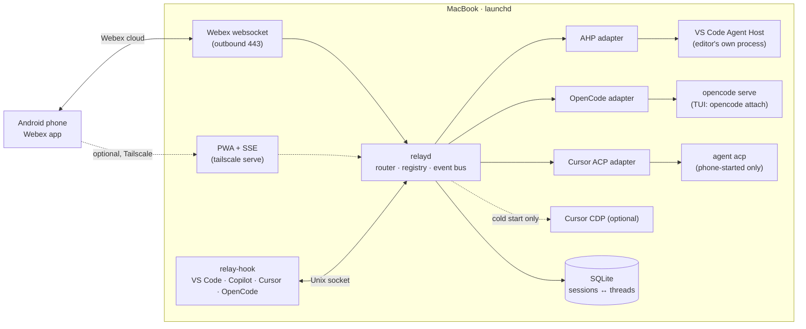
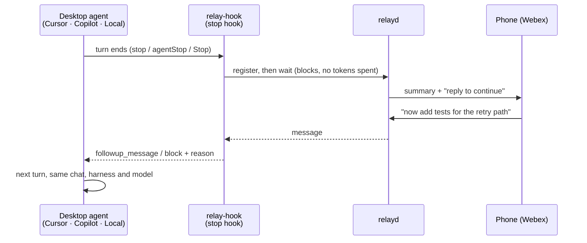
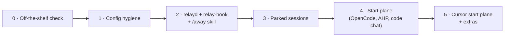

# Controlling desktop coding agents from a phone

> Historical record: this research predates the build. [PLAN.md](PLAN.md) and [deviations.md](deviations.md) record what was actually built.

- **Goal:** drive VS Code Copilot, Cursor and OpenCode on the MacBook from an Android phone, in the same harness the desktop UI uses, choosing model and workspace from the phone.
- **Snapshot:** 2026-10-03, on this Mac: VS Code 1.140, Cursor 3.23, OpenCode 1.18.15, a VPN client, macOS 27.
- **verify** marks anything that still needed a short spike.

## TL;DR

- **One small daemon, `relayd`**, under launchd. The phone talks to it **through a Webex bot** over an outbound websocket: no inbound port, no VPN, no Tailscale.
- **`relayd` never runs its own agent.** It attaches to each app's existing harness:
  - VS Code: the Agent Host Protocol (AHP) socket the editor already publishes.
  - OpenCode: the `opencode serve` server the TUI attaches to.
  - Cursor: Cursor's own hooks for desk-started sessions (with parked sessions); the Cursor CLI (`agent acp`) for phone-started sessions; no UI scripting.
- **Hooks do most of the in-session work.** One `relay-hook` binary goes into every harness's hook system (as `git-ai` already does on this Mac): observe, approve, steer, and keep a session waiting for the phone. This removes the VS Code extension and most Cursor UI scripting.
- **One Webex thread per agent session.** Replying in the thread steers it. Cards pick app, workspace and model, and approve tool calls.
- **Support both VS Code harnesses.** Local is **not formally deprecated** (1.140 lists no deprecations; Local still gets features), though setting texts say it "will be removed in a future release", no date. Prefer the Copilot harness for phone-steered work: sessions survive window crashes and vendor remote features come with it.
- **Tailscale is optional**, only for a richer PWA with true token streaming. It works badly alongside a VPN client anyway.

## 1. Design principles

| Constraint | Rule in the design |
|---|---|
| Control each agent independently | One adapter per harness, one queue per session, one Webex thread per session. One adapter failing doesn't stop the others. |
| Same harness as the desktop | Adapters attach to the running desktop harness; never spawn a CLI clone. |
| Choose the model | Each adapter lists the harness's own live models and passes the choice through natively. |
| Stream responses | Normalised event bus, then a renderer per front end (Webex or PWA). |
| Choose app and workspace | Workspace allowlist plus live-discovered windows; the relay opens the app if needed. |
| Mac never sleeps | `pmset disablesleep 1` (assumed); `relayd` under launchd `KeepAlive`. |

## 2. Off-the-shelf tools

| Tool | Covers | Same desktop harness? | Gate | Verdict |
|---|---|---|---|---|
| **Copilot remote control** (GitHub Mobile / github.com) | Copilot CLI and VS Code **Copilot-harness** sessions: prompt, approve, answer, switch mode, cancel | Yes; CLI or Agent Host keeps running locally | Org/enterprise policy *"Store local sessions in the Cloud" = View and control* | **Use if the policy is on.** No Local harness. |
| **VS Code Agents window in the browser** (`code tunnel`, then `insiders.vscode.dev/agents`) | Agent Host sessions (Copilot, Claude, Codex harnesses) | Yes; AHP to the Mac | Microsoft dev tunnels not blocked | Good backup GUI; Insiders web client clunky on a phone |
| **Cursor Remote Control** (`/remote-control`) | Cursor **Agents Window** sessions; Android uses the `cursor.com/agents` PWA | Partly: **agent loop moves to Cursor's cloud**, tools run locally | Admin toggle (Teams/Enterprise) plus cloud data storage (not Legacy Privacy Mode) | Doesn't cover the classic editor chat |
| **`opencode web` / `opencode serve`** | OpenCode | Yes; TUI is a client of the same server | Needs a network path (Tailscale) for the phone | Strong; `relayd` reuses its API |
| **Happy**, **claude-code-telegram**, Omnara, vibe-kanban | Claude Code / Codex CLIs, or own runtimes | No; separate CLI harness | n/a | Good reference designs, wrong harnesses |
| **Screen Sharing / VNC over Tailscale** | Everything | Yes; it is the desktop | Tailscale and Screen Sharing allowed | Zero drift, poor phone UX; last resort |

**Gap:** nothing unifies all three apps behind one Webex interface while keeping the desktop harness. `relayd` fills it.

## 3. Architecture



`relayd`: Python 3.13 with uv, about 1–2k lines plus the `relay-hook` binary, single instance behind a file lock.

| Part | Job |
|---|---|
| Front ends | Webex bot (primary), PWA (optional); both reduce to the same commands |
| Router | Maps session to adapter; serialises work per session |
| Registry (SQLite) | `session_id ↔ webex_thread_id ↔ harness session/chat id`, sticky model, workspace, last seen message id; survives restarts |
| Event bus | `text.delta`, `tool.start/end`, `approval.request`, `question`, `turn.done`, `error` |
| Adapter interface | `list_workspaces · list_models · start · send · steer · approve · answer · cancel · status` |

## 4. Adapters per harness

All four drive the real desktop harness (same process, same chat, or the server the TUI attaches to).

| Harness | Mechanism | Pros | Cons |
|---|---|---|---|
| **VS Code, Copilot harness** (preferred) | AHP JSON-RPC on the editor's Unix socket, found with `code agent endpoints` (verified: protocol 0.9.0, socket and token) | Sessions appear in VS Code; **token** streaming; **low** fragility (versioned protocol, chat channel marked *Stable*) | Customisations must move to `~/.copilot` |
| **VS Code, Local harness** (supported) | `code chat` CLI (verified in 1.140) plus hooks; `relay-bridge` extension only to pick the model from the phone | Drives the window's own chat | **Medium** fragility (removal announced, no date); **milestone** streaming only |
| **Cursor, classic chat** | `~/.cursor/hooks.json` scripts, plus CDP on `127.0.0.1` (launch with `--remote-debugging-port`) | The real composer | **High** fragility: DOM changes on updates |
| **OpenCode** | HTTP and SSE to `opencode serve` on `127.0.0.1`, protected by `OPENCODE_SERVER_PASSWORD` | TUI attaches to the same server; **token** streaming; **low** fragility (OpenAPI at `GET /doc`) | Needs the server running |

| Operation | Copilot harness (AHP) | Local | Cursor | OpenCode |
|---|---|---|---|---|
| Send prompt | `createSession`, then `createChat {initialMessage}` / `chat/turnStarted` | `code chat -m agent -r "<prompt>"` from the workspace; with extension: `chat.newLocalChat`, then `chat.open {query, mode, modelSelector, blockOnResponse, preserveInput}` | CDP: focus composer, insert text, send; mid-turn steering via `stop` hook `followup_message` | `POST /session/:id/prompt_async` |
| Pick model | `model` on the AHP `Message` | `modelSelector` / `chat.changeModel {vendor,id,family}` | CDP drives the model dropdown | `{providerID, modelID}` per message |
| Stream | `chat/delta`, `chat/toolCall*` (tokens) | Hooks `PreToolUse`/`PostToolUse`/`Stop` + `transcript_path` (milestones) | Hooks `afterAgentResponse`/`afterAgentThought`/tool hooks (milestones); CDP `MutationObserver` for tokens | `/global/event` `message.part.updated` (tokens) |
| Approvals, questions | `chat/toolCallConfirmed`; `chat/inputRequested`, then `chat/inputCompleted` | `PreToolUse` hook blocks until the phone answers (raise `timeout`), or `chat.acceptTool`/`skipTool` | `beforeShellExecution`/`beforeMCPExecution` return `allow`/`deny` | `permission.asked`, then `POST /permission/:id/reply` |
| Cancel | `chat/turnCancelled` | `workbench.action.chat.cancel` | CDP stop button | `POST /session/:id/abort` |
| Workspace | Session `workingDirectories` (optional worktree) | One window per workspace (`code -n <path>`) | One window per workspace (`cursor -n <path>`); CDP target per window | `?directory=<path>` on every call |

Hooks (section 5) shrink this: Local needs the extension only to pick the model from the phone; Cursor needs CDP only to cold-start a chat or switch model.

### Status of the Local harness (checked 2026-10-03)

| Signal | Says "going away" | Says "not soon" |
|---|---|---|
| 1.140 setting texts (`nls.messages.json`) | "This setting and the Local agent harness will be removed in a future release", on 4 Local-only settings (instruction, skill, agent and mode file locations) | No date or version |
| 1.140 release notes | Copilot harness is the headline; it "might already be the default" | "Deprecated features and settings: **None**" |
| Feature work | MCP migration prompts to the Copilot harness; profile `mcp.json` and `.vscode/mcp.json` labelled deprecated | 1.140 adds Local-only features (OTel identity capture, managed Auto tier) |
| Parity | — | Copilot harness lacks extension-provided tools outside windows, `${input:}` variables, `envFile`, MCP dev mode, custom OAuth. Handoffs start only from Local. Docs still recommend Local for extension tools and bring-your-own-key models. |

- **Verdict:** announced for eventual removal, still actively developed, blocked on parity. Treat as fully supported.
- Both harnesses read `~/.copilot/hooks`, so the relay barely changes when you switch.

**Why prefer the Copilot harness for phone-steered work**
- The Agent Host owns sessions independently of windows: a renderer out-of-memory crash (seen on this Mac) no longer kills a running agent.
- AHP is multi-client: phone and desktop see the same live state; first approval wins.
- Unlocks Copilot remote control and the browser Agents window for free.
- Cost: move user-level customisations from the VS Code profile to `~/.copilot` (section 9).

### Cursor

Ranked options:
1. **Hooks plus parked sessions** (section 5) for desk-started sessions: supported, documented; observe, approve, steer, continue after a turn ends.
2. **Cursor CLI in ACP mode** (`agent acp`) for **phone-started** sessions. The only sessions in this design that run in a sibling of the desktop harness rather than the harness itself (drift below).
3. If the admin enables Remote Control: the Agents Window plus the `cursor.com/agents` PWA.
4. **CDP**, only if a phone-started chat must appear *inside the desktop composer*. Keep it behind `selectors.json` and a self-test.

Cursor CLI (`agent` / `cursor-agent`) as the start plane:

| | Detail |
|---|---|
| Protocol | `agent acp`: JSON-RPC over stdio. `session/new`, then `session/prompt`. Streams `session/update` (`agent_message_chunk`: tokens). Approvals `session/request_permission`; questions `cursor/ask_question`; stop `session/cancel`. |
| Model | `--model` or the ACP session model; list from `agent models` (same account as desktop) |
| Workspace | `--workspace <path>`; `--worktree [name]` isolates edits under `~/.cursor/worktrees/` (shared with editor worktrees) |
| Resume | `--resume <chatId>`, `agent ls`; `&` hands off to a Cloud Agent |
| Fragility | **Low**: documented flags and protocol; replaces CDP entirely |

What the CLI shares with the desktop (checked on this Mac):

| Aspect | Shared | Differs |
|---|---|---|
| Account, models | Yes | — |
| MCP | `~/.cursor/mcp.json`, project `mcp.json` | Team-dashboard MCP servers unavailable in ACP |
| Rules, `AGENTS.md`, skills | Yes (`.cursor/rules`, `AGENTS.md`/`CLAUDE.md`, `~/.agents/skills`) | — |
| Hooks | Reads `hooks.json` | Only `workspaceOpen` documented to fire in the CLI (**verify** the rest); ACP permission requests make approval hooks unnecessary |
| Approval rules | — | Separate `~/.cursor/cli-config.json` (`approvalMode`, `permissions`, `sandbox`) vs IDE auto-run settings |
| Release train | — | Separate binary and updater: CLI `2026.07.17` vs desktop `3.23` |
| Sessions | Worktree folder | CLI chats in `agent ls`, **not the desktop chat panel** (**verify** the Agents Window) |
| Tools | Files, search, shell, web | No IDE-only pieces: editor diagnostics, browser tool, review UI (**verify**) |

Mitigations:
- Render `cli-config.json` permissions from the same source as the IDE allowlist.
- `/doctor` flags CLI/desktop version skew; a weekly launchd `agent update` keeps the CLI current.
- Back at the desk: `agent resume <id>` in Cursor's integrated terminal.

Compared with Copilot: Copilot CLI *is* the VS Code Copilot harness runtime and VS Code can adopt its sessions. Cursor's CLI is a sibling client with its own sessions: a **bounded exception** to "no parallel harness" (low, listed drift; phone-started sessions only).

## 5. Hooks, skills and plugins: the lighter path

| Plane | Job | Provided by |
|---|---|---|
| **Start plane** | Open a brand-new session from the phone | A protocol: AHP and the OpenCode HTTP API have one; Cursor has none |
| **Session plane** | Observe, approve, steer, keep alive | **Each harness's documented hooks; no UI automation** |

### What hooks and plugins can do

| Capability | VS Code Local | Copilot harness / CLI | Cursor | OpenCode plugin |
|---|---|---|---|---|
| Auto-register session (one Webex thread) | `SessionStart` | `sessionStart` | `sessionStart` | `event`: `session.created` |
| Observe tool calls | `PreToolUse` / `PostToolUse` | `preToolUse` / `postToolUse` / `postToolUseFailure` | `postToolUse`, `afterShellExecution`, `afterMCPExecution`, `afterFileEdit` | `tool.execute.after`; `message.part.updated` gives **tokens** |
| Final answer text | Read `transcript_path` (unstable format) | Read `transcriptPath` | **`afterAgentResponse.text`** | `message.updated` |
| Approve from phone | `PreToolUse` `permissionDecision` | **`permissionRequest` `behavior`** (+ `interrupt`) | `beforeShellExecution` / `beforeMCPExecution` `permission`, with `failClosed: true` | `tool.execute.before` (no timeout; throw to deny), or `permission.asked` + reply API |
| Steer mid-turn | `PostToolUse` `additionalContext` | `postToolUse` `additionalContext` (≤ 10 KB) | `postToolUse` `additional_context` | `noReply` prompt |
| Continue after turn ends | `Stop` `block` + `reason` (**verify** the reason reaches the model) | `agentStop` `block`; **reason is the next prompt**; max 8 in a row | `stop` **`followup_message`**; `loop_limit: null` = no cap | `session.idle`, then `promptAsync` |
| Wake idle session | No | `notification` (`agent_idle`, `permission_prompt`) `additionalContext`, injected as a user message (**verify** for main agent) | No | Yes, `promptAsync` |
| Start new session | No | No | No | Yes, `session.create` |
| Timeout | Default 30 s; no documented max | Default 30 s; **timeout falls back to the normal prompt (fails open)** | Per script; `failClosed` option | None; waits indefinitely |

OpenCode 1.x's documented `permission.ask` plugin hook is never called (issue #7006); use `tool.execute.before` or the permission events.

### Optimisation 1: one `relay-hook`, installed everywhere

- **Precedent:** `git-ai` already installs into Cursor `hooks.json`, `~/.copilot/hooks/git-ai.json` (read by both VS Code harnesses and Copilot CLI) and `~/.config/opencode/plugins/git-ai.ts`. `relay install` writes the same files idempotently.
- **Coexistence:** several hooks can run per event; the most restrictive permission wins, so `relay-hook` and `git-ai` don't interfere.
- **Payload formats:** small shims translate Copilot (camelCase or PascalCase), Cursor and OpenCode payloads into the event bus.
- **Speed:** runs on every tool call; exits 0 within milliseconds if away mode is off or `relayd` is down.
- **Deterministic fail-closed:** its own deadline, shorter than the harness timeout, returns an explicit **deny**, even on Copilot (whose timeout fails open).

### Optimisation 2: parked sessions

Replaces most of CDP and the VS Code extension.



- **Start:** begin at the desk (or from the phone via the start plane), then `/away`. At each turn end the stop hook holds the session and waits for the phone.
- **Release:** `/back` from the phone, or Stop on the desktop. The hook returns nothing once away mode is off.
- **Cost:** waiting is free (the hook process blocks, not the model); each continuation is one model request, same as typing at the desk.

| Harness | Continuation limit |
|---|---|
| Cursor | Unlimited with `loop_limit: null` |
| Copilot | 8 in a row, then fall back to the `notification` wake-up or AHP |
| Local | May hit `chat.agent.maxRequests` (default 25); raise it and **verify** |

- The desktop chat shows "running" while parked.
- Hook timeouts must cover the expected idle gap; max undocumented (**verify**). Expiry just ends the session, which is safe.
- **Model and workspace are fixed by the chat.** Switching needs the start plane (or CDP for Cursor).

### Optimisation 3: skills shape behaviour, not transport

- **Wrong transport:** they run only when the model decides to; every update costs tokens and tool calls; they cannot declare hooks (only plugins can).
- **Use skills for:**
  - `/away` and `/back`: user-invocable slash commands in VS Code, Copilot CLI and Cursor (OpenCode via a custom command).
  - The **away-mode contract**: decide instead of asking, prefer reversible changes, end each turn with a phone-sized status summary.
- **Refactor `stepping-away`:** keep its decision rules, drop its Webex MCP posting. Hooks post deterministically, at no token cost, and can't forget.
- **Skills already reach every harness:** all four read `~/.agents/skills`. The 22 skill folders in `~/.copilot`, `~/.cursor`, `~/.claude` and `~/.config/opencode` are **byte-identical duplicates**; delete them, don't sync.

### Optimisation 4: a plugin per harness

- Copilot CLI plugins (hooks, skills, MCP), Cursor plugins (`pluginPaths`) and OpenCode plugins (TypeScript) can each carry `relay-hook` plus the `/away` skill.
- One repository builds all of them, version-pinned; one command installs or upgrades.

### Optional: MCP `ask_phone` tool

- `notify_phone(text)` and `ask_phone(question, options)`: identical in every harness; a structured way for the away-mode skill to ask you.
- Downsides: timeouts short or undocumented (OpenCode defaults to 5 s unless `timeout` is raised; Cursor and VS Code document none); the model must choose to call it.
- Prefer native question events where they exist: AHP `chat/inputRequested`, Copilot `notification` with `elicitation_dialog`.

### Net effect

| Original component | With hooks |
|---|---|
| VS Code Local `relay-bridge` extension | **Dropped**; hooks plus parked sessions; cold starts via the Copilot harness |
| Cursor CDP adapter | **Optional**; only to cold-start a chat or switch model |
| Approval logic per harness | **One hook path**, fail-closed everywhere |
| Webex narration from `stepping-away` | Hooks |
| Token-level streaming | Still only AHP and OpenCode; hook-based harnesses stream per tool and per turn, enough on a phone |

## 6. Phone UX (Webex)

- **One 1:1 space** with the bot; it ignores every other room and `personId`.
- **One thread per session.** Root message is the session card `app · workspace · model · status`; thread replies go to that session, so agents run side by side without mixing.
- **Top-level messages are commands.**

| Command | Effect |
|---|---|
| `/new` | Card: **app**, **workspace**, **model**, prompt. Opens a new thread. |
| `/new cursor myproject opus "fix flaky test"` | Same in one line, using `relay.toml` aliases |
| `/sessions` | Live sessions: app, workspace, status, waiting-for-you flag |
| `/model [name]` (thread) | Show or switch model for the next turn |
| `/stop` · `/status` · `/diff` (thread) | Cancel turn · state summary · attach `changes.diff` |
| `/apps` · `/ws` · `/models <app>` | Live lists; open windows marked, closed workspaces can be opened |
| `/doctor` | Adapter health, app versions, config drift report |
| `/away` · `/back` (thread) | Park the session after each turn, or release it |
| `/panic` | Cancel every turn, deny every pending approval, pause the relay |

```text
you    /new copilot myproject sonnet-4.6 "run tox and fix failures"
bot    ┌ copilot · myproject · sonnet-4.6 · running ┐   ← thread root (edited)
         ↳ ran `uv run tox` → 3 failures in tests/core
         ↳ editing myproject/core/parser.py
         ↳ [Approve shell: `uv run pytest tests/core -x`]  [Allow once] [Session] [Deny]
you      (taps Allow once)
bot      ↳ All green. Summary … (full answer attached: answer.md)
```

## 7. Model, app and workspace selection

Model list always comes from the harness, never hard-coded:

| Harness | Model list source |
|---|---|
| Agent Host | AHP root channel `agents` / models |
| Local | `vscode.lm.selectChatModels`, filtered to picker-selectable models |
| Cursor | `cursor-agent models` (same account, read-only) |
| OpenCode | `GET /config/providers` |

- **Model precedence:** per-message override (`@m:opus`), then session sticky, then workspace default, then app default in `relay.toml`.
- **Aliases** (`opus`, `sonnet`, `gpt5`) map to each harness's id. Unknown or policy-blocked models get a picker card, never a silent fallback.
- **App:** `relayd` probes each adapter (AHP endpoint alive? CDP target or hooks heartbeat? `opencode serve` healthy?); only live apps appear in the card. Closed apps can be started: `open -a "Visual Studio Code"`, `open -a Cursor --args --remote-debugging-port=9223`, or `launchctl kickstart` for opencode.
- **Workspace:** `~/.config/relayd/workspaces.toml` is an **allowlist** of `alias → path` (including `.code-workspace` files); the phone can never type an arbitrary path.
  - Merged with live discovery: open VS Code and Cursor windows, AHP session working directories, OpenCode session directories.
  - Closed workspace: `code -n` / `cursor -n`; `relayd` waits for the window to register before sending.
  - Parallel sessions on one repo: an **AHP worktree session** avoids edit collisions.

## 8. Streaming to the phone

Webex limits: **10 edits** per message; text capped at **7,439 bytes**; rate limits with `429` + `Retry-After`.

| Event | Webex rendering |
|---|---|
| State change | **Edit the thread root card** (budget 8 edits): queued, running, waiting, done/error |
| `text.delta` | Buffer; flush as a **thread reply** at a paragraph boundary once ≥ 1.5 KB or after ~15 s without one; ≤ ~6 KB per message |
| `tool.start/end` | One line per tool, batched |
| `approval.request` / `question` | Adaptive Card with buttons or a `ChoiceSet`; edited once with the outcome |
| `turn.done` | Final answer as a reply; over 6 KB becomes an **`answer.md` attachment**; diffs in `changes.diff` |
| Back-pressure | Token bucket per thread (~1 message / 2 s); obey `Retry-After` |

The PWA (over Tailscale) streams raw tokens over SSE, unbatched.

## 9. Would Copilot-CLI-style harnesses help?

**Yes, for plumbing:** headless mode, `stream-json`, ACP (`copilot --acp`, `agent acp`, `opencode acp`) and built-in remote control are far easier than UI driving.

MCP drift is real (snapshot from this Mac):

| Harness | User-level MCP servers |
|---|---|
| VS Code Local (profile `mcp.json`) | atlassian, webex-messaging |
| Copilot CLI / Agent Host (`~/.copilot/mcp-config.json`) | GitHub, sonarqube |
| Cursor (`~/.cursor/mcp.json`) | GitHub, atlassian, chrome-devtools, example-local, webex-messaging |
| OpenCode | none |

- **Skills don't drift:** every harness reads `~/.agents/skills` (43 skills).
- **VS Code:** the **Copilot harness *is* the Copilot CLI runtime** (Copilot SDK), so "CLI vs IDE" becomes a config-location problem, not a parallel harness. The Agent Host reads `~/.copilot` and `.mcp.json`; VS Code forwards its own MCP servers only while a window is attached.
- **Cursor:** low but real CLI drift (section 4 table); used only for phone-started sessions.

One source of truth:

| Area | Approach |
|---|---|
| MCP | `~/.agents/mcp.yaml`; `relayd sync-config` renders `~/.copilot/mcp-config.json`, `~/.cursor/mcp.json`, `opencode.jsonc` and the VS Code `mcp.json` |
| Skills | Only `~/.agents/skills`; delete per-harness duplicates |
| Instructions | `AGENTS.md` per repo (every harness reads it) |
| Hooks | One `relay-hook` binary; per-harness config written idempotently by `relay install` (the `git-ai` pattern) |
| Checks | `/doctor` and a launchd timer diff rendered configs and alert on drift |

**Verdict:** move VS Code to the Copilot harness; keep `relayd` on the desktop harnesses. The CLI's ease without adding a harness.

## 10. Will Tailscale work behind a VPN?

- **Technically: sometimes, unreliably.**
  - Falls back to DERP relays over TCP 443.
  - Open issue tailscale#19128: same setup (VPN client, macOS, Apple Silicon) connects at first via Dynamic Tunnel Exclusion, then loops forever after the long-poll drops or the Mac wakes. Workaround: `tailscale down && up`.
  - Full-tunnel or lockdown profiles block it outright.
  - `100.64.0.0/10` and DNS can collide with the VPN.
- **Policy: decide before installing.**
  - Some machines run network filters that block a second VPN.
  - A second VPN with a third-party control plane gives a path into the Mac from a phone; look carefully.
  - Headscale (self-hosted) removes the third-party control plane, not the policy question.
- **Not a dependency:** Webex is outbound-only. If wanted, add the PWA with `tailscale serve` (tailnet-only HTTPS). **Never use Funnel.** ACLs allow only phone to Mac on the PWA port.

## 11. Pros and cons

| Question | Answer |
|---|---|
| **Easy to set up?** | Off-the-shelf: a few toggles, if account settings allow. `relayd`: moderate (Webex bot, launchd plist, adapters). Hooks remove the hardest pieces (Local extension, most of Cursor CDP). |
| **Easy to maintain?** | Low effort: AHP, OpenCode and Webex are versioned or OpenAPI; Webex API stable. Hook schemas documented; Cursor sends `cursor_version` in every payload. Only the optional Cursor CDP cold-start breaks on UI updates. |
| **Security** | No inbound ports; pinned to your `personId`; bot token in the Keychain; output scrubbed before posting; manual approvals by default; `/panic`. CDP on loopback lets any local process drive Cursor, so the port runs only while needed. Security software may flag CDP (**verify**). |
| **Data handling** | Prompts and outputs go to Webex under its retention settings; large code as attachments. Copilot remote control and Cursor Remote Control also send session content to GitHub or Cursor. |
| **Cost of off-the-shelf only** | Three phone apps, each behind an admin policy; no shared session view; no Local harness or Cursor classic chat. |

Handling agent and environment updates:
- On launch, and when an app's `Info.plist` version changes, re-run each adapter's self-test.
- AHP negotiates `protocolVersions`; the endpoint registry carries `schemaVersion`; OpenCode checked against `GET /doc`; Cursor DOM selectors smoke-tested.
- **Degrade, don't break:** Cursor falls back to hooks-only (mirroring and approvals work, new chats don't); an AHP version mismatch pauses that adapter; `/doctor` reports degraded state on Webex.
- Pin Webex SDK and OpenCode versions. Cursor auto-updates: use the *stable* channel and expect CDP selector fixes after updates.

## 12. Edge cases

| Case | Handling |
|---|---|
| Screen locked or display asleep | AHP, OpenCode and hooks keep working. **Verify** renderer throttling for CDP and the Local adapter. Never AppleScript or Accessibility (fail when locked). |
| Reboot or forced macOS update | launchd restarts `relayd` at login; FileVault blocks until someone logs in. Posts "Mac back online" on start. |
| Webex websocket drops | Reconnect with backoff; then `GET /messages?roomId` after the last seen id to catch missed prompts |
| Device registrations pile up | Clean up stale ones on start; single instance |
| VS Code window crashes | Agent Host sessions survive; a Local-adapter disconnect posts a warning in the thread |
| Desktop and phone act at once | AHP and OpenCode are multi-client (first approval wins); Local adapter uses `preserveInput`; Cursor CDP queues the prompt if the composer has a draft |
| Hook timeouts | `relay-hook` denies first (Copilot's own timeout fails open; Cursor `failClosed: true` blocks); a timed-out parked hook just ends the session |
| Back at the desk while parked | Stop, or `/back`; releases immediately |
| Long or binary output | Attachments (Webex limit 100 MB); never paste a diff inline |
| Secrets in output | Regex-scrub keys, tokens and passwords before posting |
| Model gone, quota hit, policy-blocked | Error card listing current valid models |
| Agent asks a question | `chat/inputRequested`, OpenCode `question.asked` or a Cursor ask becomes a `ChoiceSet` card |
| Two sessions in one repo | Recommend a worktree (AHP) or a different workspace alias; warn on overlapping edits |
| Lid closed | On power, lid open or clamshell; watch thermals. `disablesleep` is the only thing keeping it awake. |

## 13. Rollout



| Phase | Do | Exit check |
|---|---|---|
| **0 · Off-the-shelf check** | Ask the GitHub org owner about *Store local sessions in the Cloud → View and control*; look for Cursor **Settings › Agents › Remote Control**; decide on Tailscale | Know which vendor paths are open |
| **1 · Config hygiene** | `~/.agents` as source of truth; `sync-config` for MCP; delete duplicate skills; move VS Code customisations to `~/.copilot` | `/doctor` shows zero drift |
| **2 · relayd + `relay-hook` + `/away` skill** | Webex bot (websocket), registry, renderer; `relay install` for every harness; observe and approve via hooks | Every desktop session is a Webex thread; phone approvals work in all harnesses |
| **3 · Parked sessions** | Stop-hook long-poll for Cursor, Copilot, Local | Phone replies continue a desktop chat in each harness |
| **4 · Start plane** | OpenCode HTTP adapter; AHP adapter for Copilot-harness sessions; `code chat` for Local | Phone-started session shows live in the VS Code Chat view and the OpenCode TUI |
| **5 · Cursor start plane, extras** | `agent acp` adapter for phone-started Cursor sessions; CDP only if they must appear in the desktop composer; PWA if Tailscale is wanted | Phone-started Cursor session streams tokens and asks for approvals |

Spikes to run first (**verify**):
1. A stop hook can block for hours: Cursor `stop` with `loop_limit: null`, Copilot `agentStop`, Local `Stop`. Does the Local `Stop` reason reach the model; does `chat.agent.maxRequests` cap the loop?
2. Copilot `notification` `agent_idle` fires for the main agent and wakes it via `additionalContext`.
3. A third-party AHP client can `createSession` with the Copilot harness on the editor-published host; do editors reuse a standalone `code agent host` supervisor?
4. Screen-locked behaviour per harness. Cursor `--remote-debugging-port` matters only if CDP cold-start is wanted.
5. Which window `code chat -r` targets when several are open; does running it inside a workspace folder pick that window?

## 14. Narrowing the scope (not ideal, worth knowing)

- Complexity comes from the **number of start planes and hook formats**, not the number of apps.
- Same in every option: Webex bot, registry, renderer, approvals, `/away`.

| Option | What you keep (built) | What you lose | Phone limits left | Fragile parts | Hook formats |
|---|---|---|---|---|---|
| **A. Everything** (current) | AHP + `code chat` + OpenCode HTTP + Cursor hooks (+ CDP) | — | Cursor: no cold start or model switch without CDP. Local: milestone streaming, can't wake idle. | Cursor CDP | 3 |
| **B. Cursor hooks, no CDP** | A minus CDP | Starting Cursor from the phone | Cursor sessions start at the desk; then observe, approve, park from the phone | **None** | 3 |
| **B+. Cursor hooks + CLI, no CDP** | B plus an `agent acp` adapter | Nothing functional; small listed drift | Phone-started Cursor sessions not in the desktop composer; resume with `agent resume` | **None** | 3 |
| **C. Drop Cursor** | AHP + `code chat` + OpenCode | Cursor from the phone (Cursor's own Remote Control still applies if the admin enables it) | Local milestone-only | None | **2** (`~/.copilot/hooks` for both VS Code harnesses and Copilot CLI, plus the OpenCode plugin) |
| **D. OpenCode only** | Webex to OpenCode HTTP, nothing else | IDE-integrated agents; OpenCode becomes the desk agent | **None**: cold start, model, tokens, approvals, multiple directories all native | None | **0** (API does it all) |
| **E. VS Code Copilot harness only** | AHP adapter, or **nothing** if GitHub Mobile remote control is allowed | Local, Cursor, OpenCode | None | None | 0–1 |
| **F. VS Code only (both harnesses)** | AHP + `code chat` + one hook file | Cursor, OpenCode | Local milestone-only | None, or the extension for model choice | 1 |

### Dropping Cursor (A to B or C)

- **Gains:** the only high-fragility part goes (no CDP port, DOM selectors, post-update breakage or security-software prompt); uniform phone UX (Cursor is the only app without a start-plane API, so no "not supported for Cursor" branches); one hook format family (`~/.copilot/hooks`, only payload casing differs); three harnesses to test instead of four.
- **Small gain:** the Cursor hook shim is small; the saving is dropping its *start plane* (CDP), not its *hooks*.
- **Verdict: take B+.** Cursor stays visible and approvable via hooks; new Cursor work starts via the CLI. Almost all of C's simplicity without losing Cursor. Fall back to **B** to allow no sibling harness at all.

### Focusing on one app (D, E or F)

- **Gains:** no app picker or per-app capability flags; one model-alias table and one workspace discovery; one end-to-end test path; `/new` drops to two steps (workspace, model).
- **Risks:** lock-in; desk sessions in other apps invisible from the phone; "each agent independently controllable" holds only within that app.

| If the one app is | Fit |
|---|---|
| **OpenCode** | **Technically best.** The server *is* the harness; `opencode web` is a ready-made GUI; can use Copilot models as a provider. Loses the IDE's agent features. |
| **VS Code (F)** | **Best fit for how you work.** Both harnesses via one hook file, `code chat` and AHP. Microsoft ships the remote features (Agents window over a tunnel, GitHub Mobile) you'd otherwise build. |
| **Cursor** | **Viable only via the CLI.** `agent acp` gives a clean API (cold start, model, tokens, approvals), but phone-started sessions live outside the desktop composer. Without it: Cursor Remote Control (admin toggle, cloud loop, Agents Window only). |

**Recommendation:** build **F**, then add OpenCode (cheap, clean API), then Cursor as in **B+**. Each step is complete on its own; stop once it covers what you need away from the desk.

## Sources

- VS Code: [Agent Host](https://code.visualstudio.com/docs/agents/concepts/agent-host) · [harnesses](https://code.visualstudio.com/docs/agents/run/agent-harnesses) · [remote agent sessions](https://code.visualstudio.com/docs/agents/run/remote-agent-sessions) · [hooks](https://code.visualstudio.com/docs/agent-customization/hooks) · [`chatActions.ts`](https://github.com/microsoft/vscode/blob/main/src/vs/workbench/contrib/chat/browser/actions/chatActions.ts)
- [Agent Host Protocol spec](https://microsoft.github.io/agent-host-protocol/specification/overview.html)
- GitHub: [Copilot CLI remote control](https://docs.github.com/en/copilot/concepts/agents/copilot-cli/about-remote-control) · [ACP server](https://docs.github.com/en/copilot/reference/acp-server)
- Hooks: [VS Code hooks reference](https://code.visualstudio.com/docs/agents/reference/hooks-reference) · [Copilot hooks configuration](https://docs.github.com/en/copilot/reference/hooks-configuration) · [Cursor third-party hooks](https://cursor.com/docs/reference/third-party-hooks)
- Skills: [VS Code](https://code.visualstudio.com/docs/agent-customization/agent-skills) · [Copilot CLI](https://docs.github.com/en/copilot/how-tos/copilot-cli/customize-copilot/create-skills) · [Cursor](https://cursor.com/docs/context/skills) · [OpenCode](https://opencode.ai/docs/skills/)
- Cursor: [mobile & Remote Control](https://cursor.com/docs/background-agent/web-and-mobile) · [hooks](https://cursor.com/docs/agent/hooks) · [CLI ACP](https://cursor.com/docs/cli/acp)
- OpenCode: [server](https://opencode.ai/docs/server/) · [web](https://opencode.ai/docs/web/) · [plugins](https://opencode.ai/docs/plugins/) · [ecosystem](https://opencode.ai/docs/ecosystem/) · [`permission.ask` issue #7006](https://github.com/anomalyco/opencode/issues/7006)
- Webex: [edit message](https://developer.webex.com/docs/api/v1/messages/edit-a-message) · [buttons & cards](https://developer.webex.com/docs/buttons-and-cards) · [`webex_bot`](https://github.com/fbradyirl/webex_bot)
- Tailscale + a VPN: [#19128](https://github.com/tailscale/tailscale/issues/19128) · [#10020](https://github.com/tailscale/tailscale/issues/10020)
- References: [Happy](https://github.com/slopus/happy) · [claude-code-telegram](https://github.com/overwirehq/claude-code-telegram) · [Headscale](https://github.com/juanfont/headscale)
