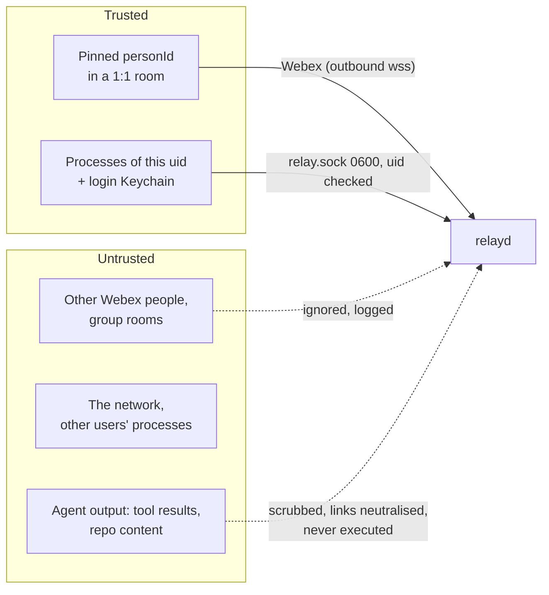

# Security

The phone drives agents that can run commands on this Mac. This page: what is at stake, the threats, the controls,
and the test that proves each control (AC-40).

## Assets

| Asset | Examples |
|---|---|
| The Mac's shell and files | Every driven agent can edit files and run commands |
| Secrets agents see | Tokens in repo files, env vars, MCP configs, tool output |
| The relay's credentials | Webex bot token, OpenCode password, PWA token, MCP secrets moved to the Keychain by `relay config import` |

## Trust boundaries

- relayd only connects out (Webex websocket and REST, `127.0.0.1` app servers).
- Nothing listens on the network unless the PWA is on, and then only on loopback.

## Threats at a glance

| Threat | Main answer |
|---|---|
| Stolen or unlocked phone | `/panic`, revoke the Webex session; **no approvals slow the thief** |
| Compromised Webex account / strangers | Pinned `personId`, 1:1 only; a compromised account *is* the user |
| Other local processes | `0600` socket + uid check, Keychain-only secrets, loopback-only servers |
| Prompt injection into what the phone shows | Fixed card buttons, one-use nonces, links as code, no HTML rendering |
| Hostile `answer.html` | `html=False`, strict CSP, no links, scrubbed |
| Secrets leaking out | Scrub every outbound byte and log record |
| Agent reading files out via `send_phone_file` | Workspace jail, no links, size cap |
| Files and clones from the phone | Owner-only, inbox jail, allowed hosts, no shell |

## Threats and answers

### Stolen or unlocked phone

The thief can read sessions and start or steer agents while Webex stays signed in. **Nothing slows them: there are no approvals.**

- `/panic` (from any device on the account): closes open questions, cancels turns, turns away off, writes a pause flag
  that survives restarts. While paused the relay answers nothing, so desk apps ask at their own prompt.
  Confirm card valid 60 s; `/panic now` skips it; `/away` resumes.
- On the Mac: `relay stop` stops everything.
- Revoke the Webex session in account settings; the bot then sees nothing from that device.

### Compromised Webex account, or someone else messaging the bot

- The first person to message with `webex.allowed_email` is pinned by immutable `personId`; any other person is ignored, even with the right email.
- Group rooms are ignored and left. Card submissions are re-checked against the pinned person and room type (a card can be forwarded).
- **Whoever controls the account can run anything on the Mac.** True via a prompt anyway; since D117 no approval step slows it.
- What is left: pinned person id, 1:1 rooms, `/panic`, revoking the session, the scrubbed logs, and the "never do while away" list in `agent-relay-away` (binds the agent, not the relay).

### No approvals (a documented deviation)

PLAN §5 promised "never a global auto-approve". [D117](deviations.md) reverses it: every tool call the relay answers is allowed at once.

- **Why (F7):** of 68 approval cards, 33 answered on the phone (all allow), 21 (31 %) timed out and were auto-denied (stalling the turn), 14 answered at the desk. Friction, not control: the same person could send any prompt.
- **What the relay answers:** phone-held sessions, and desk sessions while away is on. A desk session at the desk, and everything after `/panic`, keeps the app's own prompt (`{}` for hooks, no answer for adapters). A failing hook returns `{}` too (D124).
- **App flags:** phone sessions also start with the app's auto-approve (Cursor CLI `--force`, AHP `autoApprove`, OpenCode `always`; D125). Not verified live; the relay's allow does not depend on them.
- **Questions still wait:** `ask_phone`, AHP input, OpenCode questions, Cursor `ask_question` need your answer, with a one-use nonce and `questions.deadline_s`.
- There is no deny list.

### Other local processes

- IPC socket `0600` in a `0700` directory; every connection's peer uid is checked.
- Secrets only in the Keychain; files the relay writes hold references, never values (`relay.toml` holds no secrets).
- PWA (if on): `127.0.0.1` only, bearer token compared in constant time. Use `tailscale serve` (`relay pwa expose`), never Funnel.
- Cursor's debug port gives any local process full control of Cursor. Opened only while the CDP adapter is enabled, and only by `relay selftest cursor-cdp` or the adapter, never by the background update check.

### Prompt injection into what the phone shows

Repo content or tool output can be crafted to look like an instruction or to mislead. Question cards are the only cards carrying agent text.

- Options are fixed by the question; nothing in a card body can add or change a button.
- A submission carries only the request id, the chosen option or typed answer, and the card's one-use nonce; the server re-checks it. Expired or answered questions cannot be answered again; the first successful tap spends the nonce.
- The `/new` Start value (`harness:model`) is re-checked against the offer stored under the card's nonce, so a forged `agent` is refused.
- Card JSON is checked in CI against the Webex subset of Adaptive Cards 1.3 (`tests/frontends/card_spec.py`).
- URLs in agent output reach the phone as code spans, not links (`frontends/text.py`, re-exported by `frontends/webex/links.py`).
- The relay never executes or renders message text or cards as HTML (the PWA uses `textContent`); the only HTML artefact is below.

### HTML output (`answer.html`, `changes.html`)

Long or rich answers, and a `/diff` over 200 lines, go out as one self-contained file (`frontends/rich.py`, shared by Webex and the PWA). It must stay inert even if the agent's text is hostile.

- `markdown-it-py` with `html=False`: raw HTML is escaped, including `<script>` in a table cell, heading or emphasis.
- `<meta http-equiv="Content-Security-Policy" content="default-src 'none'; style-src 'unsafe-inline'; img-src data:">`: no script, no external resource, whichever app opens it.
- No live links: a URL stays text (label, then address in a code span); no `<a>`, no `href`; images become `[image: alt]`; `javascript:` and reference links likewise (D90).
- Source text, finished HTML and preview each pass through `scrub`. If rendering raises, the answer falls back to text chunks.
- Open check: whether Webex Android opens the file in-app or in the browser, and that the CSP survives both. The E2E driver checks the downloaded file (CSP present, no `<script`, no `href=`, no external `src=`, `url(http` or `@import`).

### Secrets leaking out

- Everything sent to Webex or the PWA is scrubbed: text, cards, attachments. Generated attachments (diffs, `answer.html`) are scrubbed before upload.
- `send_phone_file`: text is scrubbed, binary (PNG, PDF) passes byte for byte; `scrub_attachment` still refuses non-text; the upload path (`scrub_upload`) scrubs text types and sends other types as they are (D143).
- Logs are scrubbed on every record. Bodies are never logged at INFO; with `debug_bodies = true` and DEBUG they are logged scrubbed and truncated. Both off by default.
- `relay` commands scrub what they print; config diffs hide secrets.

### The Webex token

- One bot, one token (Keychain service `agent-relay`, account `webex-bot-token`).
- `relay setup token --stdin` reads stdin only (never argv, so never shell history or `ps`), refuses a terminal, never prints it.
- relayd re-reads it before every attempt and keeps running when Webex rejects it (D121); `relay doctor` tests it with `GET /people/me` and reports a rejection without printing it.
- A token seen in a transcript or screen share: regenerate it at developer.webex.com.
- The three October-round app bots are retired (D116): Keychain items deleted; the owner deletes the bots.

### Away mode is manual

- No screen-lock probe, no automatic trigger (D120). Only `/away`, `/back`, `relay away on|off` change the global flag, so a locked or sleeping Mac never hands desk sessions to the phone.
- While away is off, the router withholds desk-started sessions' events from the phone and the relay answers none of their tool calls.

### The E2E driver's person token

`scripts/phone_e2e.py` acts as the owner (D123), so it needs a person token, far more powerful than the bot's.

- Read through `webex-cli`'s `get_access_token()` (the OAuth token it already keeps); never in a relay file or the relay's Keychain.
- Sent only to `https://webexapis.com/v1/`; redirects never followed; every error text goes through a redactor that knows the token plus `agent_relay.scrub`.
- Never printed, logged, put in an exception, report or fixture; tests use a fake token.
- Refuses without `RELAY_LIVE=1`; refuses a room whose other member is not a `@webex.bot`; `.scratch` only, ≤ 3 sessions per adapter per run; deletes its messages at the end.

### `send_phone_file`: the workspace jail

The path is untrusted input (`core/send_file.py`).

- Relative, absolute or `~/…` (expanded, then judged like any absolute path); resolved with symlinks followed; must lie inside the session's resolved workspace. A link (file or folder) pointing out is refused.
- Must be a regular file (directories, FIFOs, devices refused; opened with `O_NOFOLLOW|O_NONBLOCK`, re-checked with `fstat`) and ≤ `attachments.max_bytes`, checked before reading and after scrubbing.
- Error messages name the path the agent gave, never the resolved target.
- Honoured only for phone-held sessions and, while away, desk sessions; never while paused.

### Files from the phone

- Only from the pinned person; downloaded only from the Webex API host with the bot token.
- Top-level files wait in `<app-support>/inbox-staging/` (`0700`, files `0600`) until the next `/new` or `attachments.hold_s`, then move to the session's inbox or are swept.
- Written to `<workspace>/<attachments.inbox_dir>/<session>/` (default `.agent-relay/inbox`): folders `0700`, files `0600` via `O_EXCL`/`O_NOFOLLOW`, name reduced to one safe component, inbox must stay inside the workspace, no link followed on the way.
- Over `attachments.max_bytes` (20 MB) refused, even when the download declares no length. A failed or unsupported download gets one `⚠️` line, never skipped silently.
- Inbox added to `.git/info/exclude`, never `.gitignore`. Session folder deleted a day after the session ends.
- Incoming files are the user's own and are not scrubbed; outgoing still is.

### Cloning from the phone

- `/ws` clones only `https://<host>/<owner>/<repo>` or `git@<host>:<owner>/<repo>` with a host in `ws.clone_hosts`, into a new folder directly under a root.
- `git clone -- <url> <target>`, no shell, env limited to `HOME`, `PATH`, `SSH_AUTH_SOCK`, `GIT_TERMINAL_PROMPT=0`; own process group under `ws.clone_timeout_s`, whole group killed on timeout.
- git output is scrubbed and cut to its last lines; a failed or partial clone is removed.

## Controls and their tests (AC-40)

Each PLAN §5.10 requirement, where it is enforced, and the test that fails if it regresses. A cite that starts
with `::` is in the same file as the previous cite.

| Control | Enforced in | Tests |
|---|---|---|
| No TCP listener except the PWA, on loopback | `frontends/pwa/server.py` (`LOOPBACK`) | `tests/test_security.py::test_only_the_pwa_opens_a_tcp_listener_and_only_on_loopback`, `tests/frontends/test_pwa.py` |
| Unix sockets `0600`, directory `0700`, peer uid checked | `ipc.py` | `tests/test_ipc.py::test_roundtrip_and_mode`, `::test_refuses_other_uid` |
| Only the pinned `personId`; 1:1 rooms only | `frontends/webex/access.py` | `tests/frontends/test_access.py` (first contact pins, others ignored, group rooms left) |
| Every card submission re-checked | `frontends/webex/bot.py`, `frontends/actions.py` | `tests/frontends/test_access.py::test_card_submission_from_other_person_is_ignored`, `::test_card_submission_from_group_room_is_ignored`, `::test_card_before_any_pinning_is_ignored` |
| The relay posts no approval card and allows every call it answers (D117; the old "never a global auto-approve" is superseded, reason F7) | `core/hooks.py`, `core/approvals.py` (`intercept`), `hook/outputs.py` | `tests/core/test_no_approvals.py::test_relay_never_posts_an_approval_card`, `::test_every_relay_answered_tool_call_is_allowed`, `::test_every_hook_answered_tool_call_is_allowed`, `tests/frontends/test_no_approval_card.py::test_there_is_no_approval_action_and_no_approval_card_builder` |
| A desk session at the desk, and everything after `/panic`, is left to the app's own prompt | `core/hooks.py`, `core/approvals.py` | `tests/core/test_no_approvals.py::test_desk_sessions_at_the_desk_are_left_to_the_app`, `::test_nothing_is_answered_after_a_panic`, `tests/core/test_hooks.py::test_a_hook_failure_leaves_the_tool_call_to_the_app` |
| Legacy `approvals.*` settings are ignored; only questions wait for the phone | `models/config.py` | `tests/test_security.py::test_there_is_no_approval_config_and_a_legacy_one_is_ignored`, `::test_questions_are_the_only_thing_that_waits_for_the_phone` |
| Nothing turns away mode on by itself; desk events stay off the phone while it is off | `core/away.py`, `core/router.py` | `tests/core/test_away_global.py::test_nothing_turns_away_on_by_itself`, `::test_desk_events_are_dropped_while_not_away`, `::test_an_adopted_desk_chat_stops_streaming_the_moment_away_goes_off` |
| Scrub everything outbound | `frontends/webex/api.py`, `frontends/pwa/hub.py`, `log.py`, `cli/output.py` | `tests/test_scrub.py`, `tests/frontends/test_pwa.py`, `tests/test_cli_sync.py` |
| Attachments scrubbed as text before upload | `frontends/webex/api.py::scrub_attachment`, `frontends/webex/api.py::scrub_upload` | `tests/test_security.py::test_attachments_are_scrubbed_as_text_and_binary_is_refused`, `tests/frontends/test_upload_scrub.py` |
| No bodies at INFO; DEBUG bodies scrubbed and off by default | `log.py::log_body`, `debug_bodies` | `tests/test_security.py::test_message_bodies_are_off_by_default_never_at_info_and_scrubbed` |
| CDP port only while the adapter is enabled | `adapters/factory.py`, `cli/selftest.py`, `adapters/selftests.py` | `tests/test_security.py::test_the_cdp_adapter_exists_only_when_enabled`, `tests/test_cli_ops.py::test_cdp_selftest_refuses_while_the_adapter_is_off`, `tests/adapters/test_selftests.py` |
| PWA fails closed without a token | `daemon.py`, `frontends/pwa/server.py` | `tests/frontends/test_pwa.py` |
| `/panic` pauses across restarts | `core/service.py::panic`, `paths.pause_flag` | `tests/frontends/test_flows.py::test_panic_pauses_and_cancels`, `tests/core/test_away_global.py::test_panic_pauses_forces_away_off_and_closes_questions`, `::test_set_away_for_on_resumes_after_a_panic`, `tests/frontends/test_panic_confirm.py::test_confirming_cancels_everything_and_pauses` |
| Secrets only in the Keychain | `settings.py`, `sync/secrets.py` | `tests/test_settings.py`, `tests/sync/test_config_sync.py` |
| The Webex token goes through stdin only and is never printed | `cli/setup.py`, `settings.py` | `tests/test_setup_token.py::test_setup_token_stores_the_token_from_stdin_and_never_prints_it`, `::test_setup_token_refuses_without_storing_or_echoing`, `tests/test_daemon.py::test_missing_token_exits_2_with_setup_command` |
| A rejected Webex token never stops relayd and is never printed | `frontends/webex/host.py`, `doctor/local.py` | `tests/test_daemon.py::test_startup_401_keeps_relayd_up`, `tests/doctor/test_local.py::test_doctor_reports_rejected_token` |
| A forged `/new` agent is refused | `frontends/webex/handlers.py`, `core/service/discovery.py` | `tests/frontends/test_new_card.py::test_a_forged_agent_is_refused_even_for_an_enabled_app_model`, `::test_the_card_is_checked_again_on_the_server` |
| Card JSON stays inside the Webex subset of Adaptive Cards 1.3 | `tests/frontends/card_spec.py` | `tests/frontends/test_card_spec.py::test_every_card_builder_passes_the_webex_subset_with_maximal_inputs`, `::test_action_toggle_visibility_is_refused`, `::test_an_oversized_card_is_refused` |
| `answer.html` is inert: CSP, raw HTML escaped, no `href`, scrubbed | `frontends/rich.py` | `tests/test_rich.py::test_the_csp_is_present_exactly_once_and_forbids_everything_but_inline_css`, `::test_raw_html_in_the_text_is_escaped`, `::test_script_in_a_table_cell_heading_and_emphasis_is_escaped`, `::test_links_are_text_with_no_href_anywhere`, `::test_the_scrubber_runs_on_the_html_and_the_preview`, `::test_the_diff_page_has_the_same_csp_and_escapes_everything` |
| `send_phone_file` stays inside the workspace, never through a link, capped | `core/send_file.py`, `daemon.py` (`send_file` op) | `tests/core/test_send_file.py::test_dot_dot_out_of_the_workspace_is_refused`, `::test_an_absolute_path_outside_the_workspace_is_refused`, `::test_a_symlink_inside_pointing_outside_is_refused`, `::test_a_symlinked_folder_pointing_outside_is_refused`, `::test_an_oversized_file_is_refused`, `::test_a_fifo_is_refused_without_blocking`, `::test_a_text_file_is_scrubbed`, `tests/test_daemon.py::test_send_file_goes_to_the_session_thread_and_stays_inside_the_workspace` |
| Top-level files are held privately and left behind when their time runs out | `core/inbox.py`, `frontends/webex/attachments.py` | `tests/frontends/test_attachments_intake.py::test_files_held_at_the_top_level_are_left_behind_when_their_time_runs_out`, `tests/core/test_inbox.py::test_held_top_level_is_none_once_the_time_is_up_and_leaves_the_files_for_the_sweep` |
| The driver's person token never leaves `webexapis.com` and never reaches an error or report | `scripts/e2e/webex_cli_user.py`, `scripts/e2e/model.py` | `tests/live/test_phone_e2e.py::test_an_error_from_webex_never_carries_the_token`, `::test_the_token_is_only_ever_sent_to_webexapis`, `::test_a_failed_refresh_in_webex_cli_is_a_safe_error`, `::test_a_setup_error_is_scrubbed_and_exits_two`, `tests/test_e2e_driver.py::test_an_error_text_never_carries_a_secret_into_the_report`, `::test_the_session_cap_stops_a_run_before_it_sends_anything`, `tests/live/test_phone_e2e.py::test_the_driver_refuses_to_run_without_relay_live_one` |
| Phone files stay owner-only inside the workspace, capped, never through a link | `core/inbox.py`, `frontends/webex/attachments.py` | `tests/core/test_inbox.py::test_a_file_lands_in_the_session_folder_owner_only`, `::test_a_planted_link_with_the_same_name_is_never_written_through`, `::test_an_inbox_dir_must_stay_inside_the_workspace`, `::test_a_file_over_the_cap_is_refused_and_nothing_is_left`, `::test_sweeping_never_follows_a_link_or_deletes_a_foreign_folder`, `tests/frontends/test_attachments_intake.py::test_a_file_named_by_the_sender_cannot_choose_where_it_lands`, `::test_the_cap_holds_even_when_the_download_declares_no_length`, `::test_the_bot_token_never_leaves_the_webex_api_host` |
| Clones: allowed hosts only, no shell, minimal env, killed on timeout, nothing left on failure | `core/workspaces.py` | `tests/core/test_workspaces_phone.py::test_other_urls_are_refused`, `::test_a_host_outside_the_allow_list_is_refused_and_the_list_is_named`, `::test_git_sees_only_the_allow_listed_environment`, `::test_clone_runs_git_without_a_shell_and_with_the_allow_listed_environment`, `::test_a_clone_that_takes_too_long_is_killed_and_removed`, `::test_a_failure_removes_a_partial_checkout`, `::test_git_output_is_scrubbed_and_cut_to_the_last_lines` |
| Agent links neutralised | `frontends/text.py`, `frontends/webex/links.py` | `tests/frontends/test_links.py::test_links_become_code_spans`, `::test_agent_text_posted_to_webex_has_no_live_links` |

## Not protected against

| Risk | Why |
|---|---|
| Malware running as this user | It can read permitted Keychain items, use the socket and drive the apps directly; the relay adds nothing beyond what the apps expose |
| An agent doing harm with a tool call | No approvals and no deny list (D117); the away skill's list binds the agent, not the relay. `/panic` stops turns but cannot undo what ran |
| Whoever controls the Webex account | Can run anything on this Mac; nothing slows them |
| Webex itself | Messages transit the Webex service like any other |
