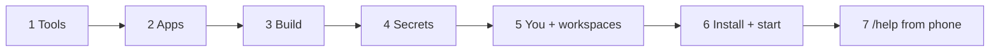

# Setup (once, on the Mac)

From nothing to "the bot answers `/help`". Day-to-day use is in [user-guide.md](user-guide.md).



- `relay …` below means `uv run relay …`, run from the checkout.
- A `relay config set` change applies after `relay start`.

## What you need

| Item | Notes |
|---|---|
| Mac | Stays powered and online while you are away (see [Keeping the Mac reachable](#keeping-the-mac-reachable)) |
| Phone | Android or iPhone with the Webex app, signed in |
| Webex bot | Your own, from [developer.webex.com](https://developer.webex.com/my-apps): **Create a New App → Create a Bot**. Keep its token |
| The apps | Installed and signed in at the desk first: VS Code + GitHub Copilot, Cursor (desktop and/or `cursor-agent`), OpenCode |

## 1. Developer tools

```bash
xcode-select --install                               # git and compilers
curl -LsSf https://astral.sh/uv/install.sh | sh      # uv (fetches Python 3.13)
brew install node                                    # npm, to build the VS Code extension
```

## 2. The apps

Set up only the ones you use. A missing app is fine: `relay doctor` says what it found. To silence one:
`relay config set adapters.opencode false`.

| App | Setup |
|---|---|
| VS Code | Sign in to GitHub Copilot. Command Palette → *Shell Command: Install 'code' command in PATH*. **Leave it running** when away: the Copilot Agent Host only exists while VS Code is open |
| Cursor CLI | `curl https://cursor.com/install -fsS \| bash`, then `cursor-agent login` |
| Cursor desktop | Nothing; restart it once after `relay install --apply` |
| OpenCode | `curl -fsSL https://opencode.ai/install \| bash` (installs to `~/.opencode/bin`), then `opencode auth login` |

## 3. Get and build the relay

```bash
git clone <this repository> ~/Desktop/Repository/Personal/agent-relay
cd ~/Desktop/Repository/Personal/agent-relay
uv sync --frozen --all-extras
(cd extensions/relay-bridge && npm ci && npm run build)
```

## 4. Secrets into the Keychain

Secrets live only in the login Keychain; none of these land in shell history.

```bash
# Webex bot token: press "Copy Token" on the bot's page, then
pbpaste | uv run relay setup token --stdin
# then copy something else so the token leaves the clipboard

# OpenCode server password (only if you use OpenCode); any long random value, e.g. openssl rand -base64 32
security add-generic-password -U -s agent-relay -a opencode-password -w
```

## 5. Who you are, where you work

```bash
uv run relay config set webex.allowed_email you@example.com   # only this account is answered
uv run relay ws add scratch "$PWD/.scratch"                  # a safe folder to try things
uv run relay ws add myproject ~/code/myproject               # each folder the phone may use
```

- A **workspace** is a folder (or a `.code-workspace` file) the phone may start sessions in, under a short name.
- `relay ws list` shows them; `relay ws rm <name>` removes one.

## 6. Install, start, check

```bash
uv run relay install            # dry run: lists every change, changes nothing
uv run relay install --apply    # hooks, plugin, MCP sync, skills, launch agents, VS Code extension
uv run relay start
uv run relay doctor             # every line should be ✅ or ℹ️
```

- Every file is backed up first; `relay uninstall --apply` restores them.
- Afterwards: reload VS Code windows and restart Cursor so they load the hooks and relay-bridge.
- relayd then starts at every login. Install details: [operations.md](operations.md).

## 7. Say hello from the phone

- In Webex, open a direct chat with your bot (address ends in `@webex.bot`) and send `/help`.
- Your first message from `allowed_email` pins your Webex account; everyone else is ignored from then on.
- relayd posts nothing on its own when it starts, so `/help` or `/doctor` is how you check the Mac is reachable.

## Keeping the Mac reachable

| Concern | What to know |
|---|---|
| Sleep | A sleeping Mac answers nothing. Laptop: plug in and enable *System Settings → Battery → Options → Prevent automatic sleeping on power adapter when the display is off* (desktop: *Energy → Prevent automatic sleeping when the display is off*). A closed lid sleeps unless external display, keyboard and power are connected |
| Waking | relayd reconnects to Webex by itself and catches up on missed messages |
| Screen lock | Stops nothing: VS Code Copilot, VS Code, OpenCode and Cursor CLI all ran full phone sessions locked ([spikes.md](spikes.md), S7). Does not change away mode. A brief network drop at lock is recovered within seconds |
| Logging out | Stops your apps and relayd |
| Network | Must reach `webexapis.com` and `*.wbx2.com`. On VPN, check Webex works in a browser |

## Updating

```bash
git pull                                   # or however you fetch the new version
uv sync --frozen --all-extras
(cd extensions/relay-bridge && npm ci && npm run build)
uv run relay install --apply
uv run relay start
```

## Stopping and uninstalling

| Goal | Command | Effect |
|---|---|---|
| Pause | `relay stop` | Stopped until `relay start` or next login; hooks fall back to the desk, apps behave as if the relay were absent |
| Restart cleanly | `relay stop`, then `relay start` | |
| Remove | `relay uninstall` (dry run), then `relay uninstall --apply` | Restores every changed file byte for byte, removes launch agents. Keeps `relay.toml`, `workspaces.toml`, session history, logs |

Remove the secrets too:

```bash
security delete-generic-password -s agent-relay -a webex-bot-token
security delete-generic-password -s agent-relay -a opencode-password
```
