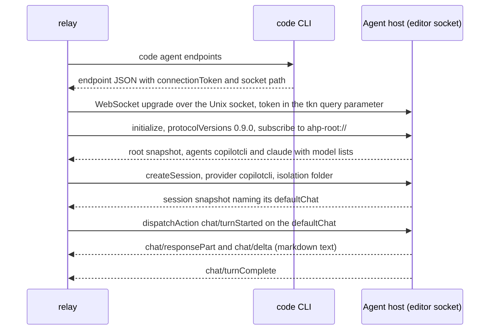
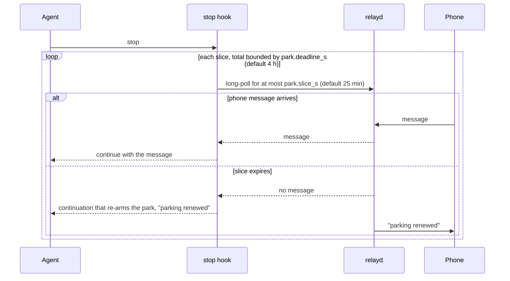
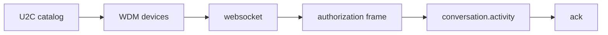

# Spikes

Questions tested against the real apps before building, with results and the path chosen.

- Run on 2026-10-03 against:

  | Component | Version |
  |---|---|
  | VS Code | 1.140.0 |
  | Cursor | 3.23.12 |
  | Cursor CLI | 2026.07.17-3e2a980 |
  | OpenCode | 1.18.15 |
  | Python | 3.13.5 |

- Live results gathered after gate G1 (C15 and later rounds) are added to the spike they answer, dated.
- Tokens are redacted in every command below.
- Fixtures live under `tests/fixtures/`.
- Deviations from the plan are recorded in [deviations.md](deviations.md).

## Summary

| Spike | Question | Result | Fallback / deviation |
|---|---|---|---|
| S1 | Can the relay drive Copilot over AHP on the editor socket? | **Yes**, with three corrections to the plan | Primary `ahp` path on the editor socket; correction 3 is D138 |
| S2 | Can a stop hook block for a long time? | **Copilot: yes for a 25-minute slice** (measured after G1); Cursor and Local not timed | Sliced parking, always (the S2 fallback) |
| S3 | Does `agent_idle` wake an idle main Copilot agent? | **No**, per vendor docs | AHP `chat/turnStarted` on the same chat |
| S4 | Does a Local `Stop` reason continue the chat, and is it capped? | **The reason continues it** (C15 smoke); the cap was not measured | Park via `Stop` and also continue through `relay-bridge` (both built) |
| S5 | Does `code chat -r` target the right window? | Not measured live | Fallback as specified, plus "open the workspace first" |
| S6 | Can the relay drive Cursor over remote debugging (CDP)? | **Yes** (C15, D35); the self-test gates each Cursor version | CDP adapter ships disabled; `relay selftest cursor-cdp` gates it |
| S7 | Does anything stop working with the screen locked? | **No**: all four phone-driven apps work with the screen locked | No lock-screen warning is needed |
| S8 | Does `webex_bot` work on Python 3.13? | **Imports, but unusable in an asyncio daemon** | Vendored async port of its websocket client |
| S9 | Which OpenCode permission and question endpoints exist? | **Both variants exist** | Implement both; choose at runtime from `/doc` |
| S11 | Can the relay read desk chats from each app's store, and do the hooks' session ids match? | **Yes** (2026-11-25, read-only): ids match for VS Code, Copilot CLI and Cursor; a desk chat's own hooks find its session | D146; driving each app is unproven live |
| S10 | Is the Cursor CLI logged in? | **No** at C1: `cursor-agent status` printed `Not logged in`; after `cursor-agent login`, AC-22 passed live (C15) | `doctor` prints `cursor-agent login`; the adapter reports "auth needed" |

## S1 — AHP on the editor socket

- **Question:** can the relay create and drive Copilot sessions through the Agent Host Protocol (AHP)?
- **Method:** `code agent endpoints`, then a WebSocket over the Unix socket in `endpoint.path`.
- **Result:** yes, with three corrections to the plan.

- **Evidence:**
  - Endpoint JSON: `{schemaVersion: 2, type: "editor", protocolVersion: "0.9.0", connectionToken, endpoint: {type: "socket", path}}`.
  - Transport: the agent host is a WebSocket server.
    - Token goes in the `tkn` query parameter of the upgrade URL (from `agentHostMain.js`:
      `searchParams.getAll("tkn")`).
    - One JSON-RPC message per text frame.
  - `initialize {protocolVersions: ["0.9.0"], clientId, initialSubscriptions: ["ahp-root://"]}` returns the
    root snapshot with agents `copilotcli` (Copilot) and `claude`, each with a model list.
  - `createSession {channel: "ahp-session:/<uuid>", provider: "copilotcli", workingDirectories: [file URI]}` works.
  - **Correction 1:** chat URIs are `ahp-chat://<chat-id>/<base64url(session URI)>`, not `ahp-chat:/<uuid>`.
    - The session's default chat is `ahp-chat://default/<base64url(session URI)>`.
    - `ahp-chat:/<uuid>` fails with `Malformed AHP chat URI`.
  - **Correction 2:** `createChat.initialMessage` is accepted but no turn runs (the chat snapshot keeps
    `turns: []`). A turn starts when the client dispatches `chat/turnStarted {turnId, startedAt, message}`
    with `dispatchAction`.
  - **Correction 3 (found 2026-11-22, D138):** the spike read the snapshot of a chat the relay had created
    itself and concluded a second chat was fine. It is not.
    - VS Code lists a session only once its *default* chat has a turn; a session whose turns all run in a
      second chat never appears in VS Code.
    - Turns go to the chat the session's snapshot names as `defaultChat` (VS Code 1.147: `ahp-chat:/<uuid>`).
    - The `ahp-chat://default/<base64url>` form of correction 1 is not a chat of such a session and fails
      with `Resource not found`.
    - `createChat` is not called.
  - Text arrives as `chat/responsePart {part: {kind: "markdown", content}}` as well as `chat/delta`; the
    adapter maps both.
  - The `copilotcli` session config defaults to `isolation: "worktree"`, which created a branch in the
    scratch repo.
  - Live run (2 of 3 attempts used for this): `Reply with exactly: OK` returned `OK`, then `chat/turnComplete`.
    - Trace: `tests/fixtures/ahp/ok_turn.trace.json` (scrubbed).
    - The scrubber also hid numeric token counts (`maxOutputTokens`, `inputTokens` and so on, keys that
      contain "Token"). C7 set those back to `0` so the fixture matches the schema's number type; no
      credential was involved.
- **Consequence:**
  - Primary `ahp` path on the editor socket.
  - Turns start with `chat/turnStarted` on the session's `defaultChat`; no `createChat`.
  - The adapter passes `config: {isolation: "folder"}` unless the user asks for isolation.

## S2 — Long-blocking stop hooks

- **Question:** can a stop hook block for a long time (30 minutes) while the user is away?
- **Method:** not measured. A 30-minute block needs hooks installed under the real home directory (G1) and
  a live IDE turn. The documented limits are enough to choose a design.
- **Evidence (documented limits):**

  | Harness | Hook timeout | Notes |
  |---|---|---|
  | Copilot | configurable (`timeoutSec`) | **fails open** |
  | Local | `timeout` in seconds, default 30 | |
  | Cursor | per-script `timeout` | `stop` supports `followup_message`, `loop_limit: null` |

- **Result:** sliced parking everywhere.
- **Live, after G1 (measured 2026-11-22):** the Copilot runtime writes a `hook.start` and a `hook.end` for every
  hook into `~/.copilot/session-state/<id>/events.jsonl`, so the block length of each `agentStop` can be read
  back. Over the 1,518 recorded `agentStop` runs:

  | Measure | Value |
  |---|---|
  | Longest single block | 1,501.5 s (one full 25-minute slice; the installed `timeoutSec` is 1,620 s) |
  | Slices that ran to the end and renewed | 4, each `success: true` with `decision: block` and "Parking renewed" |
  | Longest park of one session | about 96 minutes: three renewed slices, then a 21-minute block that ended in a release |
  | Hook runs that failed | 0 |

  - Cursor `stop` and Local `Stop` parks ran live (C15 smoke, scenario 8) but relayd logs no park start, so
    their block lengths were not timed.
  - A 30-minute single block was never tried: the slice is 25 minutes by design.

- **Consequence:**
  - The stop hook long-polls `relayd` for at most `park.slice_s` (default 25 min), always below the hook's
    configured timeout.
  - A slice that expires with no phone message returns a continuation that re-arms the park
    (`reason`/`followup_message` "parking renewed"); the phone gets "parking renewed".
  - Total parking is bounded by `park.deadline_s` (default 4 h).
  - Correct whether or not the harness tolerates longer blocks, so no live measurement can change the design.
  - C15 smoke records the observed behaviour in [testing.md](testing.md).

## S3 — Waking an idle Copilot session

- **Question:** can the `notification` hook's `agent_idle` be used to wake the main agent?
- **Method:** GitHub Copilot hooks reference, `notification` hook.
- **Result:** no.
- **Evidence:**
  - `agent_idle` fires when "a **background** agent finishes a turn and enters idle state". It does not
    fire for the main agent.
  - `notification` is Copilot-CLI-only.
- **Consequence:**
  - Wake the main agent with AHP `chat/turnStarted` on the session's chat.
  - The hook still handles `notification`/`agent_idle` for background agents.

## S4 — Local `Stop` reason

- **Question:** does a Local `Stop` block with a reason continue the agent, and does
  `chat.agent.maxRequests` cap parked continuations?
- **Method:** VS Code Local hooks reference.
- **Result:** the reason continues the agent (documented, then seen live at C15); the cap was not measured live.
- **Evidence:**
  - `Stop` output `hookSpecificOutput {decision: "block", reason}` "explains why the agent should continue".
  - `stop_hook_active` guards loops.
  - Live, C15 smoke (2026-10-04 06:55 UTC): a VS Code Local session parked, the phone's reply went back as the
    `Stop` reason, and the agent answered it ([testing.md](testing.md), October round smoke).
  - Whether `chat.agent.maxRequests` (default 25) caps parked continuations was not measured: no live park
    has needed 20 continuations.
- **Consequence:** park Local via `Stop` **and** build the fallback.
  - When `stop_hook_active` is set and the session has continued `park.local_max_continuations` times
    (default 20, below the 25 cap), the relay continues the chat through `relay-bridge`
    `workbench.action.chat.open` with `preserveInput`.
  - [operations.md](operations.md) recommends `chat.agent.maxRequests: 100` for away mode.

## S5 — `code chat -r` window targeting

- **Question:** does `code chat -r` send the prompt to the window holding the workspace?
- **Method:** not measured live (each attempt opens a chat in a real window).
- **Result:** unknown; the fallback is built.
- **Consequence:**
  - Run `code <workspace>` first, wait up to 20 s for `relay-bridge` to register a window containing the
    workspace, then send through the extension.
  - Without the extension, run `code chat -m agent -r "<prompt>"` from the workspace directory.
  - Tell the phone "open the workspace first" if no window holds it.

## S6 — Cursor remote debugging

- **Question:** can Cursor be driven over its Chromium remote-debugging port?
- **Method:** `npx @electron/fuses read --app /Applications/Cursor.app`.
- **Result:** yes. At C1 the fuses allowed it and a live connect was left for C15 (relaunching Cursor with
  the flag would have ended the running Cursor session); at C15 it connected and drove the composer.
- **Evidence:**
  - `RunAsNode Enabled`, `EnableNodeCliInspectArguments Enabled`.
  - No fuse exists for `--remote-debugging-port`, so the Chromium switch is not blocked.
  - Live, C15 (2026-10-05, D35): Cursor 3.23.12 started with the debug port; the self-test (AC-24) passed
    after three stale selectors were fixed (selectors v2), and a phone prompt and a follow-up got correct
    replies (v3 fixed the model menu).
  - Live, November round (2026-11-21, D133, D134): Cursor 3.31.15 needed selectors v4; the self-test passes
    and E2E scenarios 2 to 7 and 10 pass.
- **Consequence:**
  - The CDP adapter ships disabled.
  - `relay selftest cursor-cdp` checks every selector before it can be enabled.
  - `doctor` explains the state.

## S7 — Does anything stop working with the screen locked?

- **Question:** do the phone-driven apps keep working with the screen locked?
- **Method:** run at C15 on 2026-10-05, after gate G2.
  - Screen locked from before the first session until after the last; the script checks the lock state
    through `ioreg` before each app and at its end.
  - Apps: VS Code Copilot (Agent Host and hooks), VS Code Local (relay-bridge extension and hooks),
    OpenCode, the Cursor CLI.
  - Each session started from Webex and driven through the live smoke test steps: stream, approval card,
    park or idle, reply, and `/back` for the parking apps.
- **Result:** all passed with the screen locked. The relay-bridge extension, the Agent Host socket, the
  OpenCode server and the Cursor CLI all kept running.
- **Evidence:**
  - First attempt did not start VS Code Copilot: the Mac briefly could not resolve DNS as the screen locked.
    - That hit the test script's own Webex send.
    - relayd's websocket dropped for two seconds and reconnected by itself.
  - A repeat run with the screen locked from the start passed.
  - A log line printed the wrong delay for that reconnect; it now prints the delay it uses.
- **Consequence:** nothing to build. `doctor` does not warn about a locked screen.

## S8 — `webex_bot` on Python 3.13

- **Question:** can `relayd` use the `webex_bot` package on Python 3.13?
- **Method:** `uv pip install webex_bot` in a 3.13 venv; import `WebexBot` and `WebexWebsocketClient`.
- **Result:** version 1.3.1 imports cleanly (with `websockets` 16.1, `webexpythonsdk` 2.0.6), but its client
  is unusable in an asyncio daemon.
- **Evidence:** the client
  - blocks its own loop with `asyncio.get_event_loop().run_until_complete(...)`, so it cannot run inside
    `relayd`'s event loop;
  - acks each message with `asyncio.run(self.websocket.send(...))` from an executor thread, against a
    connection owned by another loop;
  - uses blocking `requests` for every REST call.
- **Consequence:** vendor its websocket client as `agent_relay/frontends/webex/ws_client.py`, ported to
  asyncio and `httpx`, keeping its MIT notice. The protocol steps are unchanged:

## S9 — OpenCode permission and question endpoints

- **Question:** which endpoints does OpenCode expose for permissions, questions and events?
- **Method:** `opencode serve --port 4097` in `.scratch/`, then `GET /doc`.
- **Result:** both permission variants exist.
- **Evidence** (`tests/fixtures/opencode/doc.json`):

  | Kind | Endpoint or shape |
  |---|---|
  | Permissions, current | `POST /permission/{requestID}/reply {reply: once\|always\|reject, message?}` |
  | Permissions, legacy | `POST /session/{sessionID}/permissions/{permissionID} {response: once\|always\|reject}` |
  | Questions | `POST /question/{requestID}/reply {answers: string[][]}`, `POST /question/{requestID}/reject` |
  | Event | `permission.asked {id, sessionID, permission, patterns, tool?}` |
  | Event | `question.asked {id, sessionID, questions[{question, header, options[{label}]}]}` |
  | SSE envelope on `/global/event` | `{directory, project, payload: {id, type, properties}}` |

  - Live run (1 of 3): a session with `github-copilot/gpt-5-mini` streamed `message.part.delta "OK"`, then
    `session.idle`. Fixture: `tests/fixtures/opencode/ok_session.sse`.
  - Live attempt 2 of 3 (C6, AC-20, `tests/live/test_opencode_live.py`): the adapter started a session in
    `.scratch/` on a throwaway `opencode serve`, streamed `OK` and aborted. One attempt remains for C15.
- **Consequence:** the adapter reads `/doc` at connect time and uses the current endpoints when present,
  the legacy ones otherwise.

## S10 — Cursor CLI auth

- **Question:** is the Cursor CLI logged in, and what happens if not?
- **Method:** `cursor-agent status`.
- **Result:** `Not logged in`.
- **Consequence:**
  - `relay doctor` reports "Cursor CLI not logged in: run `cursor-agent login`".
  - The adapter checks status before `authenticate` and reports `auth needed` to the phone instead of
    starting the process.
  - Live test AC-22 needs the login first; it is a C15 step.
- **Follow-up at C9:**
  - `cursor-agent models` also needs the login, so its output format was not observed.
  - `catalog.parse_models` accepts `id`, `id - Label`, `id: Label` and bulleted lines, and treats
    `(current)` or `(default)` as the default model.
  - The ACP flow (`initialize`, `authenticate` with `cursor_login`, `session/new` or `session/load`,
    `session/prompt`, the `cursor/*` extension requests) follows the published ACP spec and Cursor's ACP
    docs; `tests/fakes/acp_agent.py` speaks exactly that subset.
  - C15 runs AC-22 against the real CLI after `cursor-agent login`.
- **Live, C15 (2026-10-04):** after `cursor-agent login`, AC-22 passed against the real CLI and the live smoke
  test passed (register, stream, approve, idle, reply). The November round's E2E scenarios 2 to 7 and 10 pass
  on it too ([testing.md](testing.md)).

## S11 — Desk chat stores and ids (D146)

- **Question:** can the relay list and identify a desk chat from the app's own files, and does the id the app's hooks send equal the id in the store?
- **Method:** a read-only run of the catalog against the real stores on 2026-11-25 (no app opened, nothing written).
- **Result:**
  - 40 chats in 0.6 s, 9 of them outside the registered workspaces; titles and snippets were sensible.
  - Hook ids equal store ids: VS Code `session_id` = `chatSessions/<id>.jsonl`; Copilot CLI `sessionId` = `session-state/<id>`; Cursor `conversation_id` = `agent-transcripts/<id>`. That lets an armed chat's next Stop find its session.
  - Cursor's own chat titles live in `state.vscdb` (over 10 GB), so the first prompt is the title.
  - A Copilot `workspace.yaml` `name: |-` is a YAML block marker, not a name.
  - A VS Code `chatSessions` file is a snapshot line plus patches and can pass 34 MB; only the tail is replayed.
- **Not run:** whether `cursor-agent` ACP `session/load` loads a Cursor desktop chat, whether `copilot -p --resume` works, whether `relay-bridge` can open an existing VS Code chat, and whether the Agent Host attaches a chat only the Copilot CLI wrote. Each is a handoff (a new session) until measured; live sessions are limited to `.scratch` and three per adapter.
